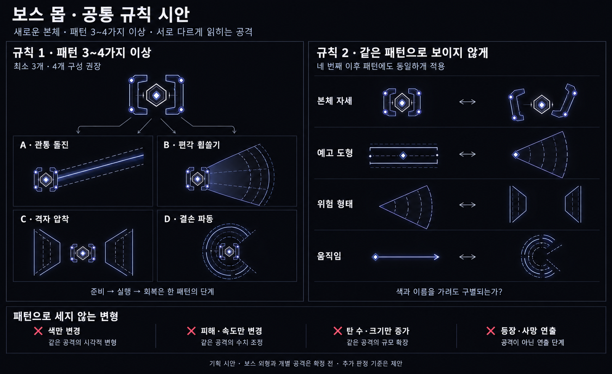
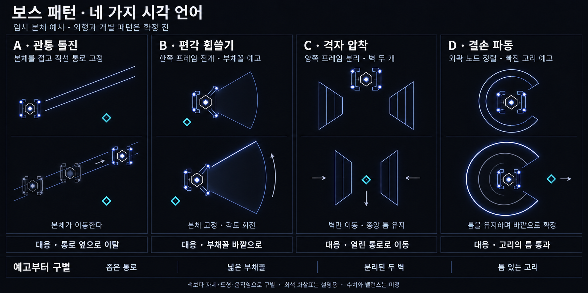

# 보스 몹 공통 규칙 — 기획 v1

작성일: 2026-10-19 · 상태: 규칙 기획 · 게임 구현 없음

현재 탐색 방향: [조율자 / 계측자 — 세 패턴 연계 기획](Boss_Tuner_Design.md). 1은 특정 몹의 영구·비중첩 강화, 2는 점화 몹의 일시 조종, 3은 성도 주사와 명중 시 피해·둔화·일시적인 점화 몹 피해 증가로 구상한다. 좌표 도약은 보류한다. 아래 초기 네 공격과 프레임 본체, 이전 연결선 점화안도 보류하며 현재 확정 구성으로 사용하지 않는다.

보스는 기존 일반 몹이나 엘리트의 본체를 확대·강화하는 방식이 아니라 **새로운 몹으로 설계**한다. 현재 단계에서는 공통 규칙과 시각적 판정 방법을 정리한다. 아래 임시 본체와 네 공격은 규칙을 설명하기 위한 예시이며, 특정 보스의 확정 디자인이 아니다.

## 사용자 지정 규칙 2개

1. **보스 몹은 패턴이 3~4가지 이상이다.**
2. **패턴들은 유저가 서로 같은 패턴이라고 생각하지 않도록 시각적으로 구별한다.**

두 번째 규칙은 최소 구성의 세 패턴 모두에 적용하며, 네 번째 이후 패턴에도 똑같이 적용한다. 세 개만 다르고 나머지는 비슷한 공격으로 채우지 않는다.

‘3~4가지 이상’의 수량 판정은 **최소 3개를 하한으로 보고, 기본 설계는 4개를 권장**하는 해석을 제안한다. 이는 사용자의 원문을 대체하는 추가 확정 규칙이 아니다. 모든 보스에 최소 4개를 강제할지는 후속 결정 사항으로 남긴다.

## 현재 게임과 연결할 시각 언어

새로운 몹이면서 같은 게임의 존재로 읽히도록 조형 언어를 공유한다.

- 검은 배경에 얇은 기하학 선, 코어·노드·프레임의 층을 사용한다.
- 청색·보랏빛 선과 흰색 강조로 구조와 힘의 흐름을 표현한다. 공격 구별을 색에만 맡기지 않는다.
- 다각형의 구조적 모서리는 유지하되 가시와 칼날 장식을 늘리는 방식은 피한다.
- 복잡한 장식이나 과도한 발광보다, 프레임의 접힘·전개·분리와 층별 움직임으로 존재감을 만든다.
- 본체가 변형되어도 코어와 주요 프레임의 관계가 남아 같은 개체임을 알아볼 수 있게 한다.

테마의 근거는 [일반 적 조형 문서 v3](Astral_Enemy_Blueprints_v3.md)의 기하학·선·노드 언어다. 도표 구성은 [퀘이사 엘리트 문서](Quasar_Elite_Design.md)와 그 비교 이미지를 참고했다. **기존 보스 기획 문서는 열람하거나 디자인 근거로 사용하지 않았다.** 기존 엘리트의 패턴 수나 다른 전투 규칙을 보스의 확정 규칙으로 가져오지도 않았다.

## 패턴을 세는 방법 — 제안

아래 내용은 두 규칙을 일관되게 판정하기 위한 제안이며, 추가 확정 규칙은 아니다.

**하나의 패턴은 예고를 읽고 대응하는 하나의 공격 단위로 센다.** 준비 → 실행 → 회복은 한 패턴의 단계다. 돌진 전에 힘을 모으는 동작과 돌진 뒤의 감속을 별도 패턴으로 세지 않는다.

다음 변화만 있는 경우에는 별도 패턴으로 세지 않는 것을 제안한다.

| 변화 | 판정 이유 |
|---|---|
| 색·피해량·속도만 변경 | 공격을 읽는 방식이 같다 |
| 탄 수·굵기·크기만 증가 | 같은 공격의 규모가 달라진다 |
| 같은 공격을 여러 번 연속 실행 | 횟수가 늘어도 새로운 공격이 되지는 않는다 |
| 체력 감소 뒤 같은 공격 강화 | 강화 상태가 곧 독립 패턴은 아니다 |
| 등장·사망 연출, 상시 외형 효과 | 대응하는 독립 전투 공격이 아니다 |

새 페이즈의 공격도 같은 기준으로 검토한다. 별도 이름이나 상태가 있다는 이유만으로 패턴 수를 채우지 않는다.

## 서로 다른 패턴인지 판정하는 방법 — 제안

**피격한 뒤가 아니라 예고 단계부터 무엇이 올지 구별할 수 있어야 한다.**

| 비교 축 | 검토할 질문 |
|---|---|
| 본체 자세 | 접힘·한쪽 전개·양쪽 분리·노드 정렬이 서로 다른가? |
| 예고 도형 | 좁은 통로·부채꼴·분리된 벽·결손 고리가 다르게 읽히는가? |
| 위험 형태 | 실제 피해를 주는 것이 본체인지, 회전하는 선인지, 벽인지, 파면인지 알 수 있는가? |
| 움직임 | 직진·각도 회전·서로 접근·바깥 확장이 구별되는가? |
| 대응 | 위험을 보고 어디로 이동해야 하는지 설명할 수 있는가? |

모든 축을 반드시 다르게 만들자는 뜻은 아니다. 같은 도형을 일부 쓰더라도 본체 자세와 움직임을 합쳐 충분히 구별할 수 있다. 반대로 이름과 색만 달라지는 경우는 부족하다. 회피 행동의 차이는 구별을 강화하는 권장 요소이며, 세 번째 확정 규칙으로 추가하지 않는다.

패턴 3개는 A–B, A–C, B–C의 **3쌍**, 패턴 4개는 여기에 A–D, B–D, C–D를 더한 **6쌍 모두**를 비교한다.

## 네 가지 시각 언어 — 설명용 예시

임시 본체는 **육각 코어 + 서로 마주 보는 분리 프레임 + 네 모서리 노드**다. 기존 몹의 궤도·원반 형태를 복제하지 않고 현재 게임의 선과 노드 표현을 사용했다. 보스 이름, 세계관, 최종 외형은 정하지 않는다.

| 예시 | 준비 자세 / 예고 | 실행과 실제 위험 | 대응의 차이 |
|---|---|---|---|
| A · 관통 돌진 | 프레임을 접고 두 평행선으로 이동 통로 예고 | 본체가 고정한 통로를 직진한다. 위험은 이동 중인 본체의 범위다 | 통로의 옆으로 이탈 |
| B · 편각 휩쓸기 | 한쪽 프레임을 펼치고 부채꼴 예고 | 본체는 멈추고 한쪽 방사선이 부채꼴 안에서 회전한다. 위험은 현재 휩쓰는 선이다 | 부채꼴 바깥으로 이동 |
| C · 격자 압착 | 양쪽 프레임을 분리해 두 벽을 예고 | 분리된 벽이 안쪽으로 접근한다. 위험은 벽이며, 중앙의 열린 통로를 남긴다 | 통로에 진입해 열린 방향으로 이동 |
| D · 결손 파동 | 외곽 노드를 정렬해 틈 있는 고리 예고 | 틈의 방향을 유지한 고리의 파면이 바깥으로 확장한다. 위험은 현재 파면이다 | 고리의 틈을 따라 통과 |

A는 빔이 아니다. 비교 시트의 회색 잔상은 본체의 과거 위치이고, 두 가는 선은 이동 통로의 예고다. 통로 전체에 지속 피해를 주는 설정이 아니다. 규칙 보드의 작은 A 아이콘은 개념 요약이며, 이동 방식은 위 비교 시트를 기준으로 읽는다.

B의 부채꼴 내부 전체, C의 두 벽 사이, D의 고리 내부 전체를 동시에 피해 영역으로 취급하지 않는다. 각 예고는 앞으로 위험이 움직일 범위를 알리고, 실제 피해를 주는 부분은 표의 ‘실행과 실제 위험’에 한정한다. 실제 제작 시 예고선과 활성 피해선의 굵기·밝기 차이는 별도 검증해야 한다.

C의 통로 폭과 D의 틈은 플레이어 크기·이동 속도·맵 경계를 고려해 실제로 통과 가능해야 한다. 그림은 축척이나 충돌 판정을 확정하는 자료가 아니다. 예고 시간, 피해량, 크기, 이동 속도, 공격 순서와 동시 사용 여부는 모두 미정이다.

## 후속 검토 — 아직 수행하지 않은 항목

1. 예고 이미지만 보여주고 이름을 가렸을 때 서로 다른 공격으로 인지하는지 확인한다.
2. 색을 제거하고 작은 실제 플레이 크기로 보아도 자세·도형·움직임이 남는지 확인한다.
3. 모든 패턴 쌍을 비교해 같은 공격의 변형으로 읽히는 쌍이 있는지 확인한다.
4. 실제 화면에서 다른 적과 플레이어 탄이 함께 있을 때도 예고와 안전 공간이 보이는지 확인한다.
5. 근접·원거리 위치와 맵 가장자리에서도 시각 정보에 따라 피할 공간이 있는지 검토한다.

생성 이미지의 구성과 문구는 확인했으나, 위 인지·축척·플레이 검증을 통과했다고 간주하지 않는다.

## 산출물과 생성 기록

- [규칙 보드](Concepts/Boss_Rules_Board_v1.png)
- [네 패턴 시각 언어 비교](Concepts/Boss_Pattern_VisualLanguages_v1.png)
- [전체 이미지 생성 프롬프트](Concepts/Boss_Rules_ImagePrompts_v1.md)

두 이미지는 내장 `image_gen`으로 생성한 기획 레퍼런스다. 게임 코드·밸런스·스폰·기존 보스 문서는 수정하지 않았다.

