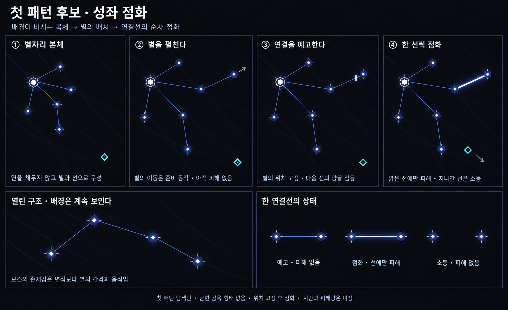

# 첫 보스 패턴 탐색 — 성좌 점화

작성일: 2026-10-19 · 상태: 첫 후보 · 게임 구현 없음

**이전 탐색 기록 — 현재 안에서 제외.** 사용자 피드백으로 패턴 1은 연결선 공격에서 특정 몹의 영구·비중첩 강화로 변경되었다. 패턴 2는 그 점화 몹을 조종하는 구조다. 최신 기획은 [조율자 / 계측자](Boss_Tuner_Design.md)를 따른다. 아래 이미지와 본문은 이전 아이디어의 기록이다.

사용자 제안에 따라 ‘어느 패턴부터 넣을까?’를 **배경화면이 보이는 구조 + 별자리 테마**에서 출발해 검토한다. 앞선 네 공격 예시는 보류하고, 첫 패턴 하나로 보스의 조형과 행동이 함께 성립하는지 탐색한다. 공통 규칙 두 개는 [보스 공통 규칙](Boss_Enemy_Rules.md)을 유지한다.

## 출발점

배경이 비치는 보스는 넓은 몸통을 칠해 존재감을 만들기 어렵다. 대신 **별의 배치가 몸체이고, 별을 잇는 선이 구조**가 되도록 한다. 움직이는 별의 간격과 연결 관계가 보스의 크기와 자세를 보여준다.

그 구조를 공격으로 확장하면, 보스가 별을 펼쳐 자신의 별자리 형태를 전장에 크게 그리고 연결선을 차례로 점화하는 패턴이 된다.

**첫 후보: 성좌 점화 — 본체의 별을 펼친 뒤, 고정된 별 사이의 선을 한 구간씩 활성화한다.**

## 한 번의 공격

| 단계 | 보이는 모습 | 제안하는 전투 의미 |
|---|---|---|
| 기본 형태 | 작은 코어 주위에 별과 가는 연결선이 열린 가지 형태로 모여 있다 | 면을 채우지 않아 별 사이로 배경이 보인다 |
| 전개 | 코어는 자리를 유지하고 본체의 별들이 바깥으로 펼쳐진다 | 별의 이동과 이때의 연결선은 준비 연출이며 피해가 없다 |
| 예고 | 별의 위치를 고정한다. 가는 선으로 연결 관계를 보여주고, 다음 활성 구간의 양 끝을 강조한다 | 플레이어는 어느 선이 켜질지 먼저 읽는다 |
| 점화 | 예고한 두 별 사이의 연결선 하나가 굵고 밝아진다 | 현재 점화된 선의 좁은 범위에만 피해가 있다 |
| 순차 진행·복귀 | 이전 선을 끄고 다음 구간을 예고·점화한 뒤, 모든 공격선을 끄고 별들이 돌아온다 | 공격선이 누적되지 않으며 복귀 중에도 피해가 없다 |

한 번에 활성화되는 선은 하나로 시작하는 것을 제안한다. 각 구간은 자기 예고를 거치고, 별의 위치는 전개 완료 후부터 전체 점화가 끝날 때까지 고정한다. 활성 중에 선이 플레이어를 따라가거나 회전하지 않는다. 여러 구간의 점화는 **한 패턴 내부의 순서**이며, 여러 패턴으로 세지 않는다.

## 이 패턴을 먼저 검토하는 이유

별이 몸체의 장식으로만 남지 않고 공격을 만드는 주체가 된다. 보스의 몸이 넓어졌다 좁아지는 모습만으로 준비와 회복을 표현할 수 있고, 배경을 가리지 않으면서도 공격이 진행 중임을 보여줄 수 있다.

플레이어가 읽는 정보도 ‘다음에 어느 두 별이 연결되는가?’로 모인다. 위험은 선에만 있고, 선 사이의 빈 면은 계속 이동 가능한 공간이다. 청백색 발광은 보조 신호이며, 선의 굵기와 양 끝의 점등으로도 상태를 구분하도록 한다.

## 실제 제작 전에 풀어야 할 문제

- **멀리 서면 무시할 수 있는가?** 전개 범위를 작게 잡으면 보스 주변에서만 일어나는 연출이 된다. 플레이어가 있는 전장까지 읽을 거리를 확보하되, 회피 공간을 없애지 않는 배치를 검토해야 한다.
- **별이 펼쳐질 공간이 있는가?** 맵 가장자리에서 전개가 잘리거나 안전한 길이 없어지지 않게 검토한다. 노드 배치와 통과 가능한 길을 먼저 확인하고 공격을 시작해야 한다.
- **기본 연결선과 피해선을 구별할 수 있는가?** 평소 가는 선, 활성화 직전 끝점 강조, 점화된 굵은 선을 실제 배경 위에서 확인해야 한다. 밝은 배경에서도 읽히는 대비 처리는 후속 검토 사항이다.
- **본체의 피격 위치를 알 수 있는가?** 펼쳐진 모든 선과 빈 면이 보스의 피격 영역처럼 읽힐 수 있다. 첫 후보에서는 공격 가능한 중심 코어를 계속 유지하는 안을 제안하며, 최종 피격 판정은 미정이다.
- **배치가 감옥처럼 보이는가?** 첫 안은 닫힌 다각형을 만들지 않는 열린 연결 구조로 탐색한다. 면 전체를 위험하게 만들거나 모든 연결선을 동시에 활성화하지 않는다.

이미지는 구조와 순서를 설명하는 콘셉트다. 패널 사이 노드 개수·좌표를 정밀하게 재현한 도면이 아니므로, 위치 고정 규칙과 실제 피해 범위는 위 본문을 기준으로 한다. 배경의 희미한 곡선은 배경이 계속 비친다는 설명용 요소이며, 게임 배경을 교체하자는 제안이 아니다.

## 이번에 결정하지 않은 것

보스의 최종 외형·이름, 별 개수, 실제 별자리 모티프, 점화 순서, 예고 시간, 피해량과 전개 범위는 미정이다. 두 번째 이후 패턴을 채우기 전에 이 첫 패턴에서 **별자리로 된 몸체가 읽히는지, 배경과 위험선이 함께 보이는지**를 검토한다.

기존 보스 문서는 참고하지 않았다. 그림은 내장 `image_gen`으로 생성했으며, [전체 생성 프롬프트](Concepts/Boss_Constellation_Ignition_ImagePrompt_v1.md)를 함께 보관한다.

