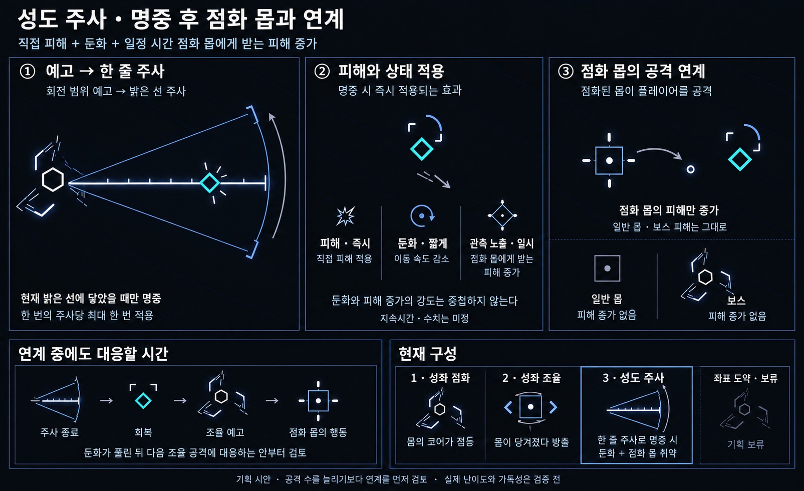
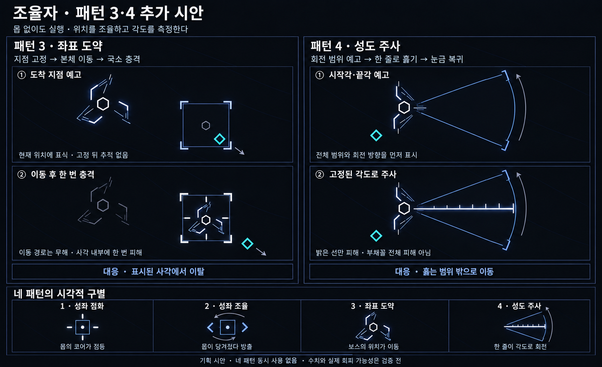

# 조율자 / 계측자 — 점화와 조율 기획

작성일: 2026-10-19 · 상태: 기획 · 게임 구현 없음

우선 가칭은 **조율자**, 대안은 **계측자**다. 점화한 몹의 배치와 행동을 직접 바꾼다는 현재 구상에는 조율자가 더 잘 맞는다는 제안이며, 이름은 확정하지 않는다.

외형의 최신 탐색: [둥근 몸체와 내장 발사포 v4](Boss_Tuner_Round_Cannon_v4.md). 사용자 의도는 긴 대칭축이 아니라 전체가 동그랗게 보이는 인상이다. 원형 외곽 레일 안에 곡선 동조 팔과 짧고 넓은 단일 발사포를 배치한다. 직접 공격·성도 주사는 이 포구를 공유한다. 세 외피와 성각 방출은 보류하고, 추가 직접 공격은 중앙포를 사용하는 방향이다. 점화 통합 여부와 아래 패턴 구성은 확정 전 기준안이다.

현재 구성은 성좌 점화·성좌 조율·성도 주사 세 패턴을 검토한다. 좌표 도약은 보류한다. 이전 이미지의 번호·상태 표기는 당시 기록이며, 현재 본문의 구성을 따른다.

## 사용자 지정 방향

- 보스는 새로운 몹으로 만든다. 배경화면이 비치는 구조와 별자리 테마를 유지한다.
- 큰 실루엣에 동그란 인상과 대칭감을 주고 기존 몹을 조율하는 계측 구조로 만든다. 곡선 팔과 포는 원형 몸체 안에 배치한다. 새 몹을 생산·소환하는 구조는 아니다.
- 중앙 발사포를 두고 보스의 추가 직접 공격과 성도 주사가 같은 포구를 사용한다. 추가 직접 공격의 방식·패턴 수는 아직 미정이다.
- 패턴 1은 특정 몹을 점화해 영구 강화한다. 점화 강화는 영구적으로 중첩되지 않는다.
- 패턴 2는 **패턴 1로 점화한 몹들을 조율해 조종**한다. 그라비스 투석의 움직임을 참고한다.
- 몹별 추가 행동이나 성향 반전 기믹을 검토한다. 모든 몹에 둘 다 넣기로 확정한 것은 아니다.
- 점화된 레굴루스가 보스에게 강력한 보호막을 제공하는 방향을 추가한다. 보호막 수치·중첩·해제 규칙은 미정이다. 기존 방호 정렬은 추가 패턴으로 채택하지 않는다.
- 성도 주사 명중 시 피해·둔화와 일정 시간 점화 몹에게 받는 피해 증가를 적용하는 방향을 추가한다.
- 성도 주사를 현재 직접 공격 기준안으로 유지하고, 중앙포를 사용하는 추가 직접 공격을 검토한다. 좌표 도약은 보류하며, 이를 영구 폐기한다는 뜻은 아니다.
- 공통 규칙은 [보스 규칙](Boss_Enemy_Rules.md)을 따른다. 현재는 세 패턴의 연계와 회피 여유를 검토하며, 실제 가독성·난이도는 검증 전이다.

이전의 ‘보스 연결선 자체를 점화하는 공격’과 ‘보스의 별들이 직접 횡단하는 공격’은 현재 구성에서 제외한다.

## 패턴 1 · 성좌 점화 — 몹의 상태를 바꾼다

점화 가능한 종류의 살아 있는 일반 몹을 골라 **일반 → 점화**로 전환한다. 강화는 한 번 적용하면 해당 몹이 살아 있는 동안 유지하는 안이다. 이미 점화한 몹을 다시 골라 수치를 더 올리지 않는다.

| 항목 | 설계안 |
|---|---|
| 대상 | 지정된 종류의 일반 몹. 첫 검토 대상은 ROTOR·SWARM, 나머지는 후속 선정 |
| 지속 | 대상 몹이 처치될 때까지 |
| 강화 중첩 | 없음. 점화 여부만 있으며 누적 단계는 없다 |
| 강화 내용 | 각 몹의 특징 하나를 강조하는 방식. 구체 수치는 미정 |
| 시각 표시 | 원래 몹의 형태를 유지하고 코어 주변에 작은 별 표식 추가 |
| 반복 시전 | 아직 점화하지 않은 다른 몹을 선정 |
| 개체 수 | 살아 있는 점화 몹의 상한을 두는 안을 권장. 수는 미정 |

점화 표식의 네 방향 빛은 고정된 모양이며, 스택 수나 남은 조종 횟수를 뜻하지 않는다. 재점화로 HP를 회복하거나 강화를 갱신하는 기능도 현재 안에 넣지 않는다.

‘영구’는 **일시적인 조율이 끝나도 사라지지 않는 강화**라는 의미로 명확히 한다. 보스 사망 뒤에도 생존한 몹의 점화를 유지할지는 후속 결정 사항이며, 현재 검토에서는 유지하는 쪽을 기본 제안으로 둔다. 다음 게임까지 이어지는 영구 성장은 아니다.

## 패턴 2 · 성좌 조율 — 점화한 몹의 행동을 바꾼다

살아 있는 점화 몹 일부에 일시적인 지시를 내린다. **새 강화 스택을 주거나 점화를 소모하지 않는다.** 지시가 끝나면 점화 상태의 일반 행동으로 돌아간다.

그라비스 투석에서 참고할 것은 **당김 → 예고한 호를 따라 방출 → 관성을 잇는 움직임**이다. 그라비스의 위성 개수·시간·피해·무적격 성질을 그대로 가져오지 않는다. 이쪽 대상은 살아 있는 몹이므로 계속 처치할 수 있다.

| 단계 | 행동과 시각 표현 |
|---|---|
| 선정 | 점화한 몹 일부에 임시 양옆 꺾쇠를 표시한다. 보스의 눈금 프레임이 선택 방향으로 정렬된다 |
| 배치·당김 | 대상의 평소 이동과 공격을 잠시 중단하고 열린 호 형태로 배치한다. 투석형 대상은 예고 경로를 따라 조금 뒤로 당긴다 |
| 예고 | 각 몹이 수행할 이동 경로 또는 행동 영역을 보여준다. 순차 실행되는 각 몹에 충분한 개별 예고를 준다 |
| 실행 | 몹 종류에 맞는 행동을 시간차로 실행한다. 투석형은 고정된 곡선을 따라 움직이며, 출발 뒤 플레이어를 따라 꺾지 않는다 |
| 해제 | 꺾쇠와 경로 예고를 지우고 원래 AI로 부드럽게 복귀한다. 점화 표식과 영구 강화는 남는다 |

대상을 보스 주위로 순간이동시키거나 모두 같은 위치로 겹치지 않는다. 근처의 적절한 배치로 유도하고, 몹마다 이동 거리와 실행 시점을 다르게 잡는다. 보스와 몹 사이의 지속 연결선은 사용하지 않는 안이다. 경로 예고도 필요한 몹에만 순차로 표시해 배경을 읽을 수 있게 한다.

## 보류 후보 · 좌표 도약 — 이전 3번

아래는 보류한 동작의 기록이다. 현재 패턴 선택·순환에 넣지 않는다.

점화 몹과 관계없이 보스 혼자 사용하는 직접 공격이다. **플레이어가 있던 지점을 계측해 고정하고, 보스가 그 좌표로 도약한 뒤 사각 범위에 한 번 충격을 준다.** 플레이어나 다른 몹의 위치를 강제로 바꾸는 능력은 아니다.

| 단계 | 행동과 시각 표현 |
|---|---|
| 계측·고정 | 예고 시작 시 플레이어 위치를 읽고, 네 모서리 괄호와 가는 사각 테두리로 도착 범위를 표시한다. 이후 위치를 추적하지 않는다 |
| 준비 | 기존 위치의 눈금 프레임이 접힌다. 도착 사각 안의 작은 중핵 윤곽은 도착 예고이며, 두 번째 보스가 아니다 |
| 도약 | 본체가 예고한 위치로 이동한다. 두 지점 사이에 피해선이나 돌진 판정을 만들지 않는다 |
| 충격 | 도착한 프레임이 안쪽으로 맞물리며 예고한 사각 내부에 한 번만 피해를 준다. 사각 바깥으로 충격파를 확장하지 않는다 |
| 회복 | 사각 표식을 지우고, 새 위치에서 프레임을 다시 펼친다. 잔류 장판이나 귀환 공격은 없다 |

플레이어 대응은 **고정된 사각에서 이탈**하는 것이다. 보스는 이후 새 위치에 남아 다음 공격의 출발점이 된다. ‘주변 몹을 조율하는 지휘자’가 자기 좌표도 조율한다는 주제와 연결한다.

도약이 플레이어에게 직접 피해를 주는 순간이 되지 않도록, 사각 예고부터 충격까지 걸어서 빠져나올 시간을 확보하는 안이다. 도착 위치에서 본체 접촉 피해가 먼저 적용되지 않게 하고, 충격과 접촉의 중복 피해도 막아야 한다. 예고 중 기존 위치의 보스와 도착 후 실제 중핵은 공격 가능한 안으로 시작하며, 별도 장시간 무적은 제안하지 않는다.

맵 경계에서는 사각 전체를 수용할 수 있는 도착점으로 **표시 전에** 보정한다. 고정한 뒤에는 중심·크기·충격 시점을 플레이어를 쫓아 바꾸지 않는다. 사각을 안전하게 배치할 수 없거나 이탈 경로가 없는 경우에는 시전을 보류한다. 크기·예고 시간·도약 연출 길이·피해량은 미정이다.

## 패턴 3 · 성도 주사 — 이전 4번, 현재 직접 공격 후보

점화 몹 없이도 사용하는 직접 공격이다. **보스가 한 자리에 멈춰 중앙포의 집속·눈금 레일을 정렬하고, 포구에서 나온 단방향의 한 줄을 정해진 각도 범위에서 회전시킨다.** 명중하면 피해·둔화·관측 노출로 이어진다. 최신 외형에서는 양팔을 기준 자세에 두고 중앙포가 조준하는 안이다.

| 단계 | 행동과 시각 표현 |
|---|---|
| 범위 고정 | 준비 시작 시 플레이어 방향을 기준으로 시작각·끝각·길이·회전 방향을 정한다 |
| 예고 | 부채꼴의 양 끝 선과 바깥 호, 회전 방향 표시를 가는 선으로 보여준다. 안쪽 면은 채우지 않는다 |
| 정렬 | 중앙포의 집속·눈금 레일이 시작각을 따라 길게 정렬된다. 충전 중에는 아직 피해가 없다 |
| 주사 | 보스는 멈추고, 눈금이 붙은 밝은 선 하나가 시작각에서 끝각까지 한 번 회전한다. 선은 보스에서 한 방향으로만 뻗는다 |
| 회복 | 끝각에서 선을 끄고 중앙포의 레일을 기준 자세로 되돌린다. 되감는 공격은 없다 |

**실제 명중은 현재 밝게 켜진 선의 폭 안에서만 발생**한다. 부채꼴 전체, 양 끝의 예고선, 바깥 호와 회전 표시에는 피해·둔화·관측 노출이 없다. 몹에게 새 점화·조율을 부여하는 공격은 아니다.

플레이어는 예고 동안 훑는 범위 밖으로 이동하거나, 이미 선이 지나간 쪽의 공간을 이용한다. 근접 위치에서도 범위가 회전하는 방향을 읽어 대응하도록 검토한다. 주사 중 보스의 위치·시작각·끝각·길이·회전 방향을 다시 조준하지 않고, 플레이어를 쫓아 가속하거나 역회전하지 않는 안이다.

고정한 길이는 실제 예고와 피해 판정이 일치해야 한다. 먼 거리의 플레이어까지 위협하려고 예고 범위 밖으로 선을 늘리지는 않는다. 시전 전 사거리와 각도를 조정하고, 읽을 수 있는 예고와 회피 공간을 확보하지 못하면 시전을 보류한다.

회전 중 프레임마다 반복 피해를 받지 않도록 **한 번의 주사에서 플레이어당 최대 한 번 피격**하는 안으로 시작한다. 회전 속도·각도·선 길이·폭·피해량과 재사용 대기는 미정이며, 실제 배경의 밝기와 혼잡도에서 선이 읽히는지 확인해야 한다.

## 성도 주사 명중 효과 · 피해·둔화·관측 노출

성도 주사가 플레이어를 **실제로 타격했을 때** 직접 피해와 둔화를 주고, 일정 시간 **점화 몹에게 받는 피해량 증가**를 적용한다. 이 효과의 작업명은 ‘관측 노출’이다. 주사를 피하면 직접 피해·둔화·관측 노출 모두 적용되지 않는다.

이는 성도 주사가 플레이어의 위치를 읽어 점화 몹에게 유리한 표적으로 만든다는 연계다. 플레이어를 점화 몹으로 바꾸거나, 점화 몹 자체의 강화 스택을 더하는 기능은 아니다.

| 효과 | 적용 범위 | 현재 설계 상태 |
|---|---|---|
| 직접 피해 | 주사선 명중 시 한 번 | 사용자 제안 반영. 피해량 미정 |
| 둔화 | 명중한 플레이어의 이동 속도 | 사용자 제안 반영. 강도·시간 미정 |
| 관측 노출 | 지속 중 점화 몹으로부터 받는 피해 증가 | 사용자 제안 반영. 증가량·시간 미정 |
| 재명중 | 같은 주사에서 추가 피해·효과 반복 없음 | 기존 시전당 1회 피격안을 유지하는 제안 |
| 재적용 | 다른 주사를 다시 맞으면 각 효과의 시간만 기본 지속시간으로 갱신 | 제안. 강도 중첩·남은 시간 합산은 하지 않음 |

관측 노출은 **점화 상태 몹이 피해의 주체인 공격**에만 적용하는 안이다. 그 몹의 일반 행동과 조율 지시 공격 모두 포함하되, 한 공격의 피해에 한 번만 적용한다. 보스의 주사 피해, 일반 몹의 피해, 환경 피해는 늘리지 않는다. 투사체·지속 효과를 나중에 넣는다면 어느 몹이 만든 공격인지 식별해 같은 기준을 따르게 하고, 소유자를 알 수 없는 피해에 임의로 적용하지 않는다.

플레이어의 표식은 작은 관측 괄호와 남은 시간 표시로 구별한다. 몹의 영구 점화를 뜻하는 별 표식과 다른 형태다. 둔화 종료 후에도 관측 노출이 남아 있다면 표식은 계속 보이고, 노출 종료 시 지운다. 회복 구간은 플레이어 체력을 자동 회복한다는 뜻이 아니라 보스가 다음 패턴을 준비하기 전의 대기다.

### 난이도 조정의 출발점 — 제안

**둔화는 짧게, 관측 노출은 그보다 길게** 두는 안부터 검토한다. 둔화가 풀린 뒤에도 점화 몹의 공격을 더 주의해야 한다는 연계는 남길 수 있다.

첫 검토에서는 **주사 종료 → 보스 회복 → 조율 예고 → 점화 몹의 지시 공격** 순서를 사용하고, 둔화가 풀린 뒤 다음 지시 공격에 걸어서 대응할 수 있게 한다. 주사에 맞았다는 이유로 회복을 생략하거나 조율을 즉시 발동하지 않는다. 둔화 시간과 조율 공격 도착 시점의 관계를 실제 이동 속도 기준으로 확인해야 한다.

이미 점화 몹이 주변에서 일반 행동 중일 수 있으므로, 보스의 새 패턴을 순차 실행하는 것만으로 연속 피격 문제가 해결되지는 않는다. 근접한 점화 몹과의 접촉, 여러 공격의 도착, 맵 가장자리에서 이동할 통로가 있는 상황을 우선 검토한다. 불가피한 연속 피격이 생기면 둔화 강도·시간, 점화 몹 밀도·지시 수, 회복 여유를 먼저 줄이거나 조정한다.

플레이어가 점화 몹을 먼저 정리했다면 관측 노출의 추가 피해 위협은 사라진다. 주사의 직접 피해와 둔화는 남지만, 몹 처치의 성과를 보상한다. 노출 상태를 핑계로 새 몹을 즉시 만들거나 다음 주사의 피해를 높이지 않는다.

보스 사망 시 이 보스가 부여한 일시 둔화·관측 노출을 해제하는 안을 제안한다. 살아 있는 몹의 영구 점화를 유지할지에 관한 기존 미정 사항과는 분리한다.

## 세 패턴의 운용 — 제안

현재 사용하는 기획은 **1 · 성좌 점화 / 2 · 성좌 조율 / 3 · 성도 주사**다. 기존 4번이던 성도 주사를 현재 구성의 3번으로 정리하고, 좌표 도약은 보류 후보로 남긴다. 새 공격을 추가해 빈틈을 채우기보다 이 세 패턴의 연계와 대응 여유를 먼저 검토한다.

첫 검토 순서는 **점화 → 성도 주사 → 회복 → 조율 예고·실행**이다. 번호가 고정 실행 순서를 뜻하지는 않는다. 주사에 맞았는지와 관계없이 다음 조율은 자신의 예고를 갖는다. 보스는 새 패턴을 하나씩 끝내는 안으로 시작하며, 조율 중인 몹들의 행동이 종료되거나 모두 취소된 뒤 다음 패턴을 검토한다.

- 점화 가능한 일반 몹이 있으면 패턴 1을 검토한다. 점화 몹 상한에 도달했거나 대상이 없으면 건너뛴다.
- 살아 있는 점화 몹이 있을 때만 패턴 2를 검토한다.
- 몹이 전부 정리되면 성도 주사와 회복·대기로 전투를 이어간다. 매 선택 시 대상을 재평가해 다시 몹이 생기면 점화·조율을 재개할 수 있다.
- 조율 몹을 처치해 공격을 취소하면, 남은 회복 기회를 보장하고 즉시 주사로 대체하지 않는 안이다.
- 보스 사망 시 주사선과 진행 중인 조율을 취소한다.

보스가 패턴을 하나씩 실행해도 점화 몹의 일반 행동은 계속될 수 있다. 이들의 공격과 주사 명중 효과가 섞인 실제 화면을 검토해야 한다.

### 좌표 도약과 딜링 시간에 대한 판단

좌표 도약은 **보류**한다. 플레이어 근처로 이동해 공격 가능한 보스를 내주는 동작이 될 수 있다는 사용자 우려와, 이를 막기 위해 공격을 더 추가하면 난이도가 과해질 수 있다는 우려를 기록한다.

보스의 회복·딜링 시간은 회피 성공을 보상하는 조정 요소이기도 하다. 접근 기회가 있다는 이유만으로 반드시 추가 공격을 넣지는 않는다. 근접·원거리 빌드에서 얻는 공격 시간과 위험을 확인하고, 점화 몹과 성도 주사만으로 압박이 충분한지 먼저 검토한다.

## 몹별 변주 — 검토안

**몹마다 우선 하나의 명확한 지시**를 정한다. 추가 공격과 성향 반전을 무작위로 겹치기보다, 같은 종류가 같은 조율 신호에 일관되게 반응하도록 한다.

| 종류 / 후보 | 조율 중 변화 | 구별되는 모습 |
|---|---|---|
| ROTOR · 추적형 | 평소 추적을 중단하고 뒤로 당겨졌다가 고정 곡선을 따라 투석된다 | 사각 본체가 뒤로 물러남 → 짧은 곡선 예고 → 방출 |
| SWARM · 군집형 | 조율 때는 먼저 서로 간격을 벌린 뒤, 각자 예고한 방향으로 시간차 진입한다 | 작은 삼각들이 펼쳐져 열림 → 순차 진입. 세부 추가 공격은 미정 |
| 방어형 · 대상 미정 | 방어 우선에서 지정 지점으로 진입해 이동을 압박하는 행동으로 전환하는 안 | 이동 목적지를 먼저 표시 → 본체 전개 → 재배치. MAGNETAR 등을 후보로 검토하되 기존 필드를 어떻게 다룰지는 미정 |

ROTOR의 투석은 추가 행동 예시다. SWARM의 분산은 조율 전후 성향을 대비하는 연출 제안이며, 현재 군집 AI가 존재한다고 전제하는 설명은 아니다. 방어형은 전투 역할의 일시 전환 제안이다.

여기서 ‘성향 반전’은 우선 **이동·전투 역할의 변화**로 해석한다. 아군으로 바뀌거나 동료 몹을 공격하는 진영 전환은 별도의 기믹이며, 이번 안에는 포함하지 않는다.

여러 몹 종류의 지시는 **패턴 2의 변주**다. 그 종류 수만큼 보스의 독립 패턴 수를 늘려 세지 않는다.

## 영구 강화와 일시 조종의 관계

| 대상 상태 | 점화 강화 | 행동 주체 |
|---|---|---|
| 일반 몹 | 없음 | 일반 AI |
| 점화 몹 | 한 번 적용, 유지 | 점화 상태의 일반 AI |
| 조율 중 점화 몹 | 기존 한 번의 강화만 유지 | 일시적인 보스 지시 |
| 조율 종료 | 강화 유지 | 점화 상태의 일반 AI로 복귀 |
| 대상 처치 | 종료 | 해당 몹의 지시·표식·예고 취소 |

동일 몹이 여러 번 조율될 수는 있지만, 지시는 매번 끝나고 수치나 추가 공격 횟수가 영구 누적되지는 않는다. 재조율 간격과 대상 선정 순서는 후속 밸런스 항목이다.

## 패턴 1·2가 다르게 읽히는 방법

| 비교 | 성좌 점화 | 성좌 조율 |
|---|---|---|
| 보스 자세 | 프레임을 여러 방향으로 펼침 | 프레임과 눈금이 지시 방향으로 정렬 |
| 몹의 표시 | 코어의 작은 별 표식 | 기존 별 표식 + 임시 양옆 꺾쇠 |
| 화면의 움직임 | 개별 몹이 국소적으로 밝아짐 | 여러 몹이 배치·당김·방출 동작 수행 |
| 남는 효과 | 몹의 강화 상태 | 지시가 끝나면 사라지는 경로와 임시 표시 |
| 플레이어 판단 | 강화된 몹을 우선 정리할지 선택 | 예고된 몹의 경로와 행동을 피하고 조율 대상을 처치 |

공통 소재는 같지만, 점화와 조율을 색 차이만으로 구별하지 않는다. 별 표식은 상태, 꺾쇠는 현재 지시, 경로는 앞으로의 행동을 의미한다.

## 세 패턴의 전체 구별

| 번호 / 패턴 | 주된 변화 | 예고·위험 형태 | 플레이어 대응 |
|---|---|---|---|
| 1 · 성좌 점화 | 특정 몹의 영구·비중첩 강화 | 몹 코어의 국소 별 표식 | 처치 우선순위 선택 |
| 2 · 성좌 조율 | 점화 몹의 일시 행동 제어 | 양옆 꺾쇠, 몹별 곡선·배치 예고 | 대상 처치 또는 지시 경로 회피 |
| 3 · 성도 주사 | 보스 관측축 회전과 명중 후 일시 약화 | 열린 부채꼴 예고, 현재 밝은 선만 위험, 플레이어 관측 괄호 | 주사 회피. 피격 후 점화 몹의 공격을 경계 |

1–2, 1–3, 2–3의 세 쌍을 예고와 실행에서 비교한다. 2–3은 ‘살아 있는 몹들이 예고 경로로 움직임’과 ‘보스가 멈춰 한 줄을 회전시킴’으로 구별한다. 관측 노출은 패턴 3의 명중 효과이며 별도 네 번째 패턴으로 세지 않는다.

공통 규칙의 ‘3~4가지 이상’을 최소 3개로 보는 현재 해석에서 세 패턴으로 검토할 수 있다. 모든 보스에 최소 4개를 요구하기로 결정한다면 한 패턴이 더 필요하며, 그 정책을 이번 보류로 바꾸지는 않는다.

## 대상 부재·처치와 대응 기회 — 제안

- 점화 몹이 없으면 조율을 시작하지 않는다. 대기·재평가 뒤 점화 가능한 일반 몹이 있으면 패턴 1로 이어간다. 점화 가능한 몹도 없다면 조율은 계속 건너뛴다. 보스가 새 몹을 자동 소환하는 기능은 아직 추가하지 않는다.
- 준비 중 대상이 죽으면 그 몹의 지시만 취소한다. 다른 몹으로 즉시 바꿔 예고 없는 공격을 하지 않는다.
- 조율되는 동안에도 대상은 피해를 받고 처치된다. 지시 시작으로 무적·부활·HP 회복을 주지 않는다.
- 보스가 죽으면 조율은 중단하고 살아 있는 몹은 자기 AI로 돌아가는 안이다. 점화 유지 여부는 위 후속 결정에 따른다.
- 조율 중 평소 공격과 지시 공격을 동시에 실행하지 않는 안으로 시작한다. 준비·재배치·복귀 때의 접촉 피해도 끄고, 지시한 공격이 활성인 동안만 해당 공격의 판정을 적용하는 안을 제안한다.
- 한 번의 투석에서 기존 접촉 피해와 새 지시 피해가 겹쳐 적용되지 않게 한다. 몹별 공격 1회당 피해 처리와 재피격 간격은 후속 결정 사항이다.
- 맵 경계와 여러 지시가 겹쳐도 걸어서 피할 통로를 남긴다. 몹마다 별도 예고를 주고 동시 지시 수를 제한하는 안으로 시작한다.

점화 몹을 미리 처치하면 패턴 2가 약해지거나 취소되고, 관측 노출에 의한 추가 피해 위협도 줄어든다. 대상이 없으면 성도 주사와 회복으로 전투를 이어간다. 몹 정리의 성과를 없애려고 직접 공격의 피해나 속도를 즉시 올리지는 않는다.

## 현재 산출물과 남은 결정

이미지의 본체는 별자리 계측 기구를 연상시키는 **중앙 코어 + 분리된 눈금 프레임** 임시안이다. 최종 외형이 아니며, 방어형 몹 아이콘도 기능을 설명하는 도형이다. 배경의 가는 곡선은 투과 구조 설명용이고 게임 배경 교체 제안이 아니다.

이미지 구성·표식·문구를 확인했다. 실제 플레이 크기의 가독성, 곡선 이동, 처치 가능성, 예고와 충돌 판정은 구현·검증 전이다. 게임 코드·스폰·밸런스는 수정하지 않았다.

남은 결정은 최종 이름, 점화 대상 종류와 강화 내용, 동시 점화·조율 수, 몹별 지시, 보스 사망 뒤 점화 유지, 세 패턴의 시간·범위·피해·선택 주기, 둔화와 관측 노출의 강도·시간이다. 현재 세 패턴 구성과 좌표 도약 보류는 검토안이며, 실제 난이도 검증이 끝났다고 간주하지 않는다.

현재 이미지: [성도 주사 명중 효과](Concepts/Boss_Tuner_Scan_HitEffects_v1.png) · [전체 생성 프롬프트](Concepts/Boss_Tuner_Scan_HitEffects_ImagePrompt_v1.md). 내장 `image_gen`으로 생성했다. 주사 명중·일시 효과·점화 몹 피해 연계의 구성을 확인했으며, 실제 게임의 가독성과 판정은 검증 전이다. 가운데 표식 아이콘은 효과 설명용이며 실제 플레이어 형태는 청록색 마름모다.

이전 시각 기록: [점화·조율 비교](Concepts/Boss_Tuner_Ignition_Control_v1.png) · [기존 패턴 3·4 비교 시트](Concepts/Boss_Tuner_Patterns_3_4_v1.png) · [당시 생성 프롬프트](Concepts/Boss_Tuner_Patterns_3_4_ImagePrompt_v1.md). 이전 이미지의 ‘네 패턴’ 구성과 번호는 현재 순환에 적용하지 않는다.

이미지는 내장 `image_gen`으로 생성했다. [전체 생성 프롬프트](Concepts/Boss_Tuner_ImagePrompt_v1.md)를 함께 저장했다. 기존 보스 문서는 참고하지 않았고, 사용자가 지정한 [그라비스 엘리트 투석](Gravis_Elite_Orbit_Design.md)만 동작 레퍼런스로 추가했다.

