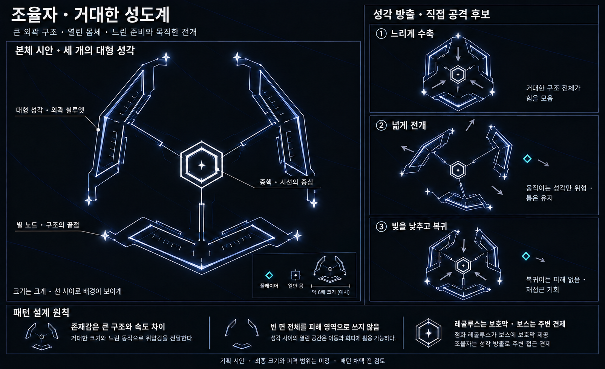

# 조율자 — 거대한 성도계와 성각 방출 후보

작성일: 2026-10-19 · 상태: 대형 본체·직접 공격 시각 탐색 · 게임 구현 없음

**현재는 이전 탐색 기록이다.** 제네시스와 유사하다는 사용자 피드백으로 육각 중핵·세 외피를 재검토한다. 최신 외형 대안은 [실루엣 재탐색 v2](Boss_Tuner_Silhouette_Exploration_v2.md)이며, 아래 성각 방출도 본체 선택 전에는 채택하지 않는다. 큰 비례와 배경 투과는 유지할 방향으로 남긴다.

사용자 방향은 **자체 크기가 큰 보스에 어울리는 위엄 있는 구조**다. 배경이 비치는 선 구조와 별자리 테마를 유지하면서, 큰 계측 구조물의 비례와 동작으로 존재감을 만든다. 이 문서의 본체와 성각 방출은 아직 채택 전 시안이다.

## 본체 · 중앙 중핵과 세 개의 대형 성각

기존의 작은 코어·눈금 프레임 아이콘을 **중앙 중핵 + 세 개의 거대한 분리 프레임**으로 확장한다. 외곽을 이루는 프레임을 ‘성각’으로 부른다. 최종 이름은 조율자 / 계측자 중 미정이다.

| 부분 | 형태와 역할 |
|---|---|
| 중앙 중핵 | 이중 육각 윤곽과 중앙의 작은 별. 넓은 외곽 속에서도 시선이 모이는 중심 |
| 대형 성각 세 개 | 긴 계측자가 꺾인 듯한 큰 프레임. 떨어진 세 부분이 보스의 외곽을 구성 |
| 별 노드 | 프레임 끝점의 작은 별. 힘을 모으거나 전개할 때 먼저 반응 |
| 눈금·내측 레일 | 긴 구조의 방향과 움직임을 읽게 하는 최소한의 세부 요소 |
| 프레임 사이 | 배경화면이 계속 보이는 열린 공간. 보스 외곽 전체를 채운 덩어리로 그리지 않음 |

그림의 일반 몹 대비 약 6배 표시는 **큰 비례를 비교하기 위한 예시**다. 실제 월드 크기·카메라 줌·화면 점유율·피격 범위를 확정하는 수치가 아니다. 화면 가장자리에서도 다음 공격의 예고와 탈출 경로를 볼 수 있는 크기를 찾아야 한다.

## 위엄은 크기와 동작에서 만든다

- 대기 중에는 대형 성각이 천천히 자세를 유지하고, 별 노드와 눈금은 약하게 반응한다.
- 준비 때는 구조 전체가 서서히 수축해 힘을 모으는 모습이 분명히 보인다.
- 실행 때는 충분한 예고 뒤에 큰 프레임이 넓게 전개된다. 일정한 속도로 떠다니는 장식과 다른 움직임을 준다.
- 회복 때는 빛과 움직임을 낮추고, 큰 부품들이 제자리로 돌아오는 과정을 보여준다.

느린 준비와 무게감 있는 전개는 시각 방향이다. 판정에 필요한 예고 시간과 실제 이동 속도는 플레이어의 속도·둔화 상태를 기준으로 검증해야 한다. 장식과 발광을 늘리는 양이 곧 보스의 위엄을 결정하지는 않는다.

## 직접 공격 후보 · 성각 방출

앞서 제안한 ‘작은 파편을 뿌리는 공격’을 **본체를 이루는 대형 성각 자체의 전개**로 구체화한다.

| 단계 | 제안 |
|---|---|
| 준비 | 세 성각이 중핵 쪽으로 천천히 모이고 끝점의 별이 밝아짐 |
| 방향 예고 | 각 성각이 나갈 방향과 끝 위치를 읽을 수 있게 함. 그림의 회색 화살표는 설명용이며 게임 내 예고는 후속 설계 |
| 방출 | 중핵은 자리를 유지하고 세 성각이 각자의 바깥 방향으로 한 번 밀려 나감 |
| 회복 | 성각의 밝기와 피해를 끄고 복귀. 복귀에는 피해 없음 |

위험은 **현재 이동 중인 성각의 표시된 판정 부분**에만 둔다. 펼쳐진 외곽 내부 전체나 성각 사이의 빈 면을 한 번에 공격 영역으로 만들지 않는다. 그림의 성각은 이중 윤곽의 열린 선 구조이므로, 윤곽선만 위험하게 할지 레일 사이의 좁은 띠를 판정으로 쓸지는 별도 확정해야 한다. 시각 크기만큼 보스 전체에 거대한 접촉 판정을 주지는 않는 안이다.

첫 검토는 한 번의 방출로 시작하며, 추가 둔화·밀치기·탄 차단·반사·새 몹 소환은 붙이지 않는다. 플레이어는 성각 사이의 틈에 머무르거나 잠깐 물러날 수 있고, 회복 중에는 다시 접근할 수 있어야 한다.

## 레굴루스 보호막과 역할 분담

사용자가 정한 방향은 **점화된 레굴루스가 보스에게 강력한 보호막을 제공**하는 것이다. 기존 ‘방호 정렬’은 현재 추가 패턴으로 채택하지 않는다.

- 점화 레굴루스: 보스에게 보호막을 제공하는 지원 역할.
- 성각 방출: 보스의 몸체를 움직여 자기 주변의 접근을 견제하는 직접 공격 후보.

레굴루스가 제공하는 보호막의 강도·중첩 여부·공급 대상 수·파괴와 재생·레굴루스 처치 시 해제 방식은 미정이다. 그림의 작은 보호막 아이콘은 역할 설명용이며 실제 보호막 형상이 아니다.

## 기존 패턴과의 관계와 검토 장면

- 성도 주사는 정지한 본체에서 긴 한 줄이 각도를 따라 움직인다.
- 성각 방출은 본체의 큰 세 조각이 서로 떨어지며 바깥으로 이동한다.
- 성좌 조율은 본체가 아닌 점화 몹을 움직인다.

성각 방출을 추가하기 전 **레굴루스 보호막이 있는 상태에서 주사에 맞아 둔화된 플레이어도 틈으로 피할 수 있는가**, **레굴루스를 처치하고 공격을 피한 플레이어에게 보스를 공격할 시간이 남는가**를 확인한다. 화면 확대·축소와 맵 가장자리에서도 성각의 양 끝과 이동 범위가 읽혀야 한다.

점화를 주사에 합칠지는 아직 결정하지 않았다. 독립 점화를 유지하면 성각 방출 채택 시 네 패턴이 되고, 점화를 주사에 합치면 조율·주사·성각 방출 세 패턴이다. 이 이미지로 패턴 수나 채택 여부를 확정하지 않는다.

## 산출물

[현재 조율자 기획](Boss_Tuner_Design.md)과 함께 검토한다. 이미지의 선 구조, 큰 비례, 준비·전개·복귀 표현을 확인했다. 실제 화면 점유율·충돌·회피 가능성과 난이도는 검증 전이며 게임 코드는 수정하지 않았다.

내장 `image_gen`으로 생성했고, 역할 설명 문구를 한 차례 수정했다. [전체 생성·수정 프롬프트](Concepts/Boss_Tuner_GrandStructure_ImagePrompts_v1.md)를 저장했다. 기존 보스 문서는 참고하지 않았다.

