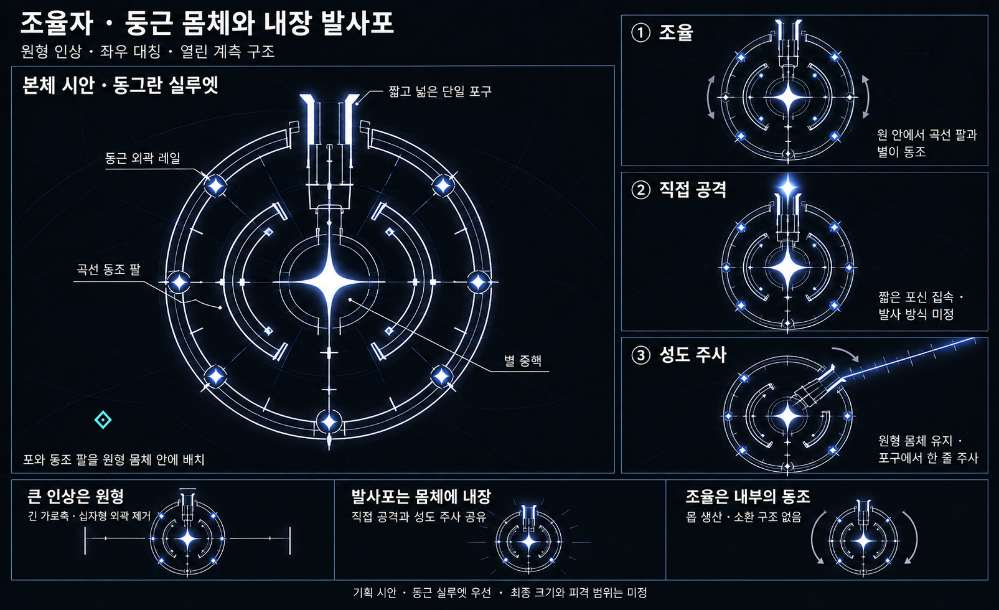

# 조율자 — 둥근 몸체와 내장 발사포 v4

작성일: 2026-10-19 · 상태: 원형 인상을 반영한 외형 수정안 · 게임 구현 없음

사용자의 ‘대칭감’은 **전체가 동그랗게 보이는 인상**을 뜻한다. 이전 v3의 긴 가로축과 십자형 외곽은 요구를 잘못 해석한 탐색안으로 남긴다.

## 현재 조형 방향

- **둥근 외곽 레일:** 가로·세로 비례가 비슷한 원형 계측 구조가 전체 인상을 만든다. 채운 구체 대신 가는 원형 레일 사이로 배경이 보인다.
- **곡선 동조 팔:** 이전의 긴 양팔을 몸체 안으로 감싼다. 좌우 곡선 팔과 별 노드의 각도·점등이 맞춰지며 조율을 표현한다.
- **별 중핵:** 원형 구조 안에서 시선이 모이는 중심. 최종 크기와 발광은 미정이다.
- **내장 단일 발사포:** 몸체 전방에 짧고 넓은 발사 통로를 둔다. 포구를 조금 돌출시키되 전체 원형 인상을 깨지 않는다.

큰 외피 세 개나 육각 코어를 재사용하지 않는다. 본체를 가로지르는 얇은 계측선과 눈금은 보조 구조이며, 길게 바깥으로 뻗는 양팔이 아니다.

## 기능과 자세

| 기능 | 시각 방향 |
|---|---|
| 기존 몹 조율 | 원 안에서 곡선 팔과 별 노드가 동조한다. 몹 생산·소환 통로 없음 |
| 보스 직접 공격 | 짧은 포신을 집속하고 포구에서 힘을 방출한다. 탄 형태와 공격 방식은 미정 |
| 성도 주사 | 원형 몸체를 유지하고 중앙포가 조준한다. 단일 포구에서 눈금이 붙은 한 줄이 나와 회전 |

직접 공격과 성도 주사는 같은 발사포를 사용한다. 주사의 피해·둔화·일시적인 점화 몹 피해 증가 방향은 유지한다. 외형 수정으로 패턴 수나 점화 통합 여부를 바꾸지 않는다.

## 남은 검토

원형 레일의 크기, 실제 화면 점유율, 피격·접촉 판정과 별 노드 수는 미정이다. 큰 빈 면 전체를 자동으로 피해 영역으로 취급하지 않는다. 직접 공격의 준비 자세와 주사 자세를 실제 크기에서 구별할 수 있는지도 검토해야 한다.

이미지에서 원형 인상과 내부 곡선 팔, 단일 열린 포구를 확인했다. 작은 자세 도해의 노드 수·레일 연결은 정밀 기구 도면이 아니다. 실제 게임 가독성·기구·공격 판정은 구현·검증 전이다.

전투 기준은 [조율자 기획](Boss_Tuner_Design.md)을 따른다. [v3](Boss_Tuner_Symmetric_Cannon_v3.md)는 이전 기록이다.

내장 `image_gen`으로 생성했다. [전체 프롬프트](Concepts/Boss_Tuner_Round_Cannon_ImagePrompt_v4.md)를 저장했다. 기존 보스 문서는 참고하지 않았다.

