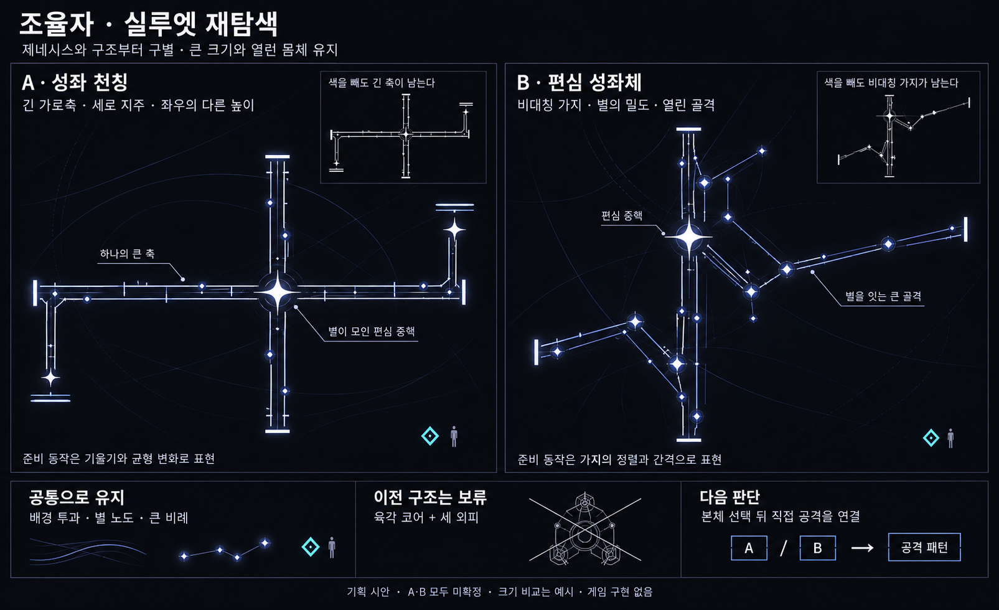

# 조율자 — 제네시스와 실루엣을 구별하는 재탐색 v2

작성일: 2026-10-19 · 상태: 외형 대안 비교 · A·B 미확정 · 게임 구현 없음

현재는 이전 탐색 기록이다. 대칭감과 중앙 발사포를 요구한 후속 사용자 방향은 [대칭 동조 팔과 중앙 발사포 v3](Boss_Tuner_Symmetric_Cannon_v3.md)에 반영했다. 아래 비대칭안과 우선 추천은 당시 검토 내용이다.

사용자 피드백: 이전 대형 시안은 방향 자체에는 가능성이 있지만 **제네시스와 너무 비슷하다.** 큰 크기와 열린 몸체는 유지할 수 있으나, 외곽을 이루는 구조를 다시 검토한다.

## 겹친 이유

사용자가 지적한 기존 몹과의 유사성을 확인하기 위해 [제네시스 엘리트 시각 자료](Concepts/Genesis_Elite_Rotor_RearProduction_v3.png)와 [이전 조율자 대형안](Concepts/Boss_Tuner_GrandStructure_v1.png)을 나란히 보았다.

두 시안은 **육각 코어 + 분리된 외피 세 개**를 공유한다. 각 외피가 코어 둘레를 감싸고 움직이는 방식도 비슷해, 색과 크기를 바꾸어도 같은 계열의 강화형으로 읽힐 가능성이 있다. 이는 구조 비교를 통한 디자인 판단이며, 플레이어 인지 시험의 결과는 아니다.

이전안은 기록으로 보존한다. 위엄 있는 큰 비례와 배경 투과는 계승할 방향으로 남기고, 삼분 외피와 육각 중핵을 현재 선택안으로 확정하지 않는다. 성각 세 개를 방출하는 공격도 본체와 함께 재검토한다.

## 대안 A · 성좌 천칭

**긴 가로 계측축 + 세로 지주 + 높이가 다른 양쪽 끝**으로 구성한다. 중핵은 다각형 외피로 둘러싸지 않은 밝은 별이며, 축과 지주가 만나는 곳에서 시선을 모은다.

- 실루엣의 중심은 하나의 긴 축이다.
- 긴 레일 사이와 양팔 사이로 배경이 비친다.
- 길이가 다른 양팔과 끝부분의 높이 차이로 기계적 균형을 표현한다.
- 준비 동작은 양팔의 기울기, 지주의 정렬, 별 노드의 이동으로 탐색할 수 있다.

조율·계측이라는 이름과 움직임을 연결하기 좋고, 제네시스의 외피 구조와 구별할 수 있어 **현재 우선 검토를 추천하는 안**이다. 좌우로 길어졌을 때 화면 가장자리에서 양 끝이 잘리지 않는지, 긴 선이 상시 공격선처럼 오해되지 않는지 확인해야 한다.

그림은 외형 시안이며 양팔을 회전시켜 곧바로 광역 피해를 준다는 뜻이 아니다. 성도 주사의 예고와 본체 레일은 별도로 구분해야 한다.

## 대안 B · 편심 성좌체

**긴 세로 골격 + 높이가 다른 비대칭 가지 + 분산된 별 노드**로 구성한다. 밝은 중핵은 외곽 중앙에서 살짝 벗어난 위치에 둔다.

- 몸을 외피로 둘러싸는 방식 대신, 별을 잇는 골격이 외형이 된다.
- 별의 밝기·크기 차이로 중핵과 보조 노드를 구별한다.
- 큰 가지 사이를 비워 배경을 보존한다.
- 준비 동작은 가지의 정렬과 벌어지는 간격으로 탐색할 수 있다.

별자리 테마를 직접 드러내는 안이다. 작은 별들이 흩어져 한 보스로 읽히지 않거나, 조율되는 일반 몹들과 혼동될 가능성을 확인해야 한다. 그림의 짧은 삼각 보강선은 골격 표현이며 닫힌 공격 면을 뜻하지 않는다.

## 비교

| 기준 | A · 성좌 천칭 | B · 편심 성좌체 |
|---|---|---|
| 큰 인상 | 하나의 축과 양팔을 가진 거대한 계측기 | 별들이 이루는 거대한 비대칭 골격 |
| 제네시스와의 구별 | 세 외피를 감싸는 구조를 긴 축으로 변경 | 세 외피를 분산된 가지와 노드로 변경 |
| 정체성과 연결 | 계측·균형·조율 | 별자리·배치·정렬 |
| 동작의 주재료 | 기울기·축 정렬 | 가지 간격·노드 정렬 |
| 우선 확인할 점 | 본체 축과 공격선의 혼동, 가로 화면 점유 | 개체의 통일감, 일반 몹과 노드의 구별 |

이미지의 단색 작은 도해는 형태 확인을 돕는 설명이다. 실제 게임 크기에서의 인지 테스트를 통과했다고 간주하지 않는다.

## 공격 기획에 미치는 범위

점화·조율·성도 주사, 주사 명중 시 둔화와 점화 몹 피해 증가, 점화 레굴루스의 보호막 방향은 유지한다. 외형 변경만으로 몹 강화나 피해 규칙을 추가하지 않는다.

**본체 후보를 고른 뒤 추가 직접 공격을 연결한다.** 이전 성각 방출을 유지하기 위해 새 몸체에도 외피 세 개를 다시 붙이지 않는다. A라면 축과 팔의 움직임, B라면 가지와 별의 움직임에서 대응 가능한 공격을 탐색할 수 있지만 아직 동작·판정·채택 여부를 정하지 않는다.

독립 점화와 주사 점화 통합 중 어느 구성을 택할지는 여전히 미정이며, 본체 외형으로 패턴 수를 바꾸지는 않는다. 전투 기획의 현재 기준은 [조율자 기획서](Boss_Tuner_Design.md)를 따른다.

## 시각 자료와 검토 상태

내장 `image_gen`으로 [비교 이미지](Concepts/Boss_Tuner_Silhouette_Options_v2.png)를 생성했다. [전체 생성 프롬프트](Concepts/Boss_Tuner_Silhouette_ImagePrompt_v2.md)를 보관한다.

두 안의 주된 구조 차이와 열린 공간을 확인했다. 그림의 인물 아이콘과 청록색 마름모는 크기 설명용이며, 새로운 인간 캐릭터를 추가하는 제안이 아니다. 배경 곡선도 투과 구조를 보여주는 설명용이다. 실제 크기·카메라 점유율·피격 판정·가독성은 검증 전이다.

기존 보스 문서는 참고하지 않았다. 제네시스 자료는 사용자가 지적한 유사성을 비교하는 대상으로만 사용했다.

