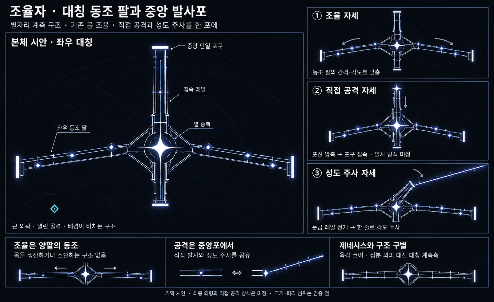

# 조율자 — 대칭 동조 팔과 중앙 발사포 v3

작성일: 2026-10-19 · 상태: 사용자 조건을 반영한 외형 시안 · 게임 구현 없음

현재는 이전 탐색 기록이다. 사용자 의도는 ‘긴 축의 대칭’이 아니라 ‘동그란 인상’으로 정정되었다. 최신 시안은 [둥근 몸체와 내장 발사포 v4](Boss_Tuner_Round_Cannon_v4.md)를 따른다.

사용자 지정 방향은 **대칭감 있는 큰 보스**, **기존 몹을 조율하는 인상**, **보스의 직접 공격과 성도 주사를 함께 수행하는 발사포**다. 배경이 보이는 열린 구조와 별자리 테마를 유지한다.

## 본체 구조

중앙의 전후축을 기준으로 좌우를 맞춘다. 대기 실루엣의 두 팔은 길이·꺾임·끝점 위치가 대응하고, 공격 중에는 포신의 조준과 팔의 조율 동작으로 자세가 변한다. 모든 세부 장식까지 기계적으로 복사할 필요는 없지만 큰 덩어리와 무게 중심에는 대칭감이 있어야 한다.

| 부분 | 조형과 역할 |
|---|---|
| 별 중핵 | 작은 케이스에 갇힌 육각 코어를 대신하는 밝은 별. 몸체와 포신의 힘이 모이는 중심 |
| 좌우 동조 팔 | 길고 열린 계측 레일 두 개. 같은 길이의 양팔이 간격과 각도를 맞추며 조율을 표현 |
| 팔의 별 노드 | 좌우 대응 위치에서 순서·위상이 맞춰지는 작은 별들. 일반 몹이나 새 소환체가 아님 |
| 중앙 집속 레일 | 중핵에서 전방 포구로 이어지는 두 레일. **하나의 발사 통로**를 양쪽에서 감쌈 |
| 중앙 단일 포구 | 앞쪽으로 뚜렷이 돌출된 발사포의 입구. 직접 공격과 성도 주사의 공통 출발점 |
| 후방 지지축 | 짧고 열린 후방 구조. 큰 양팔과 긴 포신의 시각적 무게를 지지 |

레일이 두 개라고 두 포가 되는 것은 아니다. 포구는 하나이며, 그 사이의 빈 채널과 포구 양옆의 짧은 테두리로 방향을 읽게 한다. 그림은 위쪽을 전방으로 삼는다.

폭넓은 두 팔과 길게 돌출된 포신이 전체 실루엣을 만든다. 제네시스처럼 세 외피가 중심을 감싸거나 생산·이송 통로를 구성하지 않는다. 바깥 프레임 내부와 팔 사이로 배경이 비친다.

## 조율을 보여주는 동작

기존 몹을 조율할 때는 양팔의 간격과 각도가 함께 맞춰지고, 좌우의 별 노드가 대응하는 순서로 점등한다. 몹을 담는 칸이나 생산구를 넣지 않는다.

팔의 동작과 대상 몹의 임시 조율 표식으로 명령의 관계를 보여주는 안이다. 보스와 모든 몹 사이를 지속적인 연결선으로 채우지는 않는다. 이미지의 양팔 이동 화살표는 설명용이다.

이는 기존 점화·조율 기획에 붙이는 **외형과 동작의 표현**이며, 몹을 추가 생성하거나 영구 강화 스택을 늘리는 새 기능이 아니다.

## 하나의 포 · 두 가지 공격 자세

| 기능 | 준비 자세 | 실행 시각 방향 |
|---|---|---|
| 보스의 직접 공격 | 포신 레일이 안쪽으로 압축되고 중핵의 빛이 포구에 모임 | 포구의 짧고 강한 섬광과 포신 반동. 실제 사격 방식·탄 형태·발사 수는 미정 |
| 성도 주사 | 포신이 정렬되고 눈금 레일이 길게 전개됨 | **포구에서 시작하는** 단방향의 긴 한 줄이 예고한 각도를 따라 회전 |

직접 공격의 압축·순간 방출과 주사의 연장·각도 회전이 준비 단계부터 구별되도록 검토한다. 같은 포에서 나온다는 이유로 탄 굵기와 피해량만 바꾼 두 패턴을 만들지는 않는다.

성도 주사 중에는 본체의 큰 양팔을 기준 자세에 두고 **중앙포가 중핵 근처의 회전축을 기준으로 조준**하는 안이다. 전체 큰 몸체를 갑자기 돌리지 않아도 관측축의 회전을 읽을 수 있다. 실제 기구 연결·회전 한계는 후속 설계한다.

성도 주사의 기존 명중 효과인 피해·짧은 둔화·일시적인 점화 몹 피해 증가 방향은 유지한다. 새 직접 공격에 같은 효과를 자동으로 복제하지 않는다. 주사선·예고·판정의 시작점은 실제 포구 위치에 맞춰야 한다.

## 위엄과 플레이 가독성

큰 양팔의 느린 동조, 압축되는 집속 레일, 순간적으로 반응하는 포구의 속도 차이로 큰 보스의 무게를 보여준다. 얇은 레일과 제한된 흰 강조로 주요 구조를 읽게 하며, 채운 장갑판이나 과도한 발광으로 몸을 덮지 않는다.

양팔은 평소 본체 구조이고, 상시 피해를 주는 긴 광선이 아니다. 실제 활성 공격은 별도 예고와 상태 변화로 구별해야 한다. 크기·카메라 줌·화면 점유율, 팔과 포신의 피격·접촉 범위는 미정이다. 그림의 플레이어 마름모는 비례 예시다.

## 이전안과의 관계

- [v2의 성좌 천칭 / 편심 성좌체](Boss_Tuner_Silhouette_Exploration_v2.md)는 이전 탐색 기록으로 남긴다. 이번에는 사용자의 대칭 요구에 맞춰 천칭의 비대칭을 줄이고 중앙포를 추가했다.
- 육각 중핵과 세 외피를 사용하는 대형안은 계속 보류한다.
- 세 외피를 방출하는 ‘성각 방출’을 채택하지 않은 상태에서, **중앙포를 이용한 추가 직접 공격**을 새 요구에 맞춰 검토한다.
- 점화 레굴루스는 보스에게 강력한 보호막을 제공하는 방향을 유지한다. 본체의 양팔을 또 다른 독립 방호 패턴으로 만들지는 않는다.
- 독립 점화를 유지할지 주사에 합칠지는 미정이다. 이번 포구 추가만으로 패턴 수나 직접 사격 패턴을 확정하지 않는다.

전투의 현재 기준은 [조율자 기획서](Boss_Tuner_Design.md)를 따른다.

## 산출물과 검토 상태

내장 `image_gen`으로 [본체와 세 자세 비교 이미지](Concepts/Boss_Tuner_Symmetric_Cannon_v3.png)를 생성했다. [전체 생성 프롬프트](Concepts/Boss_Tuner_Symmetric_Cannon_ImagePrompt_v3.md)를 함께 저장했다.

좌우 대칭감, 중앙 단일 발사 채널, 조율·직접 공격·주사의 자세 차이를 확인했다. 이미지 포구 끝의 밝은 가로 테두리가 마개처럼 읽히지 않는지는 실제 크기에서 추가 검토해야 한다. 도면의 보조 레일·작은 관절은 최종 기구가 아니며, 실제 게임에서의 가독성·충돌과 공격은 구현·검증 전이다. 기존 보스 문서는 참고하지 않았다.

