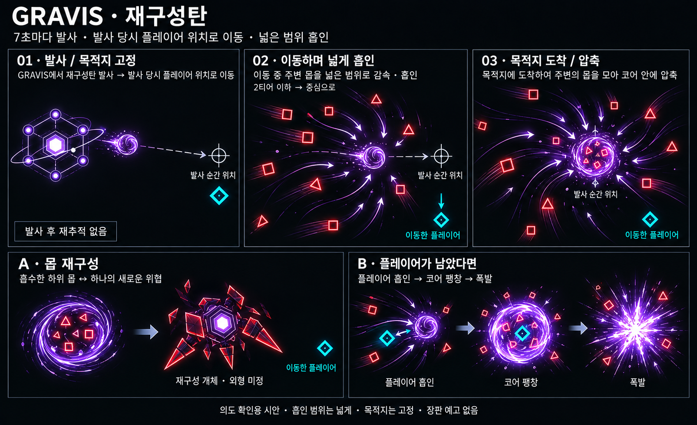

# GRAVIS 재구성탄 — 의도 확인 시안 v1

작성일: 2026-10-18 · 게임 미적용 · 내장 `image_gen` 사용



## 사용자 지정 방향

- 7초마다 중력탄을 발사한다.
- 목적지는 발사 당시 플레이어 위치로 고정한다.
- 재구성 영향 범위는 크게 잡는다.
- 주변 몹들을 감속·흡인하고, 2티어 이하 몹들을 중심에 모아 새로운 몹으로 재구성한다.
- 플레이어가 있다면 플레이어도 흡인하고 폭발하는 구조를 검토한다.
- 이전 장판 예고·회피 중심의 그라비스 시안은 채택하지 않는다.

## 이미지에서 확인할 해석

넓은 흡인 범위가 탄과 함께 이동하며 목적지 도착 후에도 몹을 모으는 것으로 표현했다. 회색 표식은 설명용 과거 위치이며 게임에 추가할 바닥 예고가 아니다. 첫 컷의 청록 플레이어는 발사 직후 원래 위치에서 벗어나기 시작한 상태다. 재구성 개체 외형은 임시 시안이다. 하단 재구성과 폭발은 결과 가능성을 비교한 것으로, 두 결과의 동시 발생 여부와 흡수된 몹 처리 규칙은 미확정이다. 재구성 개체를 그라비스처럼 만들거나 새 몹 종류를 확정한 것은 아니다. 색상·잔상은 의도 전달용이며 실제 게임 선 렌더링 밀도는 별도 조정한다.

## 생성 프롬프트 원문

```text
Use case: infographic-diagram
Asset type: Korean game concept confirmation sheet, wide landscape, high resolution.
Primary request: Visualize the user's GRAVIS reconstruction projectile idea accurately so they can confirm mechanics. Match reference ONLY in black background, crisp thin luminous geometric line art, white Korean typography, thin grey panel frames, clearly legible storyboard composition. DO NOT reuse previous gravity-well or pincer attacks.
Title exact: "GRAVIS · 재구성탄"
Subtitle: "7초마다 발사 · 발사 당시 플레이어 위치로 이동 · 넓은 범위 흡인"
Layout: three sequential panels across upper 58%, two alternative outcome panels across lower 35%, small footer.
Enemy identity: stationary GRAVIS is purple six-node hexagonal frame, large white/purple hexagonal core, one thin tilted ellipse orbit. Projectile is a CLEARLY SEPARATE purple-white dense spherical orb with a compact irregular spiral shell, much smaller than Gravis. It physically flies away from Gravis through space. Cyan hollow diamond player. Small red hollow squares (ROTOR) and red triangles (SWARM) are existing low-tier monsters. Keep same recognizable shapes across frames. No terrain, no floor, no ground target circles, no lasers, no plates, no enclosed danger zones.
01 panel title "01 · 발사 / 목적지 고정": Gravis at left emits ONE orb to right. Player cyan diamond at right. At exactly this player location put SMALL thin grey crosshair marker, with label "발사 순간 위치". Thin grey arrow shows projectile route toward fixed marker. Small caption "발사 후 재추적 없음". No orbiting mob capture here yet.
02 title "02 · 이동하며 넓게 흡인": show orb halfway toward SAME crosshair on right. Cyan player already moves downward away from crosshair with cyan arrow; original position is only grey crosshair, not a second cyan player. At least six small red squares and triangles spread well ABOVE and BELOW flight line, a very wide region at least 4-5 orb diameters away, being drawn toward flying orb with curved inward arrows and stretched fading red/purple motion trails. Some closer shapes visibly entering orb's vortex. Convey large suction reach with diffuse sparse inward particle streaks across broad space, NOT a solid circle, NOT a disk on floor. Label "주변 몹 감속·흡인", small sublabel "2티어 이하 → 중심으로".
03 title "03 · 목적지 도착 / 압축": orb has arrived exactly at old grey crosshair, which is now under orb. Cyan player safely lower right away from old target with label "이동한 플레이어". Several visible red triangles/squares spiral close to and inside compact orb, becoming compressed luminous fragments. Broad wispy inward streaks show suction much larger than orb, no ground ring. Caption "모인 몹을 코어 안에 압축".
Lower left outcome panel title "A · 몹 재구성": close view orb with compressed red geometric fragments inside transforms via simple right-pointing process arrow into ONE reconstructed enemy concept, angular red body with purple compact core, fused geometric frame from square/triangle pieces, not detailed monster character, not a second Gravis. Label under result "재구성 개체 · 외형 미정". Cyan player remains distant, not inside orb. Caption "흡수한 하위 몹 → 하나의 새로운 위협".
Lower right outcome panel title "B · 플레이어가 남았다면": clearly separate alternate case at SAME old destination, cyan diamond near orb being pulled inward with short curved arrow. Compact local white-purple explosive starburst at orb, short jagged rays, not huge screen-wide explosion. A ghost image progression or simple arrow shows pulling then burst, cyan visibly distinct from red absorbed mobs. Caption "플레이어 흡인 → 코어 팽창 → 폭발". Explosion much smaller than broad suction reach shown above.
Footer exact: "의도 확인용 시안 · 흡인 범위는 넓게 · 목적지는 고정 · 장판 예고 없음"
Visual priorities: fixed target is distinct from current moving player; moving orb is distinct from Gravis; broad MONSTER suction reads huge compared to orb and localized explosion; frames show physical bullet travel, not instantaneous remote spawning. Use concise exact Korean labels, no extra timings except 7초, no invented stats. Outcome panels are conceptual possibilities, do not show two outcomes happening sequentially. Do not render previous circular ground telegraphs or gravity slabs.
```

