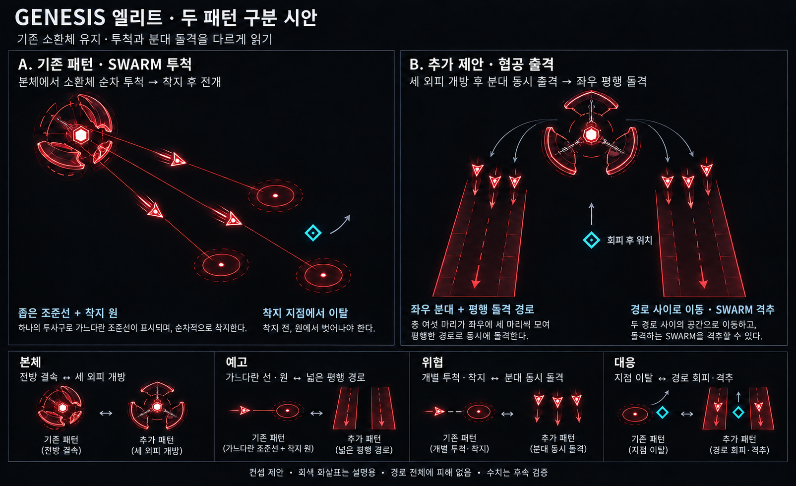
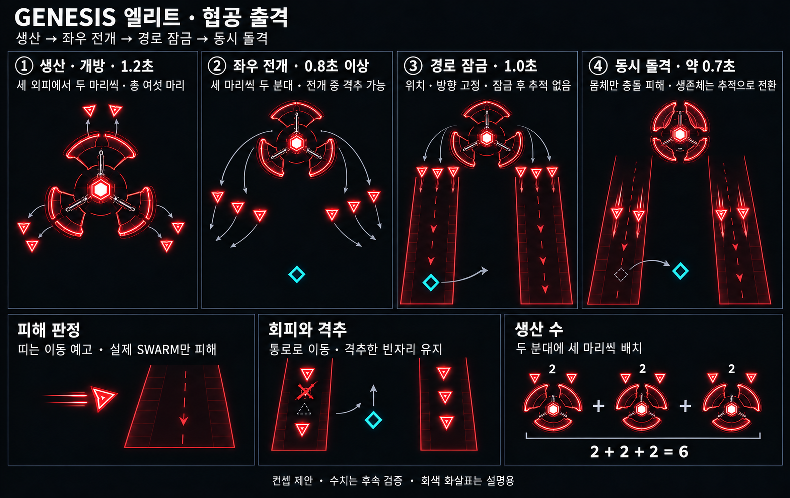

# GENESIS 엘리트 — 협공 출격 시안

작성일: 2026-10-18 · 상태: 이전 협공 기록 / 현재 게임에서 제거됨

현재 적용: [로터 연속 출격 — 매 발 조준 갱신](Genesis_Elite_Rotor_Design.md). 협공의 긴 전개 시간을 개선하기 위해 게임에 적용했다. 아래 협공 동작·검증·스모크 자료는 이전 버전 기록이며 현재 동작을 뜻하지 않는다. 협공 상태·경로 렌더링·전용 회귀는 제거했다. SWARM 투척은 유지한다.

공통 기준: [엘리트 몹 공통 규칙](Elite_Enemy_Rules.md). 기존 몹을 강화하며, **전투 패턴은 2가지 이상**, **두 패턴은 예고부터 서로 다른 공격으로 읽혀야 한다**는 두 규칙을 적용한다. 공통 문서에 있는 근거리·원거리 대응 기준도 함께 검토한다.

## 제안의 핵심

기존 **SWARM 투척**을 유지하고, 새 패턴으로 **협공 출격**을 추가한다. 제네시스가 직접 빔을 쏘는 대신, 생산한 SWARM을 두 분대로 나눠 전개하고 동시에 돌격시킨다. 같은 소환체를 ‘개별 투척체’와 ‘지휘받는 분대’로 다르게 사용한다.

현재 작업 트리의 `DrawGenesisLauncher`를 외형 기준으로 삼는다. 작은 육각 코어, 세 개의 넓고 각진 외피, 외피 안의 삼각형 SWARM, 전방 포구 틈을 유지한다. 과거 문서의 육각 발사대 안 삼각 약실 구조로 되돌리지 않는다. 이미지의 세부 장식은 시각 탐색이며 실제 형상 확정안은 아니다.

## 패턴 1 — 기존 SWARM 투척

세 외피가 결속되고 포구가 플레이어 쪽으로 정렬된다. 좁은 조준선과 착지 원을 보여준 뒤, SWARM 세 마리를 한 포구에서 순차 투척한다. 착지 후 잠시 기절한 SWARM은 일반 추적으로 이어진다.

- 읽어야 할 정보: **어느 지점으로 날아오고 어디에 착지하는가.**
- 대응: 투척 경로와 착지 범위를 벗어나거나, 비행 중인 SWARM을 격추한다.
- 현재 코드 기준으로 세 마리이며, 옛 문서의 ‘2~3마리’ 초안과 구별한다. 기존 비행·착지 피해, 기절, 보상 규칙은 이 제안에서 재설계하지 않는다.

## 패턴 2 — 협공 출격 (추천)

**세 외피가 바깥으로 열리고, 코어가 생산한 SWARM 여섯 마리가 두 분대로 전개한다. 각 분대는 세 마리의 열린 쐐기 대형이며, 충분히 예고한 뒤 고정된 두 경로를 동시에 돌격한다.** 돌격 후 생존한 SWARM은 잠시 멈춘 다음 일반 추적으로 전환한다.

스토리보드의 마지막 돌격 컷은 네 마리가 남은 생존체 예시다. 생산·전개 수량은 총 여섯 마리(3+3)를 기준으로 한다. 하단의 반복 본체 아이콘은 외피별 생산 수를 설명하며 제네시스 세 기를 뜻하지 않는다.

### 진행과 초기 검증값

아래 시간·수량은 플레이 검증을 위한 제안값이다. 밸런스 확정값이나 현재 구현값이 아니다.

| 단계 | 초안 | 본체·소환체 동작 | 플레이어가 읽는 정보 |
|---|---|---|---|
| 생산·개방 | 1.2초 | 본체 정지, 세 외피가 바깥으로 벌어짐. 외피마다 두 차례에 걸쳐 한 마리씩 생산 | 전방 포구 압축과 다른 ‘전체 개방’ |
| 분대 전개 | 0.8초 이상 | 여섯 마리가 본체에서 실제로 이동해 3+3 분대를 만듦 | 어디에 분대가 모이는지 확인. 전개 중 격추 가능 |
| 경로 잠금 | 1.0초 | 두 분대 정지, 두 평행 경로의 외곽선과 방향 꺾쇠 표시. 이때 위치·방향 고정 | 돌격할 두 띠와 그 사이의 통로 |
| 동시 돌격 | 약 0.7초 | 생존한 두 분대가 고정 방향으로 직진. 회전·재추적 없음 | 실제 삼각형 몸체를 피하거나 격추 |
| 정리·회복 | 0.6초 | 생존 SWARM은 접촉 피해 없이 감속·정지 후 일반 추적으로 전환. 본체는 외피 복귀 | 다음 공격과 분리되는 회복 구간 |

전개 거리가 길면 전개 시간을 늘리고, 분대가 자리 잡은 뒤 **1초 잠금 예고를 전부 보장**한다. 0.8초에 맞추려고 순간이동시키지 않는다. 기존 투척과 번갈아 사용하는 것을 시작안으로 삼고, 두 공격 사이에는 생산·회복 여유를 둔다.

### 조준·배치

1. 협공 생산 시작에 플레이어 위치를 한 번 읽어 공격 방향과 두 분대의 경로를 정한다. 전개 후 경로 잠금에서 조준을 다시 갱신하지 않는다. 분대가 순간이동하거나 예고 직전에 방향을 꺾지 않도록 한 구현상의 조정이다.
2. **첫 경로는 위에서 읽은 플레이어 위치를 지나도록**, 두 번째 경로는 그 옆으로 평행하게 배치한다. 생산·전개 중 먼저 이동해 피하는 것도 정상적인 대응이다. 그림의 중앙 통로에 있는 플레이어는 회피 후 위치를 나타낸다.
3. 두 경로는 겹치지 않는다. 사이의 실제 빈 폭은 최소 ‘플레이어 충돌 지름 + 이동 여유’로 잡는다. 원래 자리에서 경로 바깥으로 빠질 공간도 확보한다.
4. 제네시스와 거리가 멀어도 플레이어 주변에 분대를 전개해 대응을 요구한다. 근거리에서는 플레이어 몸 위에 분대를 만들지 않고 출발 위치를 뒤로 물린다. 본체 중심만 덮는 고정 반경 공격으로 만들지 않는다.
5. 두 분대가 플레이어를 향해 서로 마주 보고 충돌하는 완전 포위는 사용하지 않는다. **같은 방향으로 달리는 두 평행 경로**여서 탈출 방향이 읽혀야 한다.
6. 맵 경계에서는 생산 전에 전체 경로의 회전 방향과 두 번째 분대를 둘 쪽을 검사한다. 경로 양 끝과 여유가 들어가는 배치를 선택하고, 들어가지 않으면 기존 투척으로 전환한다. 예고 중 경로를 잘라 통로를 없애지 않는다.

### 피해와 소환 규칙

- 공격 주체는 새 종류의 몹이 아닌 **기존 SWARM**이다. 돌격 대형과 공격 상태를 부여한다.
- 바닥의 띠는 **분대 이동 범위의 예고**다. 띠 전체가 피해 장판이 되는 것은 아니다. 실제 SWARM 몸체와 충돌할 때만 돌격 피해를 준다.
- 전개·잠금 중에는 SWARM을 공격할 수 있으나 SWARM의 접촉 피해는 없다. 돌격 때만 강화 접촉 피해를 켠다. 전개 경로와 돌격 경로를 혼동시키는 긴 붉은 꼬리는 쓰지 않는다.
- 돌격 피해는 우선 기존 비행 SWARM의 10을 참고값으로 삼되 별도 검증한다. 한 협공 시전에서 같은 플레이어는 돌격 피해를 최대 한 번만 받게 하는 안으로 시작한다. 이후 일반 추적의 접촉 처리는 기존 규칙을 따른다.
- 돌격 끝에서 **착지 원·착지 폭발은 만들지 않는다.** 기존 투척과 다른 위협 형태를 유지한다.
- 두 분대의 빈자리는 격추 결과로 유지한다. 즉시 보충하거나, 남은 SWARM이 빈자리로 갑자기 이동하지 않는다. 전멸하면 해당 분대의 경로 예고를 지운다.
- 기존 소환체 상한 15마리를 두 패턴이 공유한다. 여섯 마리의 여유가 없으면 선택 단계에서 기존 투척으로 전환한다. 전체 130마리 제한도 검사하며, 생산 중 다른 소환자가 공간을 소비하면 현재 생산분을 무해하게 정리하고 회복한다. 전개 후 격추는 정상적인 패턴 파훼로 인정한다.
- 처치 보상은 기존 제네시스 소환 SWARM과 같은 경로를 재사용한다. 반복 소환을 통한 점수·XP·별가루 공급을 만들지 않는다.
- 본체 사망 시 미생산분과 돌격 명령·예고를 취소한다. 이미 나온 SWARM은 강화 돌격 피해를 끄고 짧은 정리 후 일반 추적으로 전환하는 안이다. 시간 정지는 생산·전개·예고·돌격을 함께 멈춘다.

## 두 패턴의 시각적 구별

| 구분 | SWARM 투척 | 협공 출격 |
|---|---|---|
| 본체 준비 | 외피 결속, 정면 포구 강조 | 세 외피가 바깥으로 개방, 생산부 강조 |
| 소환체 배치 | 한 포구에서 한 마리씩 | 본체에서 나온 3+3 분대가 좌우에 정렬 |
| 예고 도형 | 가는 조준선 + 작은 착지 원 | 두 개의 넓은 평행 경로 + 진행 꺾쇠 |
| 움직임 | 순차 비행 → 착지 | 전개 → 일시 정지 → 동시 직선 돌격 |
| 위험 | 비행 몸체와 착지 지점 | 이동하는 SWARM 몸체 |
| 대응 | 조준·착지 지점 이탈 | 띠 사이·바깥으로 이동, 분대 격추로 구멍 만들기 |

두 패턴 모두 검붉은 본색을 유지한다. 색을 바꿔 구분하지 않는다. 협공의 외곽선은 가늘게, 실제 SWARM은 밝고 선명하게 그려 바닥 전체가 공격처럼 보이지 않게 한다. 회색 이동 화살표는 컨셉 설명용이며 게임의 피해 예고가 아니다.

‘소환 수를 늘린 투척’은 기존 패턴의 강화에 머물고, ‘착지 후 폭발하는 소환체’는 퀘이사의 지점 폭격 및 기존 착지 피해와 겹친다. 협공을 추천하는 이유는 **생산한 적에게 대형과 출격 명령을 준다**는 소환형 정체성을 전투 행동으로 확장하기 때문이다.

## 시안 검토 기준

- 색·문구를 가려도 본체 개방, 예고 모양, 분대 배치로 두 공격을 구분할 수 있는가.
- 실제 게임 크기에서 여섯 삼각형과 두 경로가 과밀하지 않은가. 경로 사이 통로가 본체·다른 적에 가려지지 않는가.
- 근거리와 원거리 모두 잠금 후 이동만으로 회피할 수 있는가. 격추는 추가 선택지이며 필수 화력 검사가 되지 않는가.
- 두 제네시스가 동시에 협공할 때 통로가 막히지 않는가. 실제 검증 후 엇갈린 패턴 시작 또는 예고 중첩 제한을 검토한다.
- 생산 슬롯 하나에서 두 마리가 나오는 과정과 총 여섯 마리가 시각적으로 대응하는가.

## 구현·검증

기존 투척 → 협공 → 기존 투척 순으로 교대한다. 각 공격 전에는 기존 4.6초 추적·충전이 있다. 협공은 추가로 1.2초 생산, 최소 0.8초 전개(장거리일수록 증가), 1초 잠금, 0.7초 돌격, 0.6초 회복을 거친다. 배치 불가·상한 부족·다른 제네시스가 협공 중인 경우에는 투척으로 전환한다.

두 경로의 중심 간격은 220 월드 px, 표시 반폭은 58px다. 경로 사이에는 104px의 빈 폭이 있다. 분대의 세 SWARM은 횡방향으로 36px씩 떨어지고 가운데 한 마리가 28px 앞선다. 각 유닛은 440px를 이동한다. 돌격은 현재 시전에서 최대 1회 10 피해이며, 경로 전체에는 피해가 없다. 빠른 이동이 플레이어를 건너뛰지 않도록 이전 위치와 새 위치 사이의 선분으로 몸체 충돌을 검사한다.

애니메이션 보정: 외피 개방·복귀와 분대 전개·돌격은 완만하게 가감속한다. 생성 시 몸체 크기를 짧게 키우고, 전개 중 진행 방향으로 부드럽게 돌린다. 회복 뒤 일반 추적으로 돌아갈 때도 방향과 이동 속도를 0.4초 동안 연결한다. 본체 사망 시에는 착지 폭발 표시 없이 짧게 정리한다.

- `scripts/test_genesis_assault.ps1`: 6마리 생산, 무해한 전개·잠금, 고정 조준, 1회 선분 충돌, 경계·상한 폴백, 빈 통로, 격추 빈자리, 본체 사망 취소, 시간 정지, 두 제네시스의 협공 중첩 제한, 양방향 패턴 교대, 전개 연속성, 긴 프레임의 예고 보장.
- 기존 `test_genesis_launcher.ps1`, `test_thrown_swarm_kill.ps1`, `test_quasar_fall.ps1`, `test_quasar_beam.ps1` 통과.
- Windows x64 Release 빌드 및 실제 스모크 캡처. 기존 `APIENTRY` 매크로 재정의 경고는 남아 있다.
- [실제 애니메이션 미리보기](QA/Genesis_Elite/Assault_v1/Assault_Preview.gif). `GENESISASSAULT=<초>`로 생산 시작부터 재현한다. 미리보기는 0.08초 간격의 실제 캡처이며 합성 이동 프레임을 추가하지 않는다.

혼합 웨이브 난이도와 큰 플레이어 빌드의 이동 여유는 실전 플레이 검증 대상이다. 컨셉 이미지는 초기 참고이고 실제 판정·타이밍은 이 구현 설명을 따른다.

## 이미지 생성 기록

내장 `image_gen`을 사용한다. 비교표는 기존 퀘이사 비교 이미지를 구성·선화 스타일 참조로, 스토리보드는 퀘이사 연속 폭격 이미지를 패널 구성 참조로 사용한다. [전체 생성 프롬프트](Concepts/Genesis_Elite_ImagePrompts_v1.md)를 함께 보관한다.
