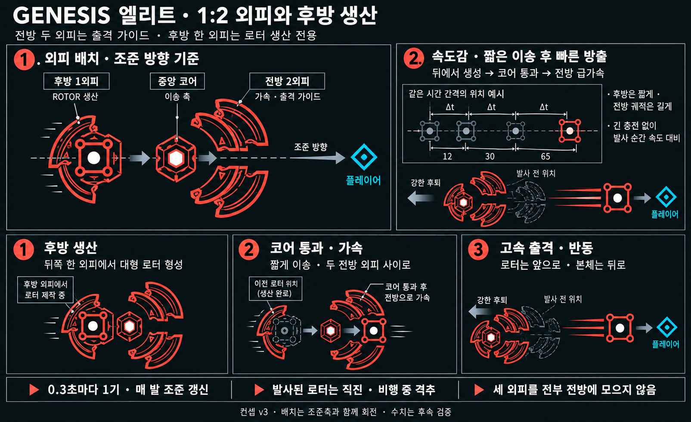
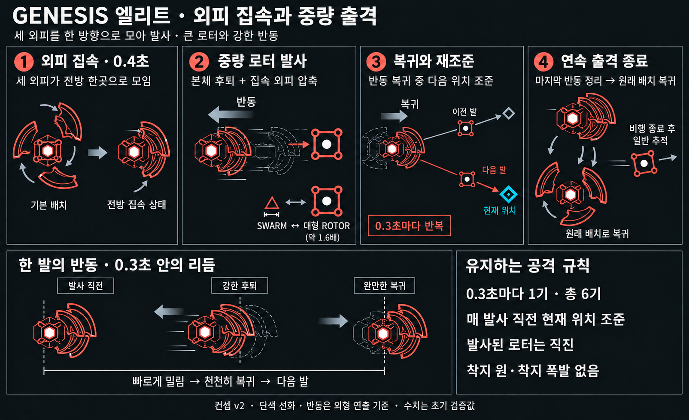

# GENESIS 엘리트 — 로터 연속 출격 시각 시안

작성일: 2026-10-18 · 상태: 게임 적용 / 협공 제거·SWARM 투척 유지 · 로터 빈 대기 0.25초

## 일반 로터 소환·사거리 제한 제거 — 현재 적용

소환체는 일반 ROTOR의 기본 색상·체력·최종 크기 1.0과 공통 사각 프레임·노드·코어 그리기를 사용한다. 전용 주황 중심 링 디자인과 제네시스 체력 배율 상속을 제거했다. 생산 중에는 같은 개체를 작은 크기에서 키우고 일반 외형을 점차 표시한다. 외피 통로 크기 검사는 일반 노드의 폭을 포함한다.

폭격의 최소 120px·최대 1100px 제한을 모두 제거했다. 매 발 출격 순간의 플레이어 위치를 착탄점으로 저장하고, 실제 로터 출발점에서 그 위치까지 비행한다. 거리 0에서는 방향·시간 계산만 안전하게 처리한다. 거리 때문에 목표 앞이나 뒤로 착탄점을 밀지 않는다. 0.4초 간격·6기, 반경 80px의 10 피해 1회, 기존 SWARM 투척은 유지한다.

`test_genesis_rotor.ps1`에서 일반 로터와 크기·색상·체력이 같은지, 0 / 20 / 2500 / 10000px의 착탄·범위 피해를 확인한다.

## 이전 참고 이미지 외형과 범위 폭격

로터를 첨부 참고 이미지의 **주황 사각 프레임 + 모서리 노드 + 중심 링·흰 코어**로 조정했다. 강한 그라데이션 대신 얇은 윤곽과 약한 단색 중심 배경을 사용한다. 몸 안에서 이동하며 완성되는 0.24초 생산과 외피 통로 크기 제한은 유지한다.

발사 간격은 **0.4초**, 총 6기로 준비 시작 후 약 **1.0 / 1.4 / 1.8 / 2.2 / 2.6 / 3.0초**에 출격한다. 매 발 현재 플레이어를 조준하고 발사 후 착탄점은 고정한다. 비행 중 예고 원을 표시하고 착탄 순간 **반경 80px에 10 피해를 1회** 적용한다. 비행체 직접 접촉 피해는 대체했으며 예고 원과 충격파의 최대 반경이 실제 피해 반경과 같다. 격추된 로터와 본체 사망으로 취소된 비행은 폭발하지 않는다.

[실제 범위 폭격](QA/Genesis_Elite/Rotor_v6_Bombardment/Bombardment_Closeup.gif) · [생산 확대](QA/Genesis_Elite/Rotor_v6_Bombardment/Production_Closeup.gif). 아래 이전 영상과 컨셉은 변경 이력으로 보관한다.

## 몸 안에서 이동하며 생산

완성된 큰 로터가 갑자기 나타나는 표현을 제거했다. 실제 로터 한 기가 본체 내부 후방에서 최종 크기의 15%로 시작해, 전방으로 이동하는 0.24초 동안 일반 로터의 프레임·노드·코어가 점차 나타나며 커진다. 같은 개체가 출구에서 완성된 뒤 그대로 출격하며 별도 미리보기 도형으로 바꿔치기하지 않는다.

완성 크기는 외피 통로에서 계산한다. 회전한 사각형의 대각선과 꼭짓점 노드를 포함한 최대 폭이 통로보다 12px 작도록 제한한다. 현재 기본 제네시스의 로터 최종 배율은 일반 로터와 같은 1.0이다. 1초 준비, 0.4초 발사 간격, 강한 반동과 기존 SWARM 투척은 유지한다.

[실제 생산·이송·출격 확대](QA/Genesis_Elite/Rotor_v5_Form/Production_Closeup.gif) · [전체 로터 모션](QA/Genesis_Elite/Rotor_v5_Form/Rotor_Preview.gif). 아래 이전 검증 영상은 변경 이력이다.

## 템포 보정 — 빈 대기 축소

로터 차례의 빈 대기를 **4.6초에서 0.25초**로 줄였다. SWARM 투척의 0.2초 회복 뒤 0.25초 동안 외피 반응을 정리하고, 곧바로 **1초 준비 → 0.4초 간격 6기 출격**으로 이어진다. 읽을 수 있는 준비 자세와 매 발 조준 갱신은 유지한다. SWARM의 4.6초 생산·충전 주기는 유지한다.

SWARM 마지막 투척부터 다음 로터 첫 출격까지의 연결이 약 6초에서 약 1.6초로 줄어든다. 긴 프레임에서는 늦어질 수 있다. [수정한 교대 모션](QA/Genesis_Elite/Rotor_v4_Tempo/WaitToRotor_Closeup.gif) · [전체 패턴](QA/Genesis_Elite/Rotor_v4_Tempo/Cycle_Preview.gif).

## 로터 대기 중 SWARM 충전 모션 제거

종전 로터 차례의 공통 대기에서도 SWARM 충전량을 0→3으로 채우고 원형 외피를 회전시키던 연결 오류를 수정했다. 이제 다음 공격이 로터이면 짧은 대기 시작부터 **SWARM 충전량 0**, **외피 자유 회전 없음**, **빈 후방 생산부와 전방 가이드**로 표시한다. 대기 완료는 SWARM 3스택이 아닌 시간으로 판정한다.

직전 SWARM 투척의 외피 반응은 대기 첫 0.25초에 서서히 정리한다. 빈 로터 대기 자세에서 같은 조준축의 1초 준비·후방 생산·출격으로 이어진다. SWARM 투척 자체의 세 마리 충전과 원형 회전은 해당 공격 차례에만 유지한다.

[SWARM 이후 대기→로터 준비 실제 모션](QA/Genesis_Elite/Rotor_v3_Transition/WaitToRotor_Closeup.gif) · [전체 실제 교대](QA/Genesis_Elite/Rotor_v3_Transition/Cycle_Preview.gif). 기존 `GENESISROTOR` 재현은 로터 준비부터 시작해 이 공통 대기를 생략했으므로, 이번에는 **`GENESISCYCLE=<초>`로 SWARM 조준부터 전체 업데이트를 진행**해 확인한다.

## 준비 자세 보강 — 현재 적용

준비를 **0.4초에서 1.0초**로 늘렸다. 단순 대기 대신 0.00–0.12초 힘 모으기, 0.12–0.70초 전방 가이드 정렬, 0.70–0.76초 완성된 발사 자세 유지, 0.76–1.00초 몸 안에서 이동하며 로터 생산으로 구분한다. 후방 생산 외피와 본체가 짧게 뒤로 힘을 모으고 전방 두 가이드가 자리 잡는다. 준비 종료 시에는 이 움직임이 정리되어 첫 반동과 자연스럽게 이어진다.

준비 중 조준은 계속 갱신한다. 매 발 실제 조준 갱신과 0.4초 연사 간격은 유지한다. 준비 자세를 보여주는 시간을 늘렸으며 이전 협공처럼 오래된 조준 지점을 향해 출격하지 않는다.

[실시간 준비 모션 확대](QA/Genesis_Elite/Rotor_v2_Prep/Prep_Closeup.gif) · [변경 전후 모션 비교](QA/Genesis_Elite/Rotor_v2_Prep/Prep_BeforeAfter.gif) · [전체 패턴](QA/Genesis_Elite/Rotor_v2_Prep/Rotor_Preview.gif). 같은 재현 시점의 실제 캡처를 사용하며 슬로모션이나 합성 프레임을 넣지 않는다.

## 실제 구현과 검증

기존 **SWARM 투척 ↔ 로터 연속 출격**을 교대로 사용한다. 이전 협공의 분대 전개·평행 경로·동시 돌격은 런타임에서 제거했다. 두 전투 패턴을 유지하므로 엘리트 공통 규칙의 예외를 만들지 않는다.

- SWARM은 기존 4.6초 추적·충전을 유지하고, 로터는 빈 대기 0.25초와 준비 1초를 사용한다. 로터의 실제 발사 방향은 대기 때 고정하지 않고 **매 발 출격 순간의 현재 위치**를 다시 읽는다. 본체의 조준 회전은 최대 9rad/s로 이어지고, 이미 출격한 로터는 자신의 고정 방향으로 직진한다.
- 로터 준비는 1.0초, 이후 발사 간격은 0.4초이며 총 6회의 출격을 시도한다. 첫 출격은 준비 시작 약 1.0초, 마지막은 약 3.0초다. 고정 업데이트 경계나 긴 프레임에 따라 늦어질 수 있으며 밀린 발을 한꺼번에 쏘지 않는다.
- 첫 로터는 준비의 마지막 0.24초, 다음 로터는 각 발사 주기의 마지막 0.24초에 본체 안에서 생산되면서 코어를 지나 전방으로 이송된다. 이송 거리는 시간의 제곱에 비례해 앞쪽으로 갈수록 빨라진다. 장시간 분대 전개는 없다.
- 기존 ROTOR의 사각 프레임·네 꼭짓점을 유지하며 완성 크기는 외피 통로의 여유 폭에 맞춘다. 처음에는 최종 크기의 15%이고 이동 중 연속 성장한다. 로터 HP는 일반 로터 기본값을 사용한다.
- 출격 속도는 2200 월드 px/s다. 발사 시 플레이어 위치에 착탄점을 고정하며 비행 거리 제한은 없다. 앞 80%를 고속 직진하고 마지막 20%에서 연속 감속한다. 실제 비행이 끝난 뒤 0.25초 무해하게 정리하고 일반 추적으로 전환한다.
- 비행 중 직접 접촉 피해를 제거하고, 착탄 시 반경 80px 안에 10 피해를 한 번 적용한다. 비행 중 고정 착탄 범위를 표시하고 도착하면 같은 반경의 충격파를 그린다. 0.25초 정리 동안 충격파가 남아도 추가 피해를 주지 않는다. 대시·보호막 등 기존 피해 처리는 그대로 사용한다.
- 전방 2외피는 출격 통로를 감싸고 후방 1외피는 생산을 담당한다. 발사 때 본체 외형은 최대 약 20px 후퇴하고 전방 가이드도 약 5px 압축한다. 0.03초에 강하게 밀린 뒤 0.28초까지 완만하게 돌아온다. 실제 충돌 위치를 누적 이동시키지 않는다. 마지막 발 이후 0.55초 회복한다.
- 기존 소환체 상한 15마리·전체 130마리를 공유한다. 장전한 로터를 격추하면 그 발을 보충하지 않는다. 실제 로터가 출격했을 때만 반동을 준다. 처치 보상은 소환 SWARM과 같이 콤보·도감만 기록한다. 본체 사망 시 장전과 유해한 비행을 취소한다.
- 주황색 사각 윤곽·네 모서리의 작은 링·주황 중심 링과 흰 코어과 실제 과거 위치의 잔상선을 사용한다. 출격 중의 광번짐을 억제한다. 시간 정지 시 본체와 로터의 상태도 함께 정지한다.

`scripts/test_genesis_rotor.ps1`은 발사 수·간격, 발사 시점 조준, 후방 생산·이송, 고정 착탄점, 범위 안팎·1회 피해·면역·시간 정지, 무해한 정리, 소환 상한, 격추 빈자리, 본체 사망 취소, SWARM으로의 복귀와 긴 프레임·반동 경계를 검증한다. 기존 SWARM 투척 회귀와 로터 처치 보상 회귀도 실행한다.

[실제 로터 출격 애니메이션](QA/Genesis_Elite/Rotor_v2_Prep/Rotor_Preview.gif). 스모크 단계는 `GENESISROTOR=<초>`이며, 준비 시작부터 실제 업데이트로 재현한다. 아래 이미지는 설계 과정의 컨셉으로, 준비 0.4초 표기는 이전 검증값이다. 실제 타이밍·판정은 위 설명이 기준이다. 피해와 혼합 웨이브 난이도는 실전 플레이 검증 대상이다.

## 외피 시안 v3 — 후방 생산 1외피 : 전방 출격 2외피

플레이어를 바라보는 조준축을 기준으로 **전방에 두 외피**, **후방에 로터 생산 전용 한 외피**를 둔다. 전방 두 외피는 한 개의 출격 통로를 위아래에서 감싸는 가이드이고, 후방 한 외피는 코어 뒤에서 대형 사각 로터를 생산하는 약실이다. 세 외피를 모두 전방에 모으는 v2를 이 구조로 대체한다.

이 1:2 배치는 조준 방향과 함께 회전한다. 생산·이송·발사 동안 후방 생산 외피는 뒤에 남으며, 두 전방 외피도 같은 출격축을 유지한다. 두 개의 발사구가 아니라 **두 외피 사이의 한 출격구**다.

로터는 **후방 생산 → 코어 중심 이송축 통과 → 전방 두 외피 사이에서 가속 → 고속 출격** 순으로 움직인다. 이미지를 읽을 때 회색 로터는 이전 시점의 위치 예시다. 동시에 여러 로터를 한 통로에 겹쳐 생산한다는 의미가 아니다.

속도감은 뒤쪽에서 앞쪽까지 실제로 이동하는 짧은 동작과, 전방으로 빠르게 튀어나오는 대비로 만든다. 같은 시간 간격의 위치 샘플 사이 거리가 출격 방향으로 커지게 하고, 비행 후방의 가늘고 긴 단색 잔상선으로 속도를 보강한다. 광번짐이나 그라데이션을 강하게 올리지 않는다. 이미지의 위치 간격 숫자는 속도 변화 설명용이며 월드 거리·탄속 확정값이 아니다.

생산 위치를 뒤로 옮겼다는 이유로 긴 전개 단계를 다시 추가하지 않는다. 연속 발사에서는 짧은 후방 생산·이송·가속·방출이 **현재 0.4초 발사 주기 안에서** 읽히도록 설계한다. 로터의 강한 후퇴 반동과 완만한 복귀, 매 발 조준 갱신, 발사 후 직진은 유지한다. 반동 때도 뒤쪽 생산 외피와 앞쪽 두 가이드의 역할이 바뀌지 않는다.

발사 종료 후에는 반동과 가이드 변형을 정리하고 1:2 배치를 유지하는 것을 최신 기준으로 삼는다. v2에 있던 세 외피의 원형 배치 복귀는 현재 기준에서 제외한다. 아래 v2 항목은 이전 결정 기록이다.

## 이전 시안 v2 — 외피 집속과 강한 반동

세 외피를 바깥으로 펼치는 v1에서 **전방 한곳에 모으는 구조**로 수정한다. 기존의 넓고 각진 외피 세 조각이 코어 앞쪽으로 돌아와 겹쳐지고, 하나의 출격축을 감싸는 비대칭 발사대를 이룬다. 새 포신을 덧붙이지 않고 기존 외피의 배치로 발사 구조를 만든다.

로터는 작은 SWARM보다 큰 사각 프레임으로 표현한다. 이미지의 약 1.6배 표기는 크기감을 탐색하는 참고값이며 게임의 크기·충돌 판정 확정값이 아니다.

매 발사마다 로터는 앞으로, 본체와 집속 외피는 **발사 반대 방향으로 크게 후퇴**한다. 외피 지지부가 함께 압축되고, 빠른 후퇴 뒤 완만히 앞으로 돌아오며 다음 발을 조준한다. 여섯 발을 쏘는 동안 외피는 전방에 모인 상태를 유지한다. 매번 세 외피를 다시 원형으로 벌렸다 모으지 않는다.

반동은 우선 렌더링 위치·외피 자세의 연출로 설계한다. 실제 본체의 충돌 위치를 밀어낼지 여부는 별도 구현 결정이며 이번 시안에서 확정하지 않는다. 0.3초 안에서 빠른 후퇴·완만한 복귀가 읽혀야 하고, 위치를 순간적으로 초기화하거나 발사 때마다 뒤로 누적 이동하는 모습은 피한다.

## 이전 개념 비교 — 범위 폭격 변경 전

이전 [v1 비교 이미지](Concepts/Genesis_Elite_Rotor_PatternComparison_v1.png)는 패턴 구별 참고로 보관한다. 해당 이미지의 외피 개방 표현은 위 v2 집속 구조로 대체한다.

기존 협공은 조준 후 생산·전개·잠금에 최소 3초가 걸려, 분대가 도착할 때 플레이어가 이미 벗어난다는 문제가 있었다. 새 안은 전개 대기 대신 짧은 준비 후 소환체를 계속 출격시키고, 매 발사 직전에 현재 위치를 새로 읽는다.

| 구분 | 기존 SWARM 투척 | ROTOR 연속 출격 제안 |
|---|---|---|
| 본체 | 기존 투척의 결속·조준 표현 | 후방 1외피에서 생산, 전방 2외피 사이로 출격 |
| 소환체 | 작은 삼각형 SWARM | 더 큰 사각형 ROTOR, 네 꼭짓점 노드 |
| 반동 | 기존 투척의 짧은 반응 | 본체 후퇴·전방 가이드 압축·완만한 복귀 |
| 조준 | 투척 전 착지 지점 고정 | 매 발사 직전 현재 위치로 갱신 |
| 공격 모습 | 순차 투척과 착지 원 | 연속 직선 출격, 착지 원 없음 |
| 대응 | 비행·착지 지점 회피, 격추 | 횡이동, 비행 중 격추 |

소환체만 바꾸는 안이 아니다. 본체 준비, 예고 도형, 조준 갱신, 착지 공격 유무를 함께 바꿔 두 패턴을 구별한다.

## 이전 컨셉 시간표 — 현재 시간표는 상단 기준

발사 시간표는 [v1 스토리보드](Concepts/Genesis_Elite_Rotor_Storyboard_v1.png)를 참고한다. 외피 배치와 출격 동작은 위 v3가 최신이다.

1. **1.0초 준비:** 힘 모으기와 가이드 정렬을 거쳐 준비 자세를 유지하고, 마지막 0.24초에 로터가 본체 안에서 이동하며 완성된다. 준비 중 피해는 없다.
2. **0.3초마다 한 기, 총 여섯 기:** 발사 직전에 플레이어 현재 위치를 읽고 그 방향으로 출격시킨다. 준비 시작 기준 발사 시점은 약 1.0 / 1.3 / 1.6 / 1.9 / 2.2 / 2.5초다. 첫 발부터 마지막 발까지는 1.5초다.
3. **발사 후 직진:** 본체는 다음 발을 계속 조준하지만 이미 발사한 로터는 방향을 바꾸지 않는다. 이미지의 회색·붉은 긴 화살표는 동선 설명이며 레이저나 경로 전체 피해를 뜻하지 않는다.
4. **종료:** 마지막 반동과 가이드 변형을 정리하되 1:2 배치를 유지한다. 살아남은 로터는 비행이 끝난 뒤 감속하고 일반 추적으로 전환하는 안이다.

시간과 여섯 기는 초기 검증값이다. 탄속·비행 거리·피해·격추 HP·소환 상한·회복 시간은 이번 이미지에서 확정하지 않는다. 특히 가까운 거리에서 0.3초 간격 공격이 회피 불가능해지지 않도록 실제 구현 시 검증해야 한다.

## 이미지 표현

- 기존 컨셉의 검은 배경·패널·제네시스 본체 구조를 유지한다.
- 넓은 그라데이션과 광번짐을 억제하고, 밝은 단색 코랄 선과 흰 글씨로 읽히게 한다.
- 제네시스의 세 외피, 삼각형 SWARM, 사각형 ROTOR를 간단한 윤곽으로 표현한다.
- 이전 발·과거 플레이어 위치는 회색, 새 발은 코랄, 현재 플레이어 위치는 청록으로 구별한다.
- 비교·연속 출격 패널의 로터 세 기는 여섯 발 중 일부를 설명하는 예시다.

## 생성 기록

내장 `image_gen` 사용. [v1 프롬프트](Concepts/Genesis_Elite_Rotor_ImagePrompts_v1.md), [v2 집속·반동 프롬프트](Concepts/Genesis_Elite_Rotor_ImagePrompts_v2.md), [v3 후방 생산·1:2 배치 프롬프트](Concepts/Genesis_Elite_Rotor_ImagePrompts_v3.md).

이전 협공 구현·검증은 [과정 문서](Genesis_Elite_Design.md)에 보관한다. 현재는 이 문서 상단의 로터 출격 구현이 적용되며, SWARM 투척은 유지한다.

