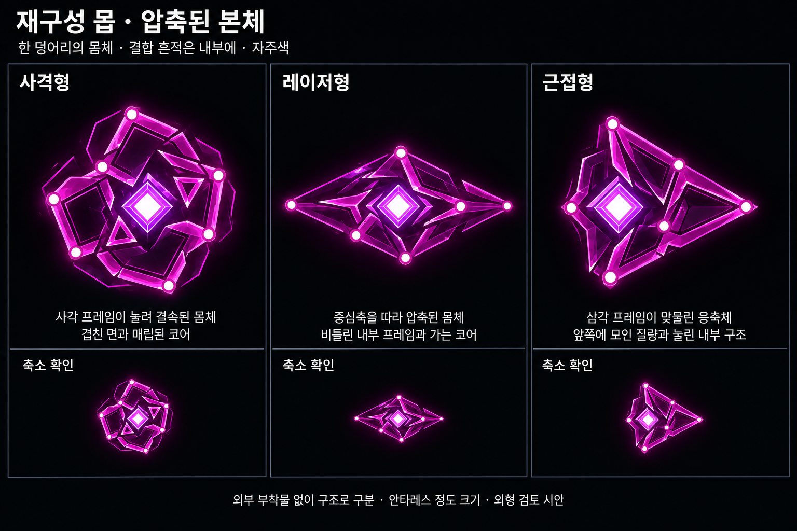
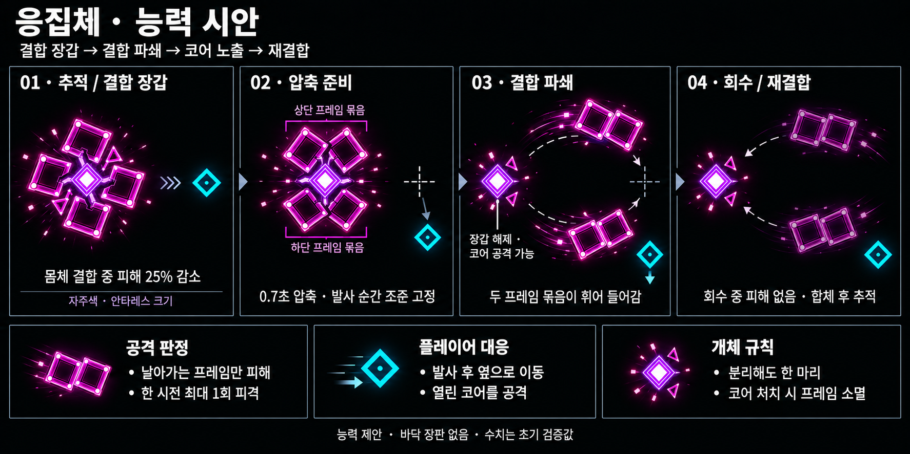

# 재구성 몹 — 응집체 / AGGREGATE

작성일: 2026-10-18 · 재구성 몹 3종 컨셉 기록 · 게임 구현 철회

구현 결과가 의도에 맞지 않아 사용자 요청으로 게임 코드를 되돌렸다. 아래 컨셉 이미지는 보관한다. [철회 전 구현 기록](Gravis_Reconstruction_Implementation.md)은 현재 게임 동작을 뜻하지 않는다.

사용자 지정 수정: 자주색을 주색으로 통일하고, 압축된 개체답게 전체 몸체를 안타레스 정도 크기로 정한다. 큰 그림은 구조 확인용 확대도이며 비교 삽화가 게임 크기 기준이다.

그라비스의 재구성탄에 흡수된 2티어 이하 몹이 하나의 새로운 개체로 결합한 결과물이다. 기존 몹을 강화한 모습만으로 대체하지 않고 새 몹의 외형을 설계한다. 명칭은 작업명이다.

## 외형 방향 수정 — 본체만 사용

사용자 피드백: 장치형 세 디자인은 게임과 맞지 않고, 이후 단일 외곽선·점 코어로 줄인 시안은 너무 단순하다. 현재는 **외부 부착물 없는 하나의 몸체 안에 압축된 프레임과 코어가 보이는 밀도**를 검토한다. 포구·레일을 별도 무기처럼 붙이지 않는다.

- 현재 새 시안은 한 덩어리의 외곽, 중심 코어, 안쪽에 서로 맞물린 프레임과 결합 노드로 구성한다. 빈 다각형에 그치지 않고 겹침·눌림·내부의 빈 공간으로 압축 흔적을 보여준다.
- 기존 게임의 ROTOR 디자인 기획과 실제 QUASAR 캡처는 게임 적용 시 선 두께·코어 광원의 기준으로 사용한다. 현재 이미지의 코어는 자주색 윤곽과 밝은 중심을 가진 압축핵이며, 단순한 점 하나로 제한하지 않는다.
- 자주색은 유지하며, 색보다 프레임의 방향·겹침으로 세 종류를 구별한다. 현재 생성 이미지의 두꺼운 빛·결정 같은 표면은 표현 시안이며, 실제 게임에 같은 광택·입체 재질을 추가한다는 뜻은 아니다.
- 재구성은 흡수된 재료가 새로운 단일 몸체로 압축되는 과정으로 표현한다. 완성된 몸체에 원래 몹들의 프레임을 계속 매달지 않는다.
- 크기는 안타레스 정도의 전체 몸체 크기로 맞춘다. 보드 위쪽은 확대도, 아래쪽은 축소 가독성 확인용이다. 이미지의 픽셀 길이가 구현 크기 수치를 뜻하지 않는다.
- 사각 결합체·길어진 응축체·삼각 결합체로 구별하는 위 본체 컨셉을 바탕으로 구현을 시도했으나, 결과에 대한 사용자 요청으로 게임 구현은 철회했다.

## 현재 방향 — 재구성 몹 3종

재구성 결과는 **사격형(탄환), 레이저형, 근접형(돌진)** 세 종류다. 역할·생성 조건은 유지하며 외형을 단순화한다. 자주색과 안타레스 정도의 크기를 공유하고 본체의 윤곽으로 구별한다. 현재 보드에는 공격 연출을 넣지 않고 본체만 비교한다.

| 종류 | 몸체 실루엣 | 준비 동작과 주 공격 |
|---|---|---|
| 사격형 | 서로 다른 각도의 사각 프레임이 눌려 붙은 뭉툭한 몸체, 내부에 매립된 코어 | 코어가 짧게 밝아지며 본체에서 탄환 발사. 세부 공격은 별도 검토 |
| 레이저형 | 가로로 압축·연장된 몸체 안에 비틀린 사선 프레임과 중심축을 둠 | 본체 장축 정렬과 코어 충전 후 레이저 발사. 별도 레일은 없음 |
| 근접형 | 삼각 프레임이 맞물린 짧은 쐐기 몸체, 뒤쪽으로 눌린 코어 | 본체 수축·정지 후 고정 방향으로 몸체 전체 돌진 |

### 세 종류를 구별하는 기준

- 색·제목·공격 효과를 가려도 사각 결합체, 길어진 응축체, 삼각 결합체를 구별할 수 있는지 확인한다. 현재 이미지의 축소 줄은 실제 플레이 크기에서의 읽힘을 검토하는 참고다.
- 공격체도 사격형은 간격이 있는 개별 탄환, 레이저형은 연속된 한 줄의 빛, 근접형은 움직이는 실제 몸체로 구별한다.
- 레이저의 방향 잠금 이후에는 플레이어를 따라 회전하지 않는 안으로 시작한다. 돌진도 발진 후 방향을 고정한다. 사격의 조준 갱신 간격·탄 수·피해량은 별도 검증한다.
- 준비는 본체의 수축·정렬·코어 점등으로 전달하고 바닥 피해 장판을 추가하지 않는다. 근접형의 잔상에는 피해가 없다.
- 자주색 외곽과 압축 코어·결합 노드를 공통 언어로 유지한다. 내부 구조를 보여주되 외부 무기를 붙여 공격 종류를 설명하지 않는다.

### 생성 조건 — 사용자 지정

재구성 한 번에 실제 흡수한 2티어 이하 몹을 집계한다. 흡인 범위 안에만 있거나 중심에 도착하지 않은 몹은 집계하지 않는다. 현재 사격계열은 짐벌, 근접계열은 로터·스웜이다. 스코프는 2.5티어로 재료에서 제외한다.

**아래 순서대로 검사하여 첫 번째로 해당하는 종류 하나를 생성한다.** 레이저형은 사격형 조건에도 겹치므로 먼저 검사한다.

| 우선순위 | 조건 | 생성 종류 |
|---|---|---|
| 1 | 사격계열 **5마리 이상** AND 근접계열 **14마리 이상** | 레이저형 |
| 2 | 위 조건에 해당하지 않고 사격계열 **4마리 이상** | 사격형 |
| 3 | 위 두 조건 모두 해당하지 않음 | 근접형(돌진) |

사용자 수정에 따라 레이저형의 사격계열 조건은 **5마리 이상**이다. 따라서 사격계열 6마리·근접계열 14마리도 레이저형이다. 두 계열 수는 동시에 충족해야 한다.

| 사격계열 | 근접계열 | 결과 |
|---|---|---|
| 3 | 14 | 근접형 |
| 4 | 14 | 사격형 |
| 5 | 13 | 사격형 |
| 5 | 14 | 레이저형 |
| 5 | 20 | 레이저형 |
| 6 | 14 | 레이저형 |
| 6 | 13 | 사격형 |

재료가 0마리이면 새 몹을 생성하지 않는다. 도착 후 2초간 더 모아 재구성하고, 별도 흡수 상한은 두지 않는다. 플레이어가 중심에 남았을 때는 압축·폭발 후 흡수한 재료의 재구성도 함께 완료한다. 상세는 위 구현 문서를 따른다.

## 이전 능력 제안 기록 — 결합 장갑 / 결합 파쇄

아래는 3종 분화 전의 단일 응집체 능력 시안이다. 현재 세 종류에 공통 적용하는 확정 능력이 아니며, 수치·동작은 과정 기록으로 보관한다. 현재 주 공격 방향은 위 표를 따른다.

자주색 몸체와 안타레스 정도 크기는 사용자 지정 사항이다. 아래 능력·시간·피해량은 새로 제안하는 초기 검증값이며 게임에는 적용하지 않았다. 이전 외형 이미지 하단의 짧은 돌진은 과거 제안으로, 현재 능력안에서는 사용하지 않는다.

### 기본 역할과 이동

재구성으로 얻은 단단한 몸체를 가진 추적형 적이다. 플레이어를 따라가다가 공격 거리 안에서 멈춰 자기 몸체 일부를 날린다. 핵과 프레임은 하나의 생명력·처치 보상을 공유한다. 프레임을 날려도 몹 수가 늘지 않는다. 그라비스가 죽은 뒤에도 이미 완성된 응집체는 독립적으로 행동하는 안을 제안한다.

### 능력 1 — 결합 장갑 (상시 방어)

네 사각 프레임이 붙어 있는 추적·대기·압축 준비 동안 받는 피해를 25% 줄인다. 결합부와 테두리가 안정적으로 밝게 연결된 모습으로 장갑 상태를 표시한다. 피격은 기존 코어 점멸로 보여준다.

프레임 발사부터 완전히 회수할 때까지 장갑을 해제하고 원래 피해를 그대로 받는다. 무적이나 추가 피해 배율은 붙이지 않는다. 노출 중에도 작은 코어만 정밀 조준하게 하지 않고 기존 몸체 크기의 피격 영역을 유지하는 안으로 시작한다.

### 능력 2 — 결합 파쇄 (주 공격)

네 사각 프레임을 두 개씩 묶어 두 덩어리로 분리하고, 조준점의 양옆으로 휘어 들어가게 날린 뒤 회수한다. 연결된 두 개의 사각 구조가 실제 공격체다. 핵과 두 작은 삼각 보강재는 본체 위치에 남는다.

1. **추적:** 플레이어와 거리가 약 260 월드 px 이내이고 공격 대기가 끝나면 준비한다. 멀면 추적을 계속한다.
2. **압축 준비 0.7초:** 본체 이동을 멈추고 네 프레임을 코어 가까이 조인다. 발사 방향을 몸체 자세로 보여준다. 이때는 발사체 피해가 없다.
3. **발사 순간 조준 고정:** 플레이어 위치를 한 번 읽어 두 프레임 묶음이 향할 공통 조준점을 정한다. 사거리는 본체에서 최대 260px다. 이후 플레이어 움직임을 다시 추적하지 않는다. 너무 가까우면 본체 앞쪽 최소 70px로 조준점을 잡아 곡선이 뒤집히지 않게 한다.
4. **전진 0.8초:** 한 묶음은 진행축의 왼쪽, 다른 묶음은 오른쪽으로 휘었다가 고정 조준점 쪽으로 접근한다. 본체는 움직이지 않는다. 바깥으로 벌어지는 곡선의 폭은 초기 55px 정도로 검증한다. 궤적 선은 설명·잔상이며 피해가 없다.
5. **회수 0.6초:** 두 묶음이 코어로 복귀한다. 밝은 흰 테두리를 끄고 어두운 자주색으로 바꾸며, 회수 중에는 피해가 없다. 코어는 계속 공격할 수 있다.
6. **재결합·회복 0.4초:** 프레임이 붙은 뒤 장갑을 복원한다. 회복이 끝나면 추적을 재개하고, 3.5초 공격 대기를 거친다. 대기는 회복 종료부터 계산하며 연속 중첩 발사하지 않는다.

두 묶음의 실제 사각 프레임과 닿으면 초기 제안 8 피해를 준다. 시전당 최대 한 번만 피해를 주어 두 묶음에 동시 피격되는 경우를 제한한다. 두 프레임 사이 공간 전체를 피해 면으로 채우거나, 궤적 사이 공간에 판정을 만들지 않는다. 열린 사각 내부의 세부 판정은 실제 크기에서 검증하되 시각 프레임보다 크게 부풀리지 않는다.

### 플레이어 대응

몸체가 압축되면 공격 준비임을 읽는다. 발사 후 고정된 진행축에서 옆으로 움직여 두 묶음을 피한다. 비어 있는 코어를 공격하면 결합 장갑이 없는 동안 정상 피해를 줄 수 있다. 근거리에서는 준비 중 본체 옆·뒤로 도는 것도 허용한다. 대시를 필수로 요구하지 않는다.

### 유지할 제한

- 프레임 묶음은 별도 유닛이 아니며 독립 HP·접촉 AI·처치 보상을 갖지 않는다.
- 프레임 비행 중에는 본체 접촉 피해를 끄고 프레임 공격만 사용한다. 재결합 뒤에도 이미 겹친 플레이어에게 준비 없이 즉시 접촉 피해를 재개하지 않고, 이탈 후 재접촉 규칙으로 연결하는 안을 검토한다.
- 본체를 처치하면 날아간 프레임의 남은 공격 판정을 즉시 지우고 무해한 파편으로 정리한다.
- 그라비스의 재구성탄에 응집체가 다시 흡수되지 않도록 재흡수 제외를 제안한다. 연쇄 재구성·무한 강화는 만들지 않는다.
- 흡수 수가 늘었다고 몸체 크기·프레임 수·발사 수를 늘리지 않는다. 흡수 수에 따른 스탯 보정 여부는 별도 결정한다.
- 분리된 프레임과 본체가 맵 경계를 벗어나지 않도록 발사 전에 곡선을 검사한다. 유효한 경로가 없으면 공격을 보류하고 추적한다. 비행 중 갑자기 경로를 꺾거나 벽에서 튕기는 기능은 넣지 않는다.

### 확인할 장면

자주색 소형 몸체에서도 장갑의 결합·해제가 읽히는지, 근접한 플레이어가 0.7초 준비를 보고 걸어서 피할 수 있는지, 회수 프레임이 무해함을 밝기로 구별할 수 있는지 확인한다. 그라비스와 제네시스가 함께 있을 때의 몹 밀집도와 코어 노출 시간을 별도로 검증한다.

## 제작 기록

내장 `image_gen`으로 생성·수정. 현재 [본체 v2 프롬프트](Concepts/Gravis_Reconstructed_BodyOnly_ImagePrompt_v2.md). 너무 단순했던 [본체 v1](Concepts/Gravis_Reconstructed_BodyOnly_v1.png), 채택하지 않은 [장치형 3종 보드](Concepts/Gravis_Reconstructed_ThreeTypes_v1.png), [단일 응집체 v2 외형](Concepts/Gravis_Aggregate_Concept_v2.png)은 과정 기록으로 보관한다. 이미지는 구현 화면이 아닌 외형 검토 시안이다.

