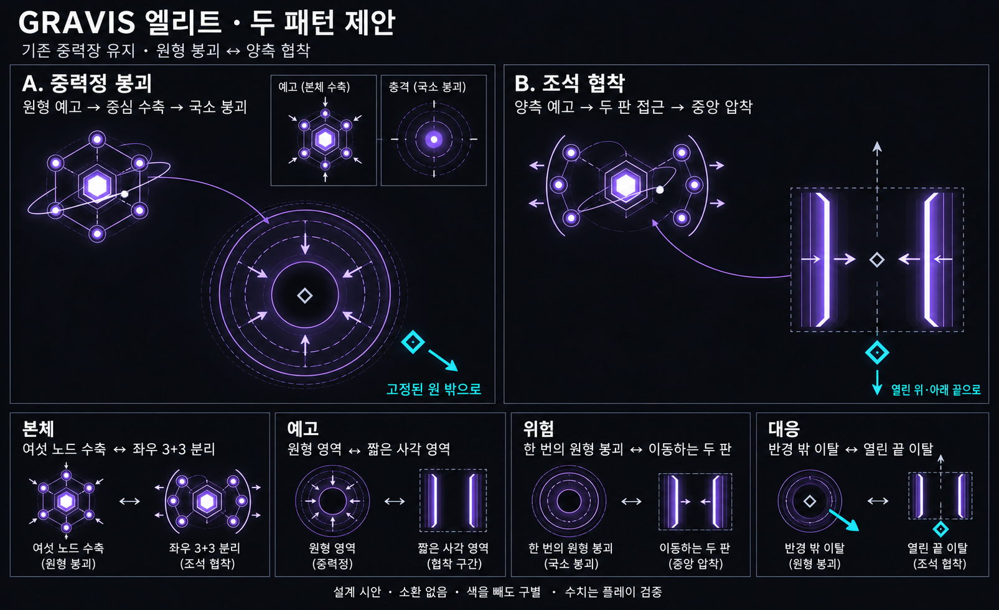
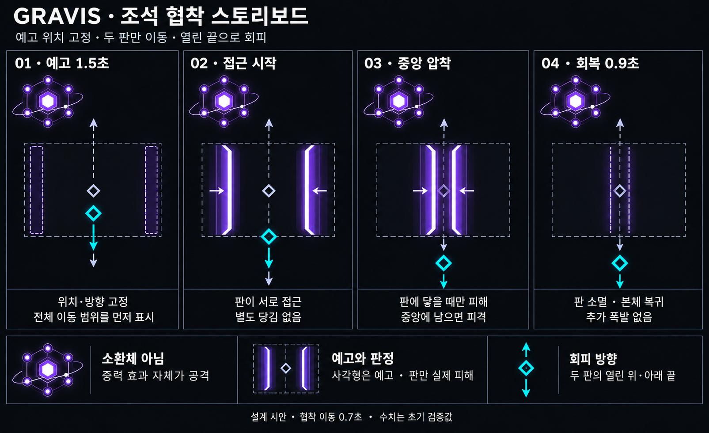

# GRAVIS 엘리트 — 중력정 붕괴 / 조석 협착

작성일: 2026-10-18 · 상태: 채택하지 않은 장판형 제안 / 과정 기록

아래 중력정·협착은 게임 전투 방식과 맞지 않는다는 사용자 피드백으로 채택하지 않았다. 이후 시도한 [재구성탄과 재구성 몹 3종 구현](Gravis_Reconstruction_Implementation.md)도 사용자 요청으로 철회했으며, 현재 게임은 기존 그라비스 동작을 사용한다.

새 외형 검토: [그라비스 자신의 재구성된 2페이즈](Gravis_Phase2_Design.md). 별자리 외형과 행성의 성질을 바탕으로 한 컨셉이며 게임에는 적용하지 않았다.

공통 기준: [엘리트 몹 공통 규칙](Elite_Enemy_Rules.md). 기존 몹을 강화하고, 전투 패턴은 두 가지 이상이며, 플레이어가 예고부터 서로 다른 공격으로 구별할 수 있어야 한다. 공통 문서의 근거리·원거리 대응 기준도 함께 검토한다. 아래 수치는 초기 검증값이다.

## 제안의 핵심

**중력으로 공간을 장악하는 기존 정체성을 유지하면서, 원형의 ‘중력정 붕괴’와 양측에서 닫히는 ‘조석 협착’을 추가한다.** 제네시스는 몹을 생산·소환하는 역할을 유지하고, 그라비스는 적을 소환하지 않고 중력장 자체로 공격한다. 중력판은 몹이나 격추 가능한 소환체가 아닌 공격 효과다.

이미지는 시각 탐색용이다. 실제 판정·예고·회피 규칙은 아래 설명을 기준으로 하며, 게임에 구현된 화면은 아니다.

## 기존 설정과 유지할 외형

현재 작업 트리의 `GravisField.h/.cpp`, `Monster.h`, `EntityDraw.cpp`를 확인했다. 현재 그라비스는 반경 285 월드 px의 중력장으로 플레이어를 당기고, 중심에서 발사 간격을 최대 35% 늘리며 대시 쿨다운 회복을 최대 50% 늦춘다. 당김은 이동 속도의 55%로 제한되고 대시 중에는 적용되지 않는다. 살아 있는 탄환의 방향도 장 중심 쪽으로 굽힌다. 본체는 느리게 표류하며 접촉 피해를 준다. 별도의 능동 공격 상태는 없다.

큰 육각 코어, 여섯 꼭짓점의 원형 노드와 육각 프레임, 내부의 기울어진 얇은 궤도와 작은 위성을 유지한다. 보라색 계열도 유지한다. 엘리트화를 위해 새 외피나 보스급 다중 링을 추가하지 않는다.

**상시 중력장은 정체성·기본 능력이며 두 전투 패턴 중 하나로 세지 않는다.** 단순히 기존 장을 더 크게 하거나 강하게 만드는 것만으로 추가 패턴을 충족하지 않는다.

## 패턴 1 — 중력정 붕괴

**플레이어의 현재 위치에 하나의 국소 중력정을 고정하고, 충분히 예고한 뒤 그 원 안을 한 번 붕괴시킨다.** 파편을 날리거나 운석을 떨어뜨리지 않는다. 퀘이사의 다수 착탄과 달리, 하나의 공간이 안쪽으로 찌그러지는 공격이다.

1. **본체 준비 0.4초:** 본체가 표류를 멈추고 여섯 노드를 코어 쪽으로 고르게 당긴다. 주변 입자도 안쪽으로 움직인다. 아직 피해는 없다.
2. **위치 고정·예고 1.4초:** 이 단계 시작 시 플레이어 위치를 한 번 읽어 반경 110px 원을 만든다. 바깥 경계는 움직이지 않고 내부의 얇은 호와 입자만 중심으로 수축한다. 원주 진행 표시가 남은 시간을 보여준다. 이후 플레이어를 따라가지 않는다.
3. **약한 당김:** 예고 전반에만 국소 중심으로 당기되 기존 장과 합친 총 당김은 현재 이동 속도의 25% 이하로 제한한다. 붕괴 0.5초 전부터 당김을 완전히 끈다. 이동 속도 저하·발사 지연·대시 회복 지연은 이 국소 장에 추가하지 않는다.
4. **붕괴 0.15초:** 예고한 원 내부에만 짧은 면광과 중심 압축을 보이며 1회 피해를 준다. 외곽으로 퍼지는 피해 충격파나 잔류 장판은 없다. 예고를 취소한 경우 피해도 없다.
5. **회복 0.8초:** 압축된 노드와 코어 밝기가 천천히 복귀한다.

읽는 정보는 **‘언제 이 원이 무너지는가’**다. 대응은 원 밖으로 이동하는 것이다. 가장자리부터 먼저 폭발하거나 안전 경계를 임의로 늘리지 않는다. 원거리 플레이어도 플레이어 위치에 생성되는 장을 피해야 한다.

## 패턴 2 — 조석 협착

**플레이어 주변에 짧은 두 중력판을 좌우로 배치하고, 두 판이 서로 접근해 중앙을 압착한다.** 원형 폭발·빔·탄환 없이 두 면이 실제로 움직인다. 두 판의 위·아래 끝은 열려 있다.

스토리보드는 판의 위치·이동과 탈출 방향을 설명한다. 본체 노드의 3+3 분리 동작은 이 이미지에 충분히 반영되지 않았으므로, 본체 준비 자세는 위 비교 보드와 아래 설명을 기준으로 한다.

1. **본체 준비 0.4초:** 여섯 노드가 좌우 세 개씩 벌어져 두 무리가 된다. 중앙 코어와 궤도는 유지한다. 원형 수축과 구별되는 양측 전개다.
2. **위치·축 고정·예고 1.5초:** 이 단계 시작에 플레이어 위치를 읽어 짧은 사각형 영역의 중심을 정한다. 두 판이 움직일 전체 범위를 얇은 사각 윤곽과 옅은 면으로 예고한다. 위·아래의 두 열린 끝에는 탈출 방향 꺾쇠를 표시한다. 위치·축은 이후 고정한다.
3. **협착 0.7초:** 길이 200px, 두께 18px인 두 평행 판이 가로 폭 220px 영역의 양 끝에서 중앙으로 일정하게 접근한다. 각 판의 바깥 가장자리는 시작 시 예고 사각형 안에 들어간다. 두 판은 중앙에서 만나며 사이의 공간은 안전지대로 남지 않는다. 판 끝은 늘어나거나 닫히지 않는다.
4. **판정:** 움직이는 판과 닿을 때만 피해를 준다. 회색 사각형 전체는 이동 범위 예고이며 그 전체가 동시에 피해를 주지는 않는다. 중앙에 남으면 마지막에 판에 닿는다. 한 시전에서 최대 한 번만 피해를 받는다.
5. **회복 0.9초:** 중앙에서 접힌 판이 즉시 무해해지고 소멸하며 노드가 복귀한다. 중앙 폭발이나 추가 원형 피해를 붙이지 않는다.

읽는 정보는 **‘두 판이 닫히기 전에 어느 열린 끝으로 나갈 것인가’**다. 권장 대응은 판의 평행 방향으로 움직여 위·아래의 열린 끝을 빠져나가는 것이다. 예고 중 사각형 바깥으로 먼저 나가는 것도 정상적인 회피다. 판을 대시로 통과해야만 살 수 있게 만들지 않는다. 원거리에서도 플레이어 주변에 배치해 대응을 요구한다.

그림은 가독성을 위해 판을 세로로 그린다. 실제 공격 축은 조준 시 본체→플레이어 방향을 바탕으로 정하되, 맵 안에 두 열린 끝의 이동 여유가 들어가도록 **예고 전에만** 회전·보정한다. 이미 예고한 사각형을 플레이어에게 맞춰 회전시키지 않는다.

## 같은 패턴으로 보이지 않게 하는 기준

| 구분 | 중력정 붕괴 | 조석 협착 |
|---|---|---|
| 본체 준비 | 여섯 노드가 중심으로 수축 | 노드가 좌우 3+3으로 벌어짐 |
| 예고 도형 | 고정된 원 하나 | 짧은 사각 범위와 양측 판 |
| 에너지 동작 | 전 방향에서 한 점으로 응집 | 두 평행 면이 서로 접근 |
| 실제 위험 | 정해진 순간의 원 내부 | 이동 중인 두 판 |
| 기본 회피 | 중심에서 바깥으로 이탈 | 두 판의 열린 끝으로 이탈 |
| 리듬 | 당김 중단 → 단발 붕괴 | 예고 종료 → 연속 접근 → 압착 |

두 패턴 모두 보라색을 사용해도 도형·본체 동작·이동이 달라야 한다. 색만 바꾼 두 원형 장판이나, 크기만 다른 중력장으로 만들지 않는다. 중력정의 고정 경계와 내부 수축 효과는 명확히 분리한다. 협착의 사각 예고에서 열린 끝 표시가 벽처럼 보이지 않게 한다.

## 공통 운용과 난이도

- 시작안은 **붕괴 → 대기 → 협착 → 대기** 교대다. 회복이 끝난 뒤 대기 2.5초를 둔다. 동시에 시전하지 않는다.
- 평상시에는 기존 상시 중력장을 유지한다. 능동 패턴의 본체 준비 시작부터 회복 끝까지 기존 장의 당김·발사 지연·대시 회복 지연·탄환 편향을 정지하고 배경 경계를 흐리게 표시하는 안을 추천한다. 중력정의 짧은 국소 당김만 별도로 허용한다. 이 변경은 제안이며 현재 게임 동작이 아니다.
- 협착 중 별도 당김은 없다. 안전한 열린 끝으로 이동하는 조작을 다른 장이 거슬러 끌어오지 않도록 한다.
- 초기 피해 제안은 붕괴 8, 협착 10이다. 본체 접촉 피해와의 중복은 플레이 검증한다. HP·보상·스폰 규칙은 이 시안에서 재설계하지 않는다.
- 이동만으로 회피 가능해야 한다. 원 중심에서 시작한 경우 붕괴의 최소 이탈 거리는 `110 + 플레이어 충돌 반경 + 여유`다. 협착 중심에서는 `100 + 플레이어 충돌 반경 + 여유`다. 실제 최소 이동 속도로 계산한 이탈 시간이 예고 시간보다 짧아야 한다. 충족하지 않으면 범위를 줄이거나 예고를 늘린다. 대시를 가정해 예고를 줄이지 않는다.
- 맵 경계에서는 예고 전 두 공격의 범위와 탈출 여유를 함께 검사한다. 중앙을 안쪽으로 보정할 때 플레이어를 겨냥한 의미가 사라지면 해당 공격을 보류하고 다시 대기한다. 예고 이후 범위를 잘라 탈출구를 없애거나 위험을 늘리지 않는다.
- 사망·공격 취소 시 예고·국소 당김·중력판·남은 피해를 함께 제거한다. 시간 정지는 게임 시간과 함께 정지한다. 다른 그라비스와 협동할 때 안전 동선이 없어지는지는 별도로 플레이 검증한다.

## 검토할 장면

1. 색과 제목을 가린 비교 이미지에서도 원형 수축과 양측 협착을 구별할 수 있는가.
2. 최소 이동 속도·대시 쿨다운 상태에서 두 패턴을 걸어서 피할 수 있는가.
3. 원거리에서도 공격이 플레이어 주변에 예고되며, 사각 예고가 갑자기 따라오지 않는가.
4. 제네시스와 섞였을 때 소환체 실루엣과 중력판이 혼동되지 않는가.
5. 실제 줌·혼잡도에서 얇은 배경 장, 확정 위험 경계, 열린 끝이 구별되는가.

## 이미지 생성 기록

내장 `image_gen`으로 비교 보드와 협착 스토리보드를 생성한다. [생성 프롬프트](Concepts/Gravis_Elite_ImagePrompts_v1.md)에 프롬프트 원문을 보관한다. 퀘이사·제네시스 비교 이미지는 검은 배경, 좌우 비교, 하단 구분 기준이라는 편집 구조의 레퍼런스로 사용하며 그 몹의 외형을 복사하지 않는다.
