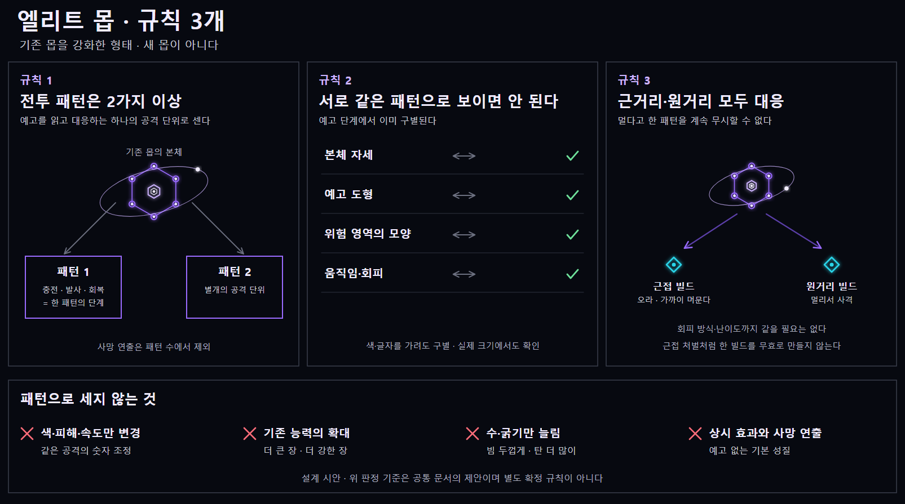
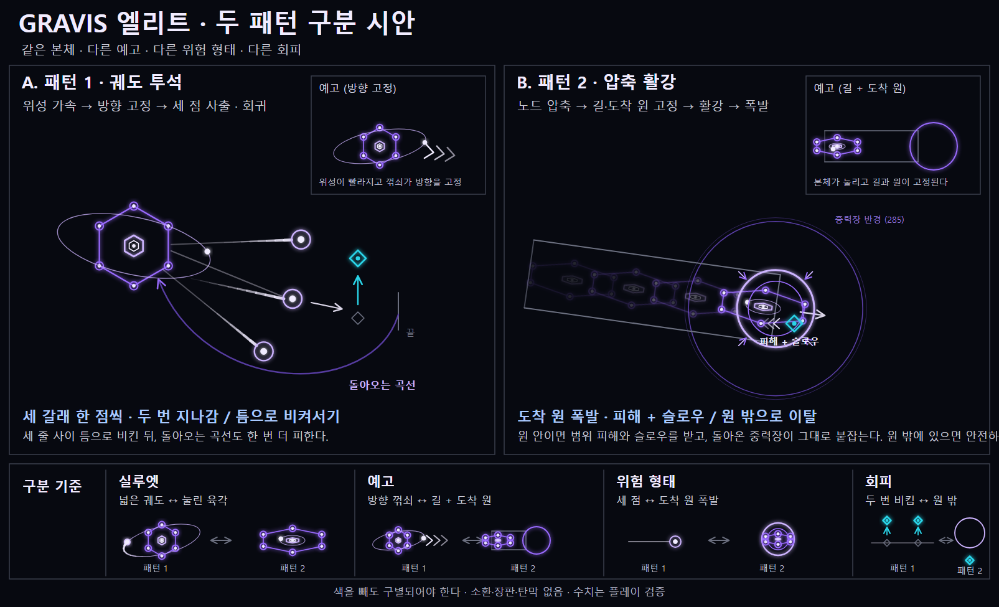
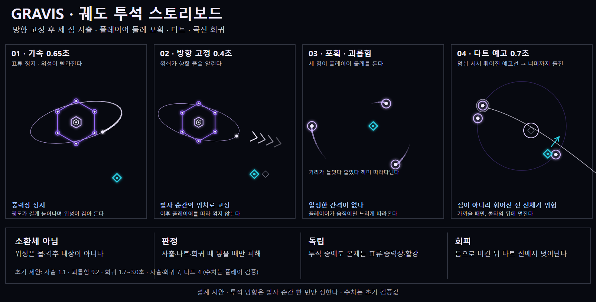
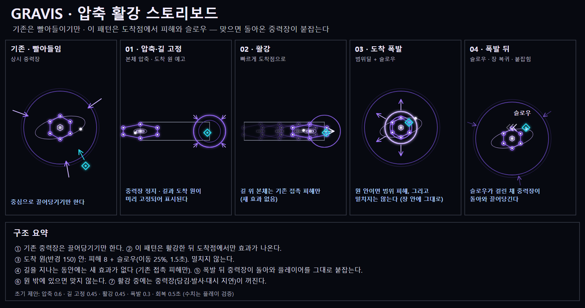
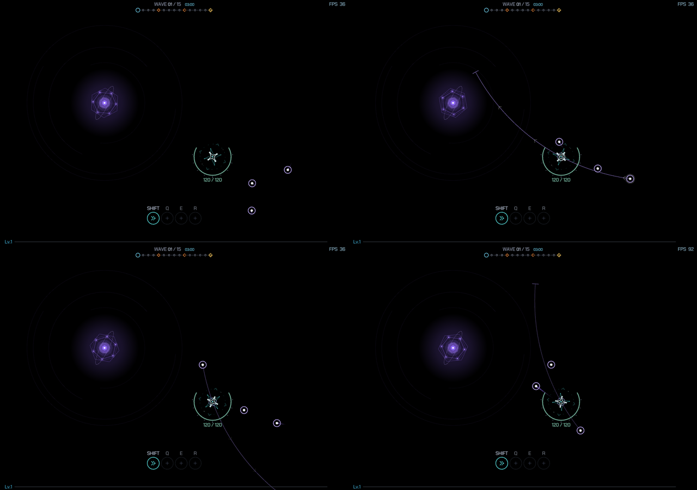
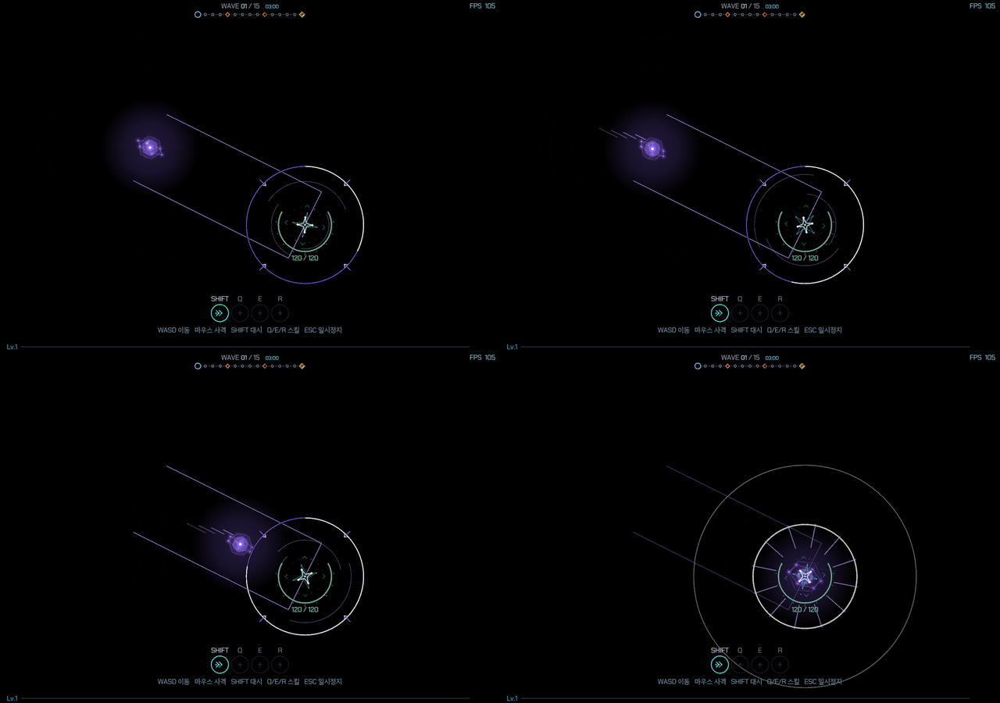

# GRAVIS 엘리트 — 궤도 투석 / 압축 활강

작성일: 2026-10-18 · 상태: 게임 적용 · 피해·시간·밀집도는 플레이 검증 대상

공통 규칙: [엘리트 몹 공통 규칙](Elite_Enemy_Rules.md)

이전 그라비스 시도([중력정 붕괴/조석 협착](Gravis_Elite_Design.md), [재구성탄·3종](Gravis_Aggregate_Design.md), [2페이즈](Gravis_Phase2_Design.md))는 반려·철회되었다. 이 설계는 그 안들과 무관하다. 장판·소환·재구성·부활·필드 강화를 쓰지 않는다.

## 역할 대비

그라비스의 기본 능력인 상시 중력장은 **끌어당기기만** 한다. 엘리트의 두 패턴은 그 능력과 맞물린다. 투석은 궤도의 위성을 밖으로 던져 플레이어를 괴롭히고, 활강은 도착점에서 피해와 슬로우를 주어 돌아온 중력장이 그대로 붙잡게 한다. 상시 중력장은 두 패턴으로 세지 않는다.

## 두 패턴 구별

시각 탐색용 이미지이며, 실제 규칙은 아래 설명과 코드가 기준이다.

| 항목 | 패턴 1 · 궤도 투석 | 패턴 2 · 압축 활강 |
|---|---|---|
| 본체 실루엣 | 궤도가 길게 늘어나고 위성이 감아 돈다 | 노드가 코어로 모이고 궤도가 오므라든 눌린 육각 |
| 예고 | 위성이 빨라진 뒤 진행 방향의 꺾쇠 | 길 윤곽과 도착 원 |
| 위험 형태 | 작고 밝은 세 점의 부채꼴, 이어서 플레이어 둘레를 헐겁게 도는 세 점과 멈춰 선 뒤 던지는 다트 | 도착 원의 폭발 |
| 회피 | 틈으로 비킨 뒤, 예고된 지점에서 계속 벗어나기 | 원 밖으로 이탈 |

## 공통 운용 — 두 패턴은 서로를 막지 않는다

그라비스는 **본체**와 **투석**이 따로 도는 두 개의 기계다. 투석이 진행되는 동안 투석을 제외한 모든 행동이 가능하고, 활강도 마찬가지다.

- 본체: 대기 1.8초 → 활강 → 대기 … (활강 약 3.0초)
- 투석: 대기 3.0초 → 투석 → 대기 … (투석 약 14초). 한 번 시작하면 끝날 때까지 두 번째 투석은 시작하지 않는다.
- 투석 중에도 본체는 표류하고 중력장이 켜져 있으며 접촉 피해를 주고, 활강을 시작할 수 있다. 위성이 플레이어를 괴롭히는 동안 본체가 활강해 도착 폭발을 일으킬 수 있다.
- 상시 중력장(당김·발사 지연·대시 회복 지연·탄환 편향)은 **본체의 활강 동작**(압축·길 고정·활강·폭발) 동안만 꺼지고 경계 표시가 흐려진다. 투석의 어느 단계도 중력장에 영향을 주지 않는다.
- 본체는 활강의 압축·길 고정·활강·폭발 동안만 가만히 있고, 그 밖에는 느리게 표류한다. 투석의 가속·고정·사출 동안에도 표류한다.
- HP·보상·스폰은 바꾸지 않는다. 사망하면 위성·길·원이 즉시 사라진다. 시간 정지는 게임 시간과 함께 정지한다. 본체 접촉 피해는 기존(초당 6)을 그대로 쓴다.

## 패턴 1 — 궤도 투석

| 단계 | 시간 | 동작 |
|---|---|---|
| 가속 | 0.65초 | 궤도가 늘어나 위성 3개가 빨라지고 꼬리가 굵어진다 |
| 방향 고정 | 0.4초 | 이 시작에 플레이어 위치를 읽어 방향과 사거리를 정한다. 세 갈래 각각 꺾쇠 3개가 뜬다 |
| 사출 | 1.1초 | 위성 3개가 고정 방향을 중심으로 약 ±20°씩 벌어져 직진한다. 출발점은 이 시점의 본체 위치다 |
| 괴롭힘 | 9.2초 | 위성이 던진 속도를 이어받아 플레이어 쪽으로 끌려와 헐겁게 도는 궤도를 돌고, 차례로 다트를 던진다 (아래) |
| 회귀 | 약 1.7~3.0초 | 위성이 본체로 관성의 큰 호를 그리며 돌아와 합류한다 (아래) |
| 회복 | 0.35초 | 세 위성이 궤도에 합류한 뒤 정리 |

- 사거리: 방향 고정 시점의 플레이어 거리 + 120, 360~900으로 제한한다. 아레나 경계에서 끊어도 플레이어가 선 위치보다 안쪽으로 줄이지 않는다.
- 사출 판정: 위성의 반경 26px 안에 플레이어 중심이 들어오면 피해 7, 위성마다 한 번씩. 이동 구간 전체를 훑어 검사한다.
- 위성은 몹도 격추 대상도 아니며 방향 고정 뒤에는 플레이어를 따라 꺾지 않는다. 세 줄 사이 틈이나 줄 밖으로 비켜서면 사출은 피한다.

### 괴롭힘 — 자연스러운 움직임

- 각 위성은 위치·속도를 가지며 스프링과 감쇠로 궤도 자리(slot)를 향해 끌려간다. 자리는 **느리게 따라오는 중심**(추종 속도 1.4/초) 둘레를 각속도 1.2rad/s로 돌고, 반경은 위성마다 위상이 달라 **110~260 사이를 오르내린다**. 플레이어가 달리면 중심이 뒤처져 궤도가 벌어진다. 가속도·속도에 상한이 있어 급하게 꺾이지 않는다.
- 던진 직후 위성은 사출의 운동량을 그대로 가진 채 끌려오므로 방향이 꺾이거나 튀지 않는다.
- **다트는 쿨타임과 거리 조건을 동시에 만족해야 던진다.** 위성마다 쿨타임(다트가 끝난 뒤 1.5초)이 지났고, 첫 예고는 0.9초에 위성 사이 0.7초 간격 이후이며, **위성과 플레이어의 거리가 340px 이하일 때만** 예고를 시작한다. 멀리 있는 위성은 던지지 않고 궤도로 계속 다가온다. 위성당 최대 4번, 괴롭힘이 끝나기 1.7초 전부터는 새 다트를 시작하지 않는다. 그래서 다트 횟수는 고정이 아니라 플레이어와의 거리에 따라 달라진다.
- **예고(0.6초)**: 위성에서 조준점을 지나 **휘어진 선**이 끝나는 곳까지 얇은 실선이 이어지고, 끝에는 짧은 마감선, 조준점에는 작은 원이 뜬다. 선 위로 꺾쇠가 끝을 향해 달린다. 조준점은 플레이어가 움직이면 속도에 약 0.3초를 곱한 만큼(최대 260px) **앞쪽**으로 잡는다. 정지한 플레이어에게는 정확히 그 위치다. **위성은 예고 동안 멈추지 않고 예고선 위에서 뒤로 당겨지는 준비 동작을 하며**, 당겨져도 선 위에 있으므로 그려진 선이 그대로 실제 비행 경로가 된다.
- **던지기**: 위성이 멈춰 있던 자리에서 예고된 **호**를 따라 간다. 곡률 반경은 760px이고 방향은 다트마다 번갈아 바뀐다. 가속은 빠르고 최고 속도는 초속 640px로 일정하다. 조준점에서 멈추지 않고 **조준점 너머로 450px를 더 나아간다**(아레나 가장자리에서 60px까지로 제한). 위험한 것은 한 점이 아니라 휘어진 선 전체이며, 선의 끝까지 날아간 뒤에야 끝난다. 조준점은 이후 플레이어를 따라오지 않는다.
- 던진 뒤에는 약한 가속도 상한으로 궤도 자리로 끌려가므로, 관성으로 크게 지나쳐 호를 그리며 돌아온다.
- 판정: 던져진 동안 선 위에서 위성의 반경 26px에 닿으면 피해 4, 다트당 1회. 궤도를 돌 때와 예고 중에는 피해가 없다. 선 위에 서 있으면 조준점에서만이 아니라 선 어디서든 맞는다.

### 돌아오는 움직임

- 괴롭힘이 끝나면 위성들은 **살아 있는 본체**를 향해 스프링으로 끌려간다. 현재 속도와 본체의 속도를 함께 반영해(본체가 표류·활강해도 따라간다) 고정된 경로 없이 속도가 이어지는 부드러운 호를 그린다. 위성마다 시작 위치와 속도가 달라 도착 시점이 다르다.
- 본체 30px 안에 들어오면 합류(dock)한다. 3초가 지나도 못 들어온 위성은 합류로 처리해 끝없이 쫓지 않는다. 세 위성이 모두 합류하면 회복으로 넘어간다.
- 돌아오는 동안에도 위성의 반경 26px에 닿으면 피해 7, 위성당 1회.

## 패턴 2 — 압축 활강

| 단계 | 시간 | 동작 |
|---|---|---|
| 압축 | 0.6초 | 노드가 코어로 모이고 본체가 활강 축으로 눌린다. 피해·표시 없음 |
| 길·원 고정 | 0.45초 | 이 시작에 플레이어 위치를 읽어 도착점을 정하고 길(폭 190)과 도착 원(반경 150)을 얇은 선으로 표시한다. 원주 진행선이 찬다 |
| 활강 | 0.45초 | 본체가 길을 따라 도착점까지 빠르게 이동한다. 가속 후 감속한다 |
| 도착 폭발 | 0.3초 | 도착 순간 원 안에 있던 플레이어에게 피해와 슬로우가 적용된다 (밀치지 않는다) |
| 회복 | 0.5초 | 중력장이 돌아온다. 폭발은 이미 끝났다 |

- 도착점: 고정 시점의 플레이어 위치. 길이는 거리에 맞추되 260~700으로 제한하고, 아레나 경계에서 92px 이상 안쪽으로 당긴다. 이후 길·원은 움직이지 않는다.
- 폭발은 원 안에서만: **피해 8, 슬로우(이동 속도 25% 감소, 1.5초)**. **밀쳐내지 않는다.** 폭발 직후 회복 단계에서 중력장이 돌아오므로 플레이어는 그라비스의 중력장 안에 그대로 있고, 당김·발사 지연·대시 회복 지연과 슬로우가 함께 걸린다. 밀쳐내면 중력장 능력이 쓸모없어진다는 피드백으로 넉백을 뺐다.
- 활강 중 길 위의 본체는 기존 접촉 피해만 준다. 안타레스의 돌진 밀치기와 겹치지 않도록 슬로우는 도착 폭발에만 붙인다.
- 대시 무적 중에는 슬로우를 무시한다(안타레스의 밀치기와 같은 경로). 피해는 기존 무적 처리가 막는다.
- 원 밖에 있으면 아무 일도 없다. 길 위에 서 있어도 폭발 범위 밖이면 피해가 없다.

## 속도와 범위 조정 (플레이 피드백, 2026-10-18)

첫 플레이에서 느리다는 의견이 있어 모든 단계를 약 35~50% 줄이고 대기를 3.0초에서 1.8초로 줄였다. 활강 폭발의 판정 반경을 100에서 150으로 넓혔다. 투석은 피하기 쉬워서 위성 3개를 부채꼴로 던지도록 바꿨다. 예고 시간이 짧아졌으므로 이동만으로 도착 원(반경 150)을 벗어날 수 있는지는 활강 고정 0.45초와 활강 0.45초 안에 이탈해야 하는 속도로 다시 계산해야 한다.

## 속도·길이 조정 2 (플레이 피드백)

투석 위성이 너무 빠르고 고리 간격이 일정해 부자연스럽다는 의견으로 사출을 0.6초에서 1.1초로, 회귀를 0.7초에서 1.2초로, 방향 고정을 0.4초로 늘렸다. 괴롭힘은 2.15초의 고정 고리에서 9.2초의 물리 궤도로 바꿨다. 한 번의 투석 시간은 약 12.9초가 되었다. 교대 대신 독립 진행으로 바뀌었다(위 공통 운용). 투석이 길어도 본체는 그동안 활강한다.

## 다트 개선 3 (플레이 피드백)

다트가 플레이어 중심으로 가서 거기서 멈추는 점 공격이라 피하기 쉽고 구조가 단순하다는 의견으로, 선을 조준점 너머 450px까지 연장해 선 전체를 위험하게 하고 움직이는 플레이어를 앞서 조준하도록 바꿨다.

## 다트 개선 4 (플레이 피드백)

궤도를 곡선으로 휘게 해 더 어렵게 했고, 플레이어와 아주 멀리 떨어진 위성이 다시 돌진을 시도하던 문제를 쿨타임과 거리 조건(340px 이하)으로 해결했다. 이전에는 고정 주기에 따라 거리와 상관없이 던졌다.

## 피드백 반영 5

- **위성의 죽음**: 그라비스가 죽을 때 밖에 나가 있던 위성(사출·괴롭힘·회귀 중)도 함께 죽는다. 위성이 각자의 위치에서 불꽃을 터뜨리고 선이 코어로 끌려 들어가며 사라지는 효과를 0.36초 동안 그린다(사망 연출 길이를 0.18초에서 0.40초로).
- **밀치기 삭제**: 활강 폭발은 피해와 슬로우만 준다.
- **중력장 가시성**: 경계선의 투명도(0.10 → 0.50)와 굵기(1.0 → 1.8)를 올리고 어두운 밑줄을 깔았으며, 안쪽 호의 투명도도 높였다.
- **위성의 준비 동작**: 다트 예고 중 위성이 멈춰 서면 느려 보인다는 의견으로, 멈추는 대신 **예고된 선을 따라 64px 뒤로 당겨졌다가** 팽팽한 상태로 안정되고(예고 시간의 80%), 예고선은 그대로 유지된다. 가늘게 당겨진 선, 조여드는 충전 호, 밝아지는 고리가 보인다. 예고 시간은 0.7초에서 0.6초로 줄였고, 발사는 초속 260px로 시작해 초속 640px까지 가속하는 새총 같은 방출이다.

## 같은 패턴으로 보이지 않게 하는 점검

- 색을 빼도 늘어난 궤도와 눌린 육각이 구별된다.
- 예고가 꺾쇠(방향)와 길·원(영역)으로 다르다.
- 위험이 작은 세 점이냐 큰 원이냐에 따라 화면에서 다르게 읽힌다.
- 회피가 두 번 비킴 대 원 밖 이탈로 다르다.
- 투석은 위성이 본체를 떠나고, 활강은 본체가 움직인다.

## 근거리·원거리 대응

- 투석 사거리와 활강 길이가 거리에 따라 늘어나 멀리 있어도 무시할 수 없고, 다트의 고리는 플레이어를 따라오므로 어디에 있어도 대응해야 한다.
- 활강의 도착 원은 예고되어 있으므로 오라 무기 사용자도 걸어서 피할 수 있다. 맞으면 피해와 슬로우를 받은 채 중력장 안에 남는다.

## 구현

| 파일 | 내용 |
|---|---|
| `WiNILL/Entity/Monster.h` | 상태 기계(`GRAVIS_*`), 투석·활강 잠금, 위성 궤적, 도착 폭발, 렌더용 보조 함수 |
| `WiNILL/Entity/GravisField.cpp` | 패턴 중 중력장 정지(`GravisFieldActive`) |
| `WiNILL/Entity/PlayerRuntime.*` | 플레이어 이동 슬로우 타이머 |
| `WiNILL/main.cpp` | 넉백·슬로우 적용, 스모크 단계 `GRAVISSLING` `GRAVISGLIDE` `GRAVISTEST` `GRAVISDUMP` |
| `WiNILL/Render/EntityDraw.cpp` | 본체 압축·궤도 늘어남, 꺾쇠·길·도착 원·폭발 그리기 |

## 검증

- `scripts/test_gravis_elite.ps1`: 교대 순서와 단계 시간(괴롭힘 2.15초 포함), 두 기계의 독립(투석 중 활강·표류·중력장)·괴롭힘 9.2초·궤도의 연속성과 거리 변화·느린 중심 추종·다트가 예고한 호를 벗어나지 않고 조준점을 지나 끝까지 돌진·호의 휘어짐·조준의 선행과 한계·쿨타임과 거리 조건(먼 위성은 예고하지 않음)·예고 중 준비 동작(선 위로만 당겨짐)·비행 중에만 피해·사망 시 위성도 함께 사라짐·돌아오는 호의 연속성과 합류, 필드 정지 구간, 투석 방향·사거리 고정, 한 번당 1회 피해와 회귀 곡선, 경계 보정, 활강 도착점 고정과 한계, 길 위 무해, 폭발 피해·슬로우(밀치지 않음)·폭발 뒤 중력장 복귀, 원 밖 안전, 사망 후 무동작.
- `scripts/test_gravis_elite_smoke.ps1`: 실제 게임 루프(Release 빌드)에서 괴롭힘 중 가만히 선 플레이어가 던지기와 다트에 맞고 중력장이 켜져 있으며 투석이 끝나면 대기로 돌아오고(스모크는 투석 시험 때 본체를 대기 상태로 고정하고, 활강 시험 때 투석을 고정한다), 활강 폭발이 피해와 슬로우를 주고 플레이어를 285px 밖으로 밀어내며, 슬로우가 풀리고 중력장이 돌아오는지 확인한다.
- 기존 `test_gravis_field` `test_quasar_*` `test_genesis_rotor` `test_mob_death_fx` `test_reg01_kill_rewards` `test_thrown_swarm_kill` `test_kill_lifesteal` 통과.
- 실제 화면: [투석 단계별](QA/Gravis_Elite/Sling_ContactSheet.png) · [활강 단계별](QA/Gravis_Elite/Glide_ContactSheet.png). 재현은 `ONEDOW_SMOKE="RUN~0.3;GRAVISSLING=3.6~0.15;GRAVISGLIDE=1.6~0.15"`와 `ONEDOW_SMOKE_SIZE=1280x900`이다.

## 검토할 장면

1. 정전기장(오라) 빌드가 근접 상태에서 회귀 곡선과 활강 폭발을 걸어서 피할 수 있는가.
2. 제네시스 로터·퀘이사 낙하와 섞였을 때 위성 세 점·도착 원이 구별되는가.
3. 그라비스 두 마리가 겹칠 때 안전 동선이 남는가. 슬로우와 중력장 당김이 겹쳐 빠져나오지 못하는 구간이 생기지 않는가.
4. 맵 가장자리에서 활강 도착 원과 위성의 선이 화면 밖으로 치우쳐 읽히지 않는 일이 없는가.
5. 실제 줌과 혼잡도에서 꺾쇠와 도착 원 윤곽이 읽히는가. 수치는 확정 밸런스가 아니다.

## 이미지 제작 기록

설계 이미지는 게임의 선 규칙(선만 사용, 채운 면·점선 없음)에 맞춰 SVG를 직접 작성하고 헤드리스 브라우저로 PNG를 만들었다. 퀘이사 비교 보드의 편집 구조를 따랐으며 그 몹의 외형은 복사하지 않았다. 그림의 크기·선 두께는 실제 월드 px가 아니다. 실제 캡처는 Release 빌드의 스모크 단계로 얻었다.
