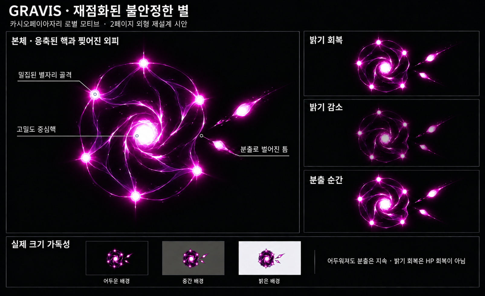
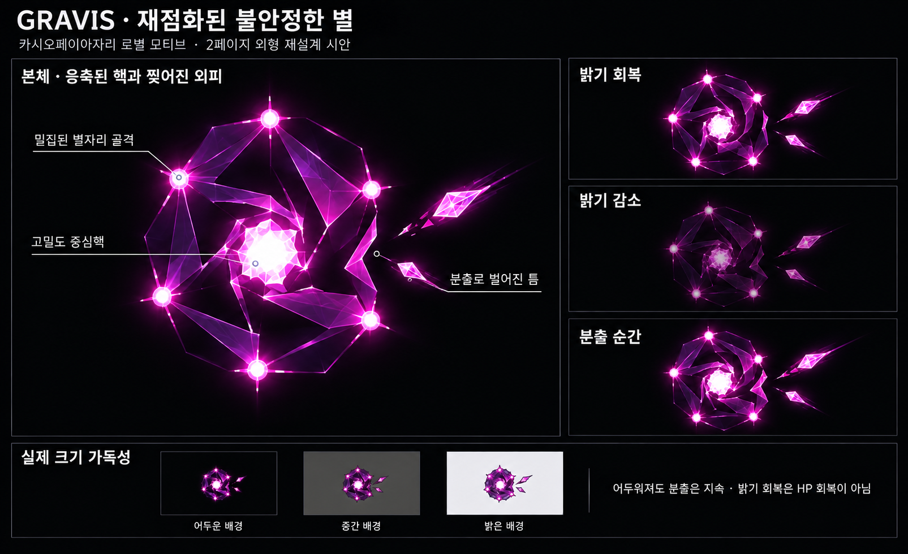
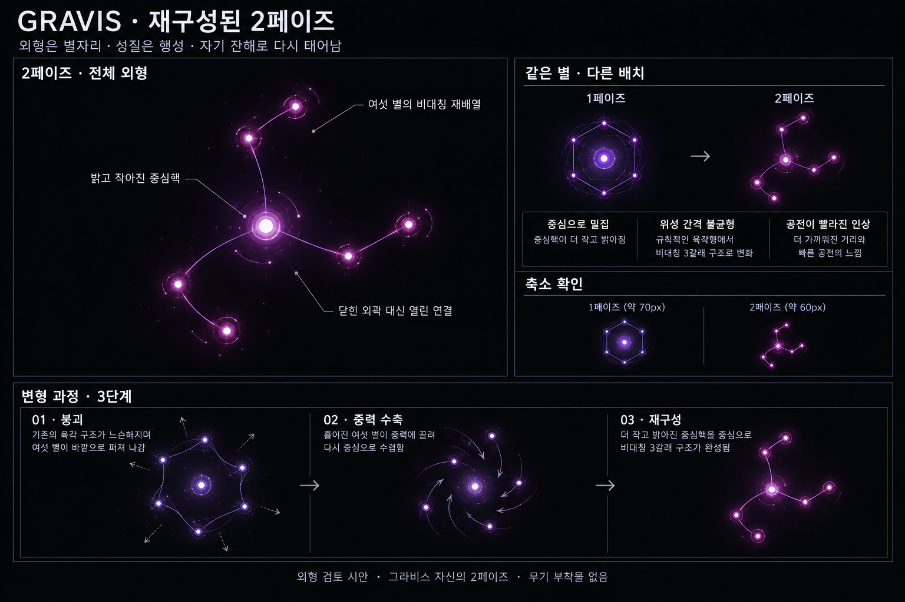
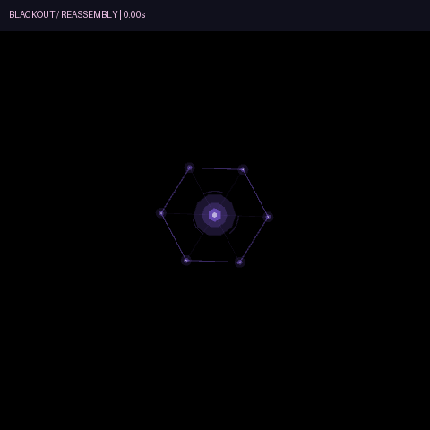
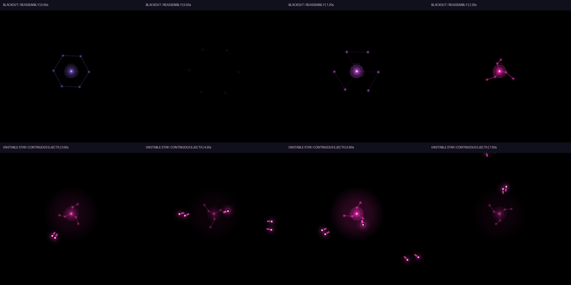
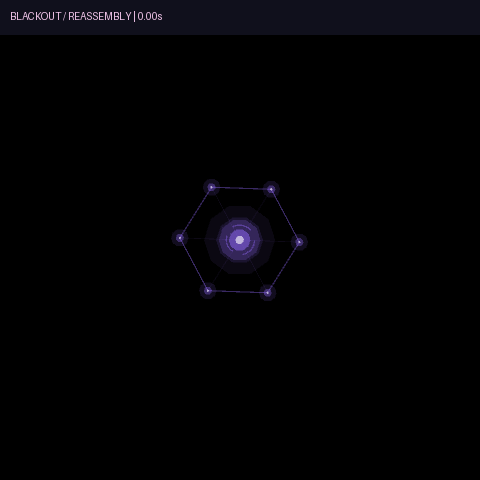
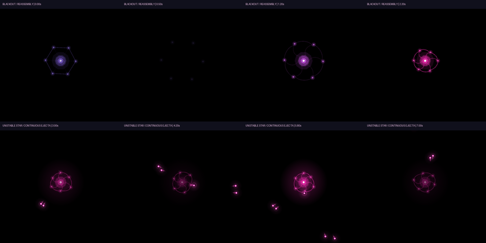

# GRAVIS — 재구성된 2페이즈 외형 시안

작성일: 2026-10-18 · 상태: 사용자 요청으로 2페이즈 구현 철회 / 기존 그라비스 복구·Release 빌드·회귀 검사 완료

## 철회 기록 — 2026-10-18

사용자 요청에 따라 부활·2페이즈·밝기 맥동·분출탄·변경 외형을 게임에서 제거하고 기존 그라비스의 외형·중력장·단일 사망·처치 보상을 복구했다. 아래 시안과 캡처는 철회된 실험의 기록이며 현재 게임의 동작이 아니다.

## 최신 수정 — 크리스탈 인상 제거 (v3)

사용자는 v2에서 디자인을 조금만 줄이고, 특히 크리스탈 느낌을 제거하도록 요청했다. 전체 밀도·실루엣·자주색은 유지하고 삼각 결정 면은 곡선형 발광 필라멘트로, 결정형 핵은 둥근 항성 핵으로, 파편 탄은 작은 빛 덩어리로 수정했다. 내장 image_gen으로 편집한 시안이며, 사용자의 적용 요청에 따라 아래 v3 게임 외형으로 옮겼다.

[생성 프롬프트](Concepts/Gravis_Phase2_StellarEnvelope_ImagePrompt_v3.md)

## 최신 외형 피드백과 재설계

기존 게임 구현의 세 갈래·일곱 점 외형은 사용자가 강하게 반려했다. 아래 구현·검증 기록은 기능 프로토타입의 이력이며 외형 승인 기록이 아니다.

새 시안은 중심 가까이에 밀집한 별자리 골격, 고밀도 핵, 틈이 벌어진 비대칭 외피, 그 틈에서 떨어져 나오는 분출 물질을 표현한다. 연속 분출과 독립적인 밝기 감소·회복이라는 합의는 유지한다. 현재 게임 코드에 새 외형을 적용하지 않은 이미지 검토안이다.

이 이미지는 내장 image_gen으로 만든 시안이다. 확대 본체와 상태별 그림의 노드 수·정확한 위치가 완벽히 일치하는 구현 명세는 아니다. 실제 제작에서는 여섯 노드의 연속성을 유지해야 한다. 기존 구현보다 밀도와 외피의 파열이 읽히는지 검토한다.

[생성 기록](Concepts/Gravis_Phase2_RupturedStar_ImagePrompt_v2.md)

## 현재 선택한 모티브 — 카시오페이아자리 로별

사용자는 **카시오페이아자리 로별(Rho Cassiopeiae)**을 모티브로 선택했고, ‘죽었는데도 살아났다’는 강한 인상을 원한다. 실제 로별에서는 반복적인 분출과 밝기 감소·회복이 관측된다. 2013년 분출 연구는 불안정한 대기와 짧고 격렬한 질량 방출, 온도·밝기 하락을 설명한다. 이는 실제 사망 후 부활이 관측됐다는 뜻이 아니다. 게임에서는 **소광 → 재점화 → 불안정한 분출**로 각색한다.

근거: [Anugu et al., 2024 — CHARA imaging of Rho Cassiopeiae](https://arxiv.org/abs/2408.02756), [Kraus et al., 2018 — A new outburst of Rho Cas](https://arxiv.org/abs/1812.03065).

### 전환의 목표

플레이어가 **평소의 처치 연출이 끝났다고 받아들인 뒤**, 꺼졌던 빛과 흩어진 자기 잔해가 다시 모이는 장면을 보여준다. 살아 있던 핵을 처음부터 계속 밝게 표시하면 강한 부활 인상이 약해진다. 눈에 보이는 중심 광원도 짧게 완전히 꺼지는 구간을 제안한다.

### 죽음과 재점화 — 연출 초안

| 순서 | 시간 제안 | 본체·소리·동작 | 의도 |
|---|---|---|---|
| 1. 죽음 | 약 0.35초 | 평소 사망 때처럼 연결이 끊기고 별들이 밖으로 흩어짐. 코어 광원과 중력장 소멸 | 익숙한 처치의 증거 |
| 2. 소광 | 약 0.45초 | 중심의 빛이 완전히 꺼지고 약한 잔해만 표류. 해당 개체의 저음·회전음도 멎음 | 끝났다고 느낄 짧은 공백 |
| 3. 첫 맥동 | 약 0.25초 | 원래 사망 위치에서 아주 작은 빛이 한 번 점멸. 바깥으로 가던 잔해가 멈추고 안쪽으로 방향을 바꿈 | 스스로 살아나기 시작했다는 첫 증거 |
| 4. 재구성 | 약 0.6초 | 같은 별들이 원래 위치로 돌아오는 대신 새로운 간격·배치로 결속. 별별로 점등하고 중심이 다시 밝아짐 | 같은 개체의 부활과 변화 |
| 5. 불안정한 생존 | 약 0.7초 | 재구성 완료 뒤 몸체가 한 번 크게 팽창·수축하며 빛이 고르지 않게 맥동. 이 구간 뒤 첫 공격 허용 | 살아났고 전투 성질도 바뀌었다는 확인 |

시간은 검토용이며 실제 화면에서 조정한다. 다른 몹과 플레이어를 강제로 멈추거나 화면 전체를 가려 전환을 보여주지는 않는다. 재점화 위치를 유지하고 잔해의 방향 전환으로 시선을 유도한다. 전환 중에는 당김·폭발·접촉 피해를 끈다. 재구성 완료가 읽히기 전에 바로 피해를 주지 않는다.

### 2페이즈의 능력 방향 — 불규칙 연속 분출과 밝기 맥동

사용자 지정: **불규칙한 방향으로 계속 분출하며, 동시에 본체의 밝기 감소·회복이 교차한다.** 긴 충전 뒤 한 번 공격하고 쉬는 구조보다, 부활 이후 불안정한 별이 자기 물질을 계속 내뿜는 인상을 목표로 한다.

| 요소 | 방향 |
|---|---|
| 분출 | 짧은 물질 분출이 긴 휴지기 없이 이어진다. 분출 위치·방향이 매번 달라진다. |
| 밝기 | 중심핵·후광·연결선이 서서히 어두워졌다가 다시 밝아진다. 길이가 조금씩 다른 감소·회복 구간을 검토한다. |
| 두 동작의 관계 | 밝아지는 동안에도 어두워지는 동안에도 분출은 지속된다. 밝기 회복이 공격 재개 신호가 되는 고정 교대는 만들지 않는다. |
| 본체 움직임 | 밝기 변화에 약한 팽창·수축과 노드 간격 흔들림을 더해 불안정을 보여주는 안을 검토한다. |
| 공격 가독성 | 본체가 어두워져도 이미 발사한 물질의 흰 중심·자주색 잔광은 유지한다. |

#### 분출과 대응 — 구체화 제안

- 외곽의 한 부분이 짧게 밝아지거나 부풀고, 그 방향으로 작은 빛점·물질 묶음이 떨어져 나간다. 공격 방향의 국소 점등과 본체 전체의 느린 밝기 맥동은 구별한다.
- 분출 방향은 고정 순환이나 계속되는 플레이어 추적 조준으로 제한하지 않는다. 매 분출마다 새 방향을 정하는 안으로 시작한다.
- 방출된 공격체는 발사 후 정해진 방향으로 이동한다. 비행 중 플레이어에게 갑자기 꺾여 들어오지 않는다. 불규칙성은 주로 본체의 방출 위치와 방향에서 만든다.
- 한 번에 넓은 전방위를 채우기보다 적은 수의 작은 분출을 이어가고, 플레이어가 실제 공격체 사이로 이동할 틈을 유지한다. 발사체 수·간격·속도·수명·피해량은 플레이 검증 전 확정하지 않는다.
- 밝기가 낮아지는 구간에도 중심 위치와 본체의 최소 윤곽은 읽히게 한다. 완전한 소광은 앞의 부활 전환에 사용하고, 전투 중에는 공격의 발사 위치를 잃지 않게 한다.
- 밝기 회복은 광원의 회복을 뜻한다. HP 회복·무적·피해 배율 변화는 이번 합의에 포함하지 않는다.
- 피해는 실제로 이동하는 분출 물질에만 연결한다. 밝아지는 순간 본체 주위에 보이지 않는 폭발 판정을 만들거나 바닥 장판을 추가하지 않는다.

이 전체 구조는 우선 하나의 연속 분출 패턴이다. 밝기 감소와 회복을 각각 별도의 전투 패턴으로 세지 않는다. 두 번째 독립 패턴과 1페이즈에서의 능동 공격은 후속 검토한다.

### 전환·보상 원칙 — 구현 전 제안

- 재구성은 개체당 한 번이며 2페이즈에서 다시 쓰러뜨리면 최종 처치한다.
- 1페이즈 소진 시 XP·점수·별가루·처치 수·흡혈·웨이브 완료를 먼저 지급하지 않는다. 최종 처치에서 한 번 처리한다.
- 부활 전환 중 같은 잔해에 추가 피해를 넣어 보상이나 사망 처리가 중복되지 않도록 한다. 새 웨이브에서 다른 몹으로 재생성하는 방식보다 기존 개체의 연속성을 유지한다.
- 아래 비대칭 여섯 별 이미지는 이전 외형 탐색이다. 로별의 팽창·수축·외피 분출 동작이 읽히는지 검토하기 전 최종 외형으로 확정하지 않는다.

## 이전 외형 탐색 기록

아래 이미지는 로별 모티브·연속 분출 방향을 정하기 전에 만든 외형 시안이다. 현재 능력에 맞춘 최종 외형이나 공격 그림은 아니다.

## 디자인 방향

사용자 제안인 ‘외형은 별자리, 특성은 행성’과 ‘죽을 때 재구성되어 다른 외형으로 변하는 2페이즈’를 바탕으로 그라비스 자신의 두 번째 몸체를 디자인한다. 이전에 철회한 재구성탄·하위 몹 흡수·새 몹 3종의 구현을 다시 적용하는 작업이 아니다. 이전 외형 탐색을 보존하고, 아래 구현 기록을 현재 게임 동작의 기준으로 사용한다.

## 재구성된 본체

- **밝고 작은 중심핵:** 원래 중심핵이 더 높은 밀도로 모인 모습이다. 작은 흰 중심과 자주색 후광으로 질량의 중심을 보여준다. 불투명한 행성 표면이나 기계 외피는 만들지 않는다.
- **기존 여섯 별 재배치:** 원래 육각 배치의 여섯 노드를 자기 잔해로 사용한다. 핵을 포함해 별 일곱 점으로 읽힌다. 새 별을 무한히 추가하거나 별도 소환 유닛으로 분리하지 않는다.
- **세 개의 불균형한 가지:** 두 별씩 연결된 세 가지가 서로 다른 방향·간격으로 뻗는다. 기존의 정육각 외곽은 풀리고 열린 연결선이 생긴다. 이 배치는 새 검토 시안이며 확정 외형은 아니다.
- **행성의 성질:** 주변 별들이 중심핵에 묶여 있다는 느낌을 짧고 옅은 공전 흔적과 중심 쪽으로 모인 배치로 표현한다. 완전한 원형 고리를 여러 겹 둘러 기계 장치처럼 만들지 않는다.
- **색과 크기:** 자주색을 유지하고 1페이즈보다 약간 조밀하게 잡는다. 이미지의 70px·60px는 축소 가독성 예시이며 실제 게임 반경이나 충돌 크기 확정값은 아니다.

## 변화 과정

1. **붕괴:** 1페이즈 HP 소진을 계기로 기존 연결이 느슨해지고 여섯 별이 잠깐 바깥으로 흩어진다. 중심핵은 희미하게 남는다.
2. **중력 수축:** 핵이 다시 밝아지고 흩어진 별들을 자기 중심으로 끌어모은다. 같은 별들이 다시 모이는 연속성이 중요하다.
3. **재구성:** 모인 별들이 새 위치에 자리 잡고 열린 별자리로 연결된다. 색만 바꾸는 전환이 아니라 배치·중심 밀도·움직임이 바뀐다.

보드의 작은 스토리보드는 흐름을 설명하는 생성 이미지다. 실제 애니메이션에서는 가림이 있더라도 여섯 노드의 개수와 이동 연속성을 유지해야 한다.

## 후속 검토

본체의 비대칭 배치가 별자리와 행성의 인상을 함께 주는지, 실제 크기에서도 핵과 여섯 별이 읽히는지 먼저 확인한다. 공격 방식·전환 시간·2페이즈 HP·피해·보상 수치는 이번 외형 작업에서 확정하지 않는다. 사망 시 재구성이 한 번 일어나고 최종 처치에서만 보상을 지급하는 흐름은 이전 제안이며 구현 전 별도로 명세한다.

## 이미지 생성 기록

내장 `image_gen`으로 생성했다. [프롬프트 원문](Concepts/Gravis_Phase2_ImagePrompt_v1.md). 기존 그라비스 실제 캡처는 본체 정체성과 게임의 선 표현을, 퀘이사 비교 보드는 편집 구조를 참고했다. 철회된 몹 3종의 외형을 재사용하지 않는다.

## 게임 구현 — 2026-10-18

- 기존 그라비스 개체 안에서 `1페이즈 → 소광·재조립 → 2페이즈`로 전환한다. 별도 몹 종류나 흡수·소환 시스템은 추가하지 않는다.
- 첫 HP 소진 뒤 2.35초 동안 움직임·접촉 피해·중력장·피해 수신을 멈춘다. 기존 여섯 별이 흩어지고, 0.25~0.80초 사이 중심핵이 완전히 꺼진다. 0.80초부터 재점화하고 1.05~1.65초에 밀집된 여섯 별과 곡선 외피로 재조립한다.
- 부활 HP는 생성 당시 1페이즈 최대 HP의 65%다. 진행도 HP 배율도 적용된다. 전환은 한 번뿐이며, XP·점수·별가루·흡혈·처치 수는 최종 처치에서 한 번만 지급한다.
- 2페이즈는 자주색 핵과 여섯 별, 열린 연결선과 끊긴 외피로 표현한다. 원래 중력장·시간 지연·탄도 왜곡은 종료한다. 접촉 피해는 전환 완료 뒤 기존 초당 6을 유지한다.
- 0.24~0.50초 간격으로 외곽 별 하나에서 물질 두 조각을 내보낸다. 발사점과 바깥 방향을 매번 새로 고른다. 발사 직전 0.18초 동안 해당 별이 부풀고 짧은 방향 표시가 나타난다. 바닥 장판은 없다.
- 조각 속도는 220~290px/s, 개당 피해는 6, 최대 이동 거리는 1050px다. 방향은 발사 후 고정되며 다른 그라비스의 중력장도 꺾지 않는다. 최종 처치 뒤 이미 나온 조각은 사거리 소진까지 남는다.
- 본체 밝기는 분출과 독립적으로 감소·회복한다. 전투 중 최저 밝기는 24%이며 HP 회복·무적·피해 배율 변경이 없다. 발사체는 본체 밝기와 무관하게 흰 중심과 자주색 잔광을 유지한다.
- 수치와 외형은 첫 플레이 검토용이다. 분출은 하나의 연속 공격으로 센다. 엘리트의 ‘서로 다른 능동 패턴 2개’ 규칙 충족을 위해 별도 패턴을 확정한 상태는 아니다.

검증: `scripts/test_gravis_phase2.ps1`에서 첫 사망·보상 보류·소광·전환 무적·화상 사망·한 번의 부활·밝기 양 구간 분출·방향 변화·탄도 고정·유한 사거리·최종 보상 중복 방지를 검사한다.

### 실제 게임 화면

- Release 실행 파일: `build/windows/x64/Release/WiNILL.exe`
- 실제 렌더 캡처 71장: 소진 직후부터 7초까지 0.1초 간격. 고정 시뮬레이션 간격 1/120초. GIF는 실제 캡처를 잘라 연결하며 중간 프레임을 합성하지 않는다.
- 재현: `ONEDOW_SMOKE`에서 `GRAVISREBIRTH=<소진 후 경과 초>~0.02`, `ONEDOW_SMOKE_SIZE=1280x900`, `ONEDOW_SMOKE_TAG=gravis-phase2-final`을 사용한다.
- 합성 스크립트: `python scripts/preview_gravis_phase2.py build/windows/x64/Release/Screenshots Docs/QA/Gravis_Phase2/final --tag gravis-phase2-final`.
- 통과: Gravis Phase2 / Gravis Field / Genesis Rotor / Quasar Fall / REG-01 Kill Rewards / Mob Death FX. 기존 `APIENTRY` 재정의 경고는 남아 있다.
- 검증 범위는 기능 회귀와 고정 장면 렌더다. 실제 전투에서의 난이도·빈도·다수 개체 압박은 플레이 조정이 필요하다.

## v3 항성 외피 게임 적용

사용자 선택: `Gravis_Phase2_StellarEnvelope_v3.png`. 시안의 색·응축된 덩어리·곡선형 외피·둥근 핵·빛 덩어리 분출탄을 게임 렌더로 구현한다.

- 여섯 별을 기존 세 갈래 배치에서 핵 주변의 비대칭 외곽 배치로 변경했다. 기존 노드 좌표 함수를 공유하여 재조립 위치와 실제 발사점이 일치한다.
- 여섯 외곽 곡선과 핵 쪽으로 휘는 여섯 필라멘트가 외피를 만든다. 발사 직전 해당 부근 외피가 옅어지고 안쪽 빛줄기가 두꺼워지며 틈을 표현한다. 결정 면·다이아몬드·삼각 파편은 사용하지 않는다.
- 중심은 기존 둥근 광원 렌더를 재사용한다. 분출탄은 둥근 흰 중심과 짧게 가늘어지는 자주색 꼬리로 그린다.
- HP·피해·간격·사거리·첫 사망 후 부활·최종 보상 규칙은 유지한다.
- 구현 변경 범위: `WiNILL/Entity/Monster.h`의 노드 배치, `WiNILL/Render/EntityDraw.cpp`의 본체·분출탄 렌더.

### v3 실제 게임 검증

- `scripts/test_gravis_phase2.ps1` 통과. Release 빌드 성공. 빌드 로그: `build/gravis_envelope_v3_build.log`.
- 실제 실행 파일에서 0~7초를 0.1초 간격으로 71장 캡처하고, 소광·재조립·밝은/어두운 상태·분출탄을 확인했다. 캡처 프로세스 종료 코드 0.
- 재현 태그: `gravis-envelope-v3`. 미리보기 생성: `python scripts/preview_gravis_phase2.py build/windows/x64/Release/Screenshots Docs/QA/Gravis_Phase2/envelope-v3 --tag gravis-envelope-v3`.
- 실행 파일: `build/windows/x64/Release/WiNILL.exe`. 이미지 시안을 게임 크기의 선·곡선·광원으로 옮긴 결과이며, 생성 이미지 자체를 스프라이트로 사용하지 않는다.

### 기존 그라비스 복구 검증

- 2페이즈 작업 전 스냅샷과 비교하여 Monster / MonsterManager / Bullet / CollisionSystem / GravisField / EntityDraw / Codex / main의 내용이 모두 동일함을 확인했다. 제네시스·퀘이사의 선행 변경도 보존되어 있다.
- Gravis Field 검사 통과. 첫 HP 소진 즉시 사망하고, 시간이 지나도 부활하거나 분출탄을 발사하지 않는 검사를 추가했다. Genesis Rotor / Quasar Fall 회귀 검사도 통과했다.
- 철회된 2페이즈 전용 테스트·실행 스크립트는 제거했다. 시안과 실제 캡처는 이력으로 보존한다.
- Release 빌드 성공: `build/windows/x64/Release/WiNILL.exe`. 빌드 로그: `build/gravis_restore_build.log`.
