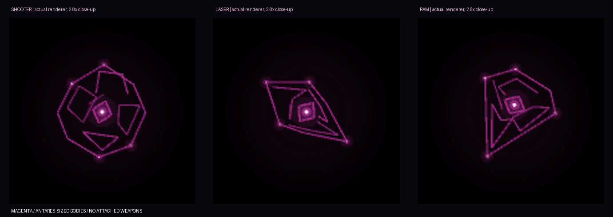

# GRAVIS — 재구성탄과 재구성 몹 3종

작성일: 2026-10-18 · 상태: 구현 철회 / 이전 구현 과정 기록

사용자 요청으로 재구성탄과 재구성 몹 3종의 게임 코드를 되돌렸다. 아래 수치·화면·검사·스모크 설명은 철회 전 기록이며 현재 게임 기능이 아니다. 컨셉 이미지는 보관한다.

사용자가 선택한 [본체 디자인](Concepts/Gravis_Reconstructed_BodyOnly_v2.png)을 기존 선·코어·노드 렌더러로 구현했다. 자주색, 별도 포구·레일 없는 한 덩어리의 몸체, 안타레스 정도의 크기를 유지한다. 생성 이미지의 결정 표면·광택을 텍스처로 가져오지 않고 실제 게임의 선 표현을 사용한다. 위 그림은 실제 1280×900 게임 캡처의 본체 부분을 2.8배 확대한 QA 자료다.

## 재구성탄

- 그라비스는 살아 있는 동안 7초마다 한 발을 발사한다. 발사할 때 플레이어 위치를 읽어 목적지로 고정한다. 비행 중 재추적하지 않는다.
- 비행 속도 기준은 420px/s이며, 거리에 따라 비행 시간을 0.3–2.8초로 제한한다. 탄은 실제로 출발점에서 목적지까지 이동한다.
- 흡인 반경은 520 월드 px다. 바닥의 큰 원 대신 탄 중심의 압축 코어·회전 호·넓게 들어오는 가는 입자 흐름을 사용한다.
- 주변 몹은 중심에 가까울수록 이동 속도가 최대 70% 감소한다. 흡수 가능한 몹은 최대 440px/s의 당김을, 상위 몹은 최대 100px/s의 당김을 받는다. 당김은 탄과 함께 이동한다. 발사자인 그라비스는 자신의 탄에 끌려가지 않는다.
- 중심 27px까지 모인 로터·스웜·짐벌을 실제 흡수한다. 스코프는 현재 2.5티어, 안타레스는 3티어이므로 재료에서 제외한다. 상위 몹과 다른 재구성 몹도 감속·흡인은 받지만 소비되지 않는다.
- 목적지에 도착한 뒤 2초간 더 모으고, 실제 흡수한 재료가 있으면 한 개체로 재구성한다. 흡수 상한은 따로 두지 않아 레이저형의 19마리 조건을 수용한다. 재료가 없으면 몹을 생성하지 않는다.
- 플레이어도 탄 쪽으로 약하게 당겨진다. 기존 그라비스 장과 여러 탄의 당김을 합친 최종 당김을 플레이어 이동 속도의 55% 이하로 제한한다. 대시 중에는 당김을 적용하지 않는다.
- 도착 후 플레이어가 중심 45px 안에 있으면 당김을 끄고 0.45초간 코어를 팽창시킨 뒤, 반경 82px에 한 번 10 피해를 준다. 팽창 중 범위에서 벗어나면 피할 수 있다. 바닥 피해 예고·잔류 장판은 없다.
- 이 폭발은 플레이어와의 상호작용이며, 이미 흡수한 몹의 재구성도 함께 완료한다. 폭발로 재료만 사라지게 하지 않는다. 그라비스를 먼저 처치하면 진행 중인 탄·흡인·폭발·미완성 재구성은 즉시 취소한다. 이미 완성된 재구성 몹은 독립적으로 남는다.

기존 그라비스 본체의 중력장·발사 지연·대시 회복 지연·탄도 편향은 유지한다. 새로운 탄의 흡인은 발사 지연이나 대시 회복 지연을 추가로 중첩하지 않는다. 시간 정지 중 탄·흡수·신규 공격은 정지한다.

## 생성 조건

재구성 한 번에 실제 흡수한 몹을 집계하고, 다음 순서로 하나를 선택한다.

| 우선순위 | 조건 | 결과 |
|---|---|---|
| 1 | 사격계열 5마리 이상 AND 근접계열 14마리 이상 | 레이저형 |
| 2 | 사격계열 4마리 이상 | 사격형 |
| 3 | 나머지 조합 | 돌진형 |

현재 흡수 가능한 사격계열은 **짐벌**, 근접계열은 **로터·스웜**이다. 5+14와 6+14는 모두 레이저형, 5+13과 4+14는 사격형, 3+14는 돌진형이다.

## 새 몹 3종

세 종류 모두 `sizeScale=1.6`, 바깥 윤곽은 최대 약 1.4×base로, 안타레스의 본체 크기를 기준으로 한다. 별도 무기·위성을 붙이지 않고 내부 프레임 배치와 외곽을 구별한다. 0.45초간 응축되어 나타나며, 이 동안 공격하지 않는다. 기존 자연 스폰 후보에는 추가하지 않았다.

| 종류 | 본체 | 공격 | 초기 동작값 |
|---|---|---|---|
| 사격형 | 사각 프레임이 눌려 붙은 뭉툭한 결합체 | 몸체 압축 후 자주색 탄환 3발 | 준비 0.7초, 약 0.18초 간격, 탄속 560px/s, 1발 8 피해 |
| 레이저형 | 중심축을 따라 길어진 내부 프레임 | 준비 시작에 고정한 축으로 단방향 레이저 | 잠금 0.9초, 발사 0.28초, 길이 900px, 한 시전 1회 12 피해 |
| 돌진형 | 삼각 프레임이 맞물린 쐐기 몸체 | 준비 시작에 고정한 방향으로 본체 돌진 | 준비 0.7초, 돌진 0.5초·680px/s, 한 시전 1회 12 피해 |

사격형은 각 발사 시 현재 위치를 조준하며 유도하지 않는다. 레이저형·돌진형은 잠금 이후 방향을 바꾸지 않는다. 레이저 판정은 선분, 돌진은 이전 위치부터 다음 위치까지의 스윕으로 검사한다. 돌진이 맵 경계에 닿으면 회복으로 들어간다. 레이저와 돌진에는 기존 플레이어 피해·보호막·대시 처리 경로를 사용한다.

기본 HP는 360이고 흡수 재료의 HP 진행 배율을 참고해 올린다. 재료 수로 크기·부품 수·발사 수를 늘리지는 않는다. 준비 중 코어 점등과 몸체 수축으로 공격을 알린다. 세 종류 모두 별도 결합 장갑 25%나 옛 ‘결합 파쇄’ 능력은 사용하지 않는다.

## 보상과 수명

흡수는 플레이어의 처치가 아니므로 점수·XP·별가루·흡혈·죽음 폭발·처치 도감을 지급하지 않는다. 흡수한 객체는 무해하게 정리하고, 여러 그라비스가 같은 재료를 중복 소비하지 않는다.

완성된 새 몹은 일반 피해·처치·도감 경로에 연결했다. 기본 보상은 XP 6, 점수 300, 별가루 3이다. 재료가 모두 제네시스 소환체였을 때는 제네시스 소환체와 동일하게 점수·XP·별가루·흡혈·런 처치 수를 지급하지 않는다. 재구성 몹은 재흡수되지 않아 연쇄 재구성으로 보상을 불리는 경로도 없다. 도감의 기존 저장 인덱스는 유지하고 새 3종을 뒤에 추가했다.

## 검증과 실제 화면

- `scripts/test_gravis_reconstruction.ps1`: 3종 선택과 5·14 경계, 레이저 우선, 7초 주기, 고정 목적지, 빈 재료, 흡수 정리, 상위 몹 제외, 재흡수 방지, 발사자 사망, 폭발 회피·1회 피해, 플레이어 흡인 상한·대시, 새 3종 공격, 중복 흡수·보상 경로.
- 기존 그라비스 장·제네시스 로터·퀘이사 폭격·소환체 보상·REG-01 처치 보상 검사.
- Windows x64 Release 빌드 및 실제 실행 캡처. 기존 `APIENTRY` 재정의 경고는 유지된다.
- 스모크 단계 `RECON=<초>`로 세 본체와 공격을, `GRAVISORB=<초>`로 5짐벌+14로터의 흡수·레이저형 탄생을 재현한다. 1280×900, 시드 1234로 캡처했다.
- [세 본체 실제 화면](QA/Gravis_Reconstruction/v1/gravis-reconstruction-v1_KR_01_RECON=0.png), [공격 실제 화면](QA/Gravis_Reconstruction/v1/gravis-reconstruction-v1_KR_03_RECON=1.25.png), [흡인 진행](QA/Gravis_Reconstruction/v1/gravis-reconstruction-v1_KR_05_GRAVISORB=2.png), [레이저형 탄생](QA/Gravis_Reconstruction/v1/gravis-reconstruction-v1_KR_06_GRAVISORB=3.8.png).

캡처 모음과 확대는 `scripts/preview_gravis_reconstruction.py`로 실제 프레임만 사용해 만든다. 실전에서 넓은 흡인이 몹 밀도·플레이어 이동에 주는 압박과 여러 발사자의 겹침은 추가 플레이 조정 대상이다. 재구성탄은 한 전투 패턴이며 결과 3종을 그라비스의 독립 패턴 세 개로 세지는 않는다.
