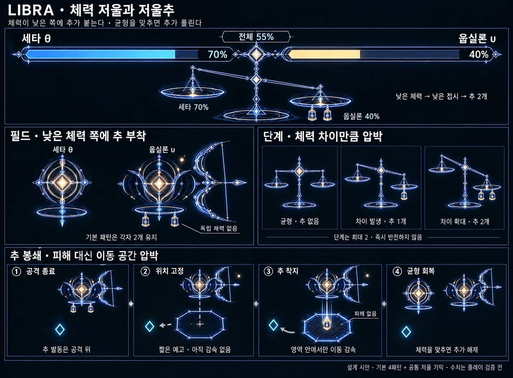

# LIBRA — 체력 저울과 저울추 v8

**이전안 보관:** 최신 보조체 방향은 [투석추·무핵 활 별자리 v9](Libra_Counterweight_Supports_v9.md)를 따른다. 아래 팔각형 감속 영역과 공격 종료마다 착지하는 규칙은 v9에서 대체되었다. HUD와 체력 비교 단계는 v9가 이어받는다.

작성일: 2026-10-20 · 상태: 신규 시스템 제안 / 게임 미구현

**사용자 지정 방향:** 보스 체력바 밑에 저울을 배치한다. 세타와 웁실론의 체력을 비교하고, 체력이 낮은 쪽에 저울추를 붙여 플레이어를 압박한다.

**이번 구체화 제안:** 체력 차이가 벌어지면 낮은 쪽에 추를 최대 2개 붙인다. 그 반신의 공격이 끝난 뒤 추 하나가 예고된 지점에 내려앉아 잠시 감속 영역을 만든다. 반대쪽 체력을 깎아 균형을 맞추면 추와 감속 영역이 해제된다. 임계값·감속량·횟수는 사용자 확정이 아닌 초기 검증값이다.

## 1. 저울이 뜻하는 것

저울은 남은 체력을 물리적 질량으로 재는 장치가 아니다. **체력이 부족한 쪽에 더해지는 ‘압박의 무게’**를 보여준다. 따라서 체력이 낮은 쪽의 접시가 내려간다.

플레이어는 저울을 보고 ‘지금 어느 쪽이 추가 압박을 얻었는지’와 ‘어느 쪽을 공격하면 추가 풀릴지’를 읽는다. 낮은 쪽을 계속 공격하면 추의 압박을 감수하게 되고, 높은 쪽을 공격하면 균형 회복으로 이어진다.

이 규칙은 회복·피해 반사·무적·강제 타기팅을 추가하지 않는다. 플레이어가 한쪽을 집중해서 처치하는 것도 허용한다. 이전안보다 균형 공격의 이유가 늘어나지만, 첫 처치는 여전히 전투를 쉽게 만드는 진전이다.

## 2. HUD — 체력바 바로 아래 저울

위쪽은 기존 보스 체력바, 바로 아래는 중앙 받침·가로대·양쪽 접시로 이루어진 저울이다. 좌우는 끝까지 **왼쪽 세타 θ / 오른쪽 웁실론 υ**로 고정한다. 보스가 필드에서 자리를 바꿔도 HUD 좌우는 바꾸지 않는다.

- 체력바는 같은 최대 체력 기준의 두 고정 구간으로 나누고 각 구간 안에서 남은 체력을 표시한다.
- 저울 접시 근처에 두 이름과 각각의 남은 체력 비율을 보여준다. 별 모양만으로 역할을 구분시키지 않는다.
- 체력 비율이 낮은 쪽의 접시가 내려가고, 실제 활성화된 추의 개수가 접시 밑에 보인다.
- 차이가 작을 때는 기울기를 과장하지 않고 거의 수평으로 둔다. 단계 진입 시 짧은 점등과 함께 추를 붙인다.
- 숫자에 비례해 가로대가 무한히 기울지 않는다. 기울기는 최대 각도 안에서 부드럽게 보간한다.
- 조준선·사선·착탄 표식보다 HUD가 더 밝아지지 않도록 한다. 기본은 청백색이고 따뜻한 강조는 코어와 활성 추의 작은 부분만 사용한다.

**표시 예시:** 세타 70%, 웁실론 40% → 전체 보스 체력은 55%. 웁실론의 접시가 내려가고 조건이 유지되면 추 2개가 붙는다. 이후 세타를 45%까지 깎아 차이를 5%p로 줄이면 추가 풀린다.

체력바는 연속적으로 갱신한다. 저울 기울기도 차이를 따라가되, 추가 붙는 순간은 아래 단계 규칙을 따른다. ‘조금 기울어 있음’과 ‘이미 추가 활성화됨’을 추 아이콘으로 구분한다.

## 3. 체력 비교와 단계

초기 최대 체력은 각자 전체 H의 절반이다. 비교는 `현재 체력 / 각자 최대 체력`으로 정규화한 남은 비율을 사용한다. 현재는 최대 체력이 같으므로 실제 남은 체력 비교와 순서가 같다.

| 단계 | 진입 차이의 초기안 | 낮은 쪽의 추 | 추가 압박 |
|---|---|---|---|
| 0 | 차이가 작음 | 없음 | 기본 4패턴만 사용 |
| 1 | 차이 15%p 이상 | 1개 | 작은 감속 영역 하나 |
| 2 | 차이 30%p 이상 | 2개 | 감속 영역의 범위·지속만 조금 증가 |

차이는 **퍼센트포인트(%p)**다. 70%와 40%의 차이는 30%p이며 체력 30% 감소라는 별도의 상대 계산을 하지 않는다.

### 진입·해제와 소유권

- 진입 조건은 약 0.6초 유지되어야 한다. 조건을 만족하면 HUD 접시가 짧게 점등해 다음 추 부착을 알린다.
- **강화 적용은 현재 기본 공격이 완전히 끝난 뒤** 한다. 돌진 도중 갑자기 추를 떨구거나 이미 예고한 공격에 방해를 덧붙이지 않는다.
- 단계 2는 차이가 23%p 미만이면 단계 1로, 단계 1은 8%p 미만이면 단계 0으로 해제한다. 두 조건을 모두 만족하면 곧바로 0까지 내려간다. 단계가 생기는 기준과 풀리는 기준을 다르게 두어 깜빡임을 막는다.
- 조건 해제는 즉시 반영할 수 있다. 강화가 사라지는 것은 위험을 추가하지 않으며, 이미 켜진 감속 영역도 함께 제거한다.
- 체력이 낮은 쪽이 바뀌면 기존 추를 먼저 해제한다. 새 낮은 쪽에서 진입 차이가 다시 0.6초 유지되어야 새 추를 예약한다. 추가 즉시 반대편으로 튀거나 양쪽이 동시에 강화되지 않는다.
- 추 단계는 체력만으로 계산한다. 같은 조건에서 공격 횟수만으로 추가 무한 증식하지 않는다.

한쪽 체력이 0이 되면 아래의 종료 규칙이 우선한다. 죽은 쪽의 남은 비율이 낮다고 추를 더 붙이지 않는다.

## 4. 필드의 추 — 붙어 있는 장치

활성 추는 강화된 반신의 저울접시 아래 양옆에 붙는 작은 무게추다. 고리 달린 짧고 묵직한 형태로 그리고, 코어·무기·동반광과 다르게 읽히게 한다.

- 단계 1은 한 개, 단계 2는 두 개를 보여준다. 두 개라고 동시에 감속 영역 두 개를 만드는 뜻은 아니다.
- 추는 별도 몹이 아니며 체력바·독립 피격·플레이어 타기팅을 갖지 않는다. 본체를 공격하면 체력이 줄고 저울 계산이 바뀐다.
- 세타의 닫힌 외곽, 웁실론의 열린 외곽과 작은 동반광은 유지한다. 원래 저울접시를 추로 대체하지 않는다.
- 단계가 유지되는 동안에는 붙어 있는 추를 남긴다. 검·활처럼 매 공격마다 전부 사라지는 부품은 아니다.
- 추 발동 시 한 개가 분리되어 내려앉는 연출을 쓰고, 부착 위치에는 어두운 빈 고리를 남긴다. 지면 효과가 끝난 뒤 추를 복원한다. 단계 2도 한 번에 한 개만 발동한다.

## 5. 공통 기믹 — 추 봉쇄

추는 기본 공격을 하나 더 강하게 만드는 공격력 보정 대신, **회피 공간을 잠시 줄이는 감속 영역**을 만든다. 기본 공격은 여전히 세타 2개·웁실론 2개다. 다만 전체 전투의 위험을 평가할 때는 이 공통 감속 효과도 별도로 포함한다. 추를 네 기본 패턴과 무관한 안전 장식으로 취급하지 않는다.

### 한 번의 발동

1. 강화된 반신이 T1 한 묶음, T2 사격 묶음, U1 한 번 또는 U2 마지막 착탄까지 마친다. 기본 패턴의 판정이 아직 남아 있다면 기다린다.
2. 추가 발동 가능한 상태라면 그 순간 플레이어의 지면 위치를 하나 기록한다. 작은 **팔각형 경계**로 위치를 고정한다. 이후 플레이어를 따라 움직이지 않는다.
3. 약 1초의 무효과 예고를 둔다. 추는 그 지점 위로 이동하며 살짝 들어 올려진다. 생성·이동·예고 중 피해나 감속은 없다.
4. 추가 내려앉으면 팔각형 내부에서만 이동 속도가 느려진다. **낙하 순간도 직접 피해는 없다.** 범위 밖에서는 즉시 정상 이동으로 돌아온다.
5. 짧은 지속 후 추와 영역이 사라지고 본체 쪽 추를 복원한다. 새 추 봉쇄까지 공통 재사용 대기시간을 둔다.

다음 기본 공격의 준비는 추 착지 후 약 0.4초부터 시작할 수 있다. 기존 v7의 ‘모든 효과 종료 후 다음 공격’ 규칙에 대한 예외는 **직접 피해가 없는 이 감속 영역 하나**뿐이다. 저울추 착지까지 다음 피해 공격을 시작하지 않으며, 기본 공격의 정상 예고 시간도 줄이지 않는다. 감속 상태에서 회피할 수 없는 배치이면 다음 공격을 보류한다.

### 검증용 시작값

R은 플레이어 피격 반경이다. 이 값들은 실제 게임 적용값이 아니다.

| 항목 | 단계 1 | 단계 2 |
|---|---|---|
| 영역 반경의 기준 | 약 2R인 팔각형 | 약 2.5R인 팔각형 |
| 예고 | 최소 약 1.0초 | 최소 약 1.0초 |
| 감속 | 영역 안에서 기본 이동의 약 75% | 동일 |
| 지속 | 약 1.2초 | 약 1.8초 |
| 동시 영역 수 | 최대 1개 | 최대 1개 |
| 공통 재사용 간격 | 예고 시작부터 최소 약 6초 | 동일 |
| 직접 피해 | 없음 | 없음 |

단계 2는 범위와 지속만 조금 늘린다. 감속 강도·개수·발동 빈도까지 한꺼번에 늘리지 않는다. 영역이 남아 있는 동안 새 영역을 만들거나 지속을 갱신하지 않는다. 다른 저울추와 감속이 중첩되는 상황도 없다.

원형 착탄은 U2의 피해 표식이므로 추 봉쇄는 **팔각형 경계·낮은 대비의 내부 빗금·묵직한 추**로 구분한다. 화살·폭발·밝은 착탄 섬광을 쓰지 않는다. 회색 연결선이 있다면 설명용 도식이며 플레이어를 실제로 묶는 사슬이 아니다.

## 6. 기존 네 패턴과의 연결

| 추를 가진 개체 | 발동할 수 있는 시점 | 이후 압박의 성격 |
|---|---|---|
| 세타 T1 | 마지막 전진 베기와 판정 종료 뒤 | 따라붙거나 거리를 벌릴 경로를 다시 고르게 함 |
| 세타 T2 | 사격 묶음과 날아간 검기가 모두 끝난 뒤 | 계속 같은 자리에서 후퇴하며 쏘는 플레이를 끊음 |
| 웁실론 U1 | 세 화살 소멸 뒤 | 다음 공격 전 이동 방향을 다시 선택하게 함 |
| 웁실론 U2 | 마지막 성우 착탄 뒤 | 낙하 원에서 피한 자리에 계속 머무르지 않게 함 |

추 발동 때문에 세타의 거리 전환을 없애지 않는다. 전환 예약과 추 봉쇄가 겹치면 전환의 무공격 간격을 유지하고, 추 예고도 따로 읽히게 한다. 추로 인한 감속은 실제 이동 벡터에 반영될 수 있지만, 웁실론이 감속 전 속도를 기억해 미래 위치를 계속 보정하는 숨은 규칙은 넣지 않는다.

## 7. 균형 회복과 처치

- 균형 회복으로 단계 0이 되면 붙은 추·예약 발동·진행 중인 추 예고·현재 감속 영역을 모두 지운다. 위험을 끝내는 긍정적인 저울 복귀 연출을 준다.
- 단계 2에서 1로 내려가면 추 하나를 제거한다. 이미 생성된 큰 영역은 즉시 제거하고 다음 발동부터 단계 1 값을 쓴다. 갑자기 범위가 옮겨지거나 피해가 발생하지 않는다.
- **한 반신 처치 시 공통 저울 시스템을 종료**한다. HUD 저울은 추가 해제되며 남은 체력바와 살아 있는 반신의 이름을 강조한다. 죽은 쪽 접시를 계속 끝까지 내려 추를 생성하지 않는다.
- 남은 반신은 v7대로 자기 두 패턴을 유지한다. 추 제거를 보상으로 체감하게 하고 공격력·회복 시간을 보복성으로 바꾸지 않는다.
- 전투 종료·장면 이탈 시 추와 영역을 정리한다. 일시정지 중 체력 차이 유지 시간·예고·재사용 대기·지속은 함께 정지한다.

## 8. 시제품에서 확인할 것

1. 체력바를 보지 않고 저울만 봐도 낮은 체력 쪽과 추 개수를 읽을 수 있는가?
2. 낮은 쪽을 계속 때리면 압박이 생기고, 높은 쪽을 때리면 실제로 풀리는가? 반대편을 때렸는데 추가 더 붙는 것처럼 보이지 않는가?
3. 단계 경계에서 추와 접시가 계속 깜빡이거나 양쪽에 동시에 추가 생기지 않는가?
4. 추의 예고는 기본 이동으로 벗어날 수 있는가? 벽 근처에서도 예고 시간을 확보하는가?
5. 감속된 플레이어에게 다음 T1·검기·삼분사·성우가 회피 불가능해지지 않는가? 감속 영역과 다음 공격을 함께 고려한 연결 경로로 확인한다.
6. 추의 팔각형과 U2의 피해 원이 구분되는가? 추의 착지가 피해를 주는 공격으로 오인되지 않는가?
7. 집중 공격으로 먼저 처치하는 전략도 가능한가? 최대 2단계의 압박이 전투를 끝없이 악화시키지 않는가?

현재는 문서·정적 컨셉 시안이다. 밸런스와 HUD 가독성은 게임 안에서 아직 검증하지 않았다. 시트 일부의 활은 역할 식별을 위한 표현이며 실제 대기·공격 종료 상태에서는 기존 규칙대로 소멸한다. HUD의 바 길이는 구성 참고용이고 실제 렌더링에서는 표시된 체력 비율과 정확히 일치시킨다.

## 관련 자료

- [기본 네 패턴 v7](Libra_Theta_Upsilon_Patterns_v7.md)
- [외형 v5](Libra_Theta_Upsilon_Redesign_v5.md)
- [체력 저울 시각화](Concepts/Libra_Balance_System_v8.png)
- [내장 image_gen 프롬프트](Concepts/Libra_Balance_ImagePrompt_v8.md)
