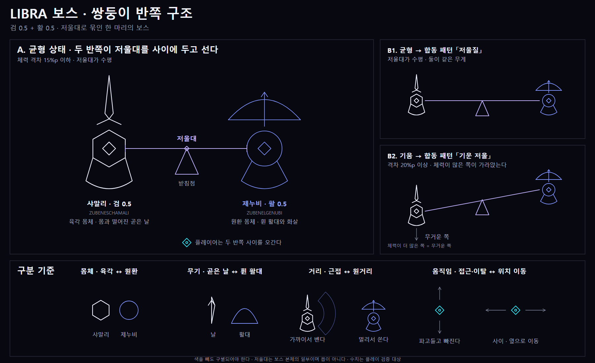
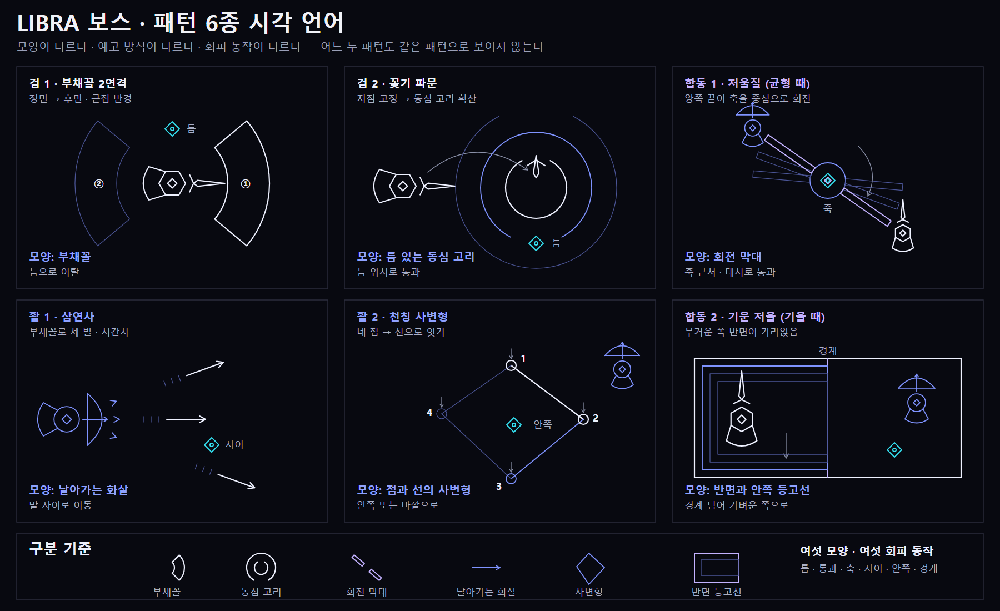
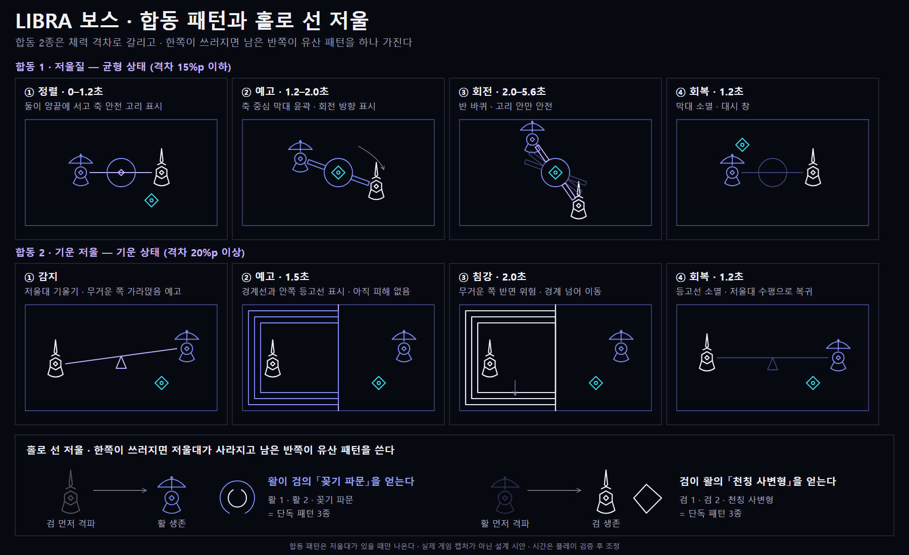

# LIBRA 보스 — 저울로 묶인 쌍둥이 반쪽 (검 0.5 + 활 0.5)

작성일: 2026-10-19 · 상태: 기획 초안 · 구현 전 · 수치는 모두 초기 가정이며 플레이 검증 대상

이 문서는 기존 보스 문서를 참고하지 않고 새로 쓴 기획이다. 기존 몹 비주얼과 [Quasar 엘리트 문서](Quasar_Elite_Design.md)의 문서 구조만 따랐다. 보스 공통 규칙 문서와 합칠 때는 아래 「전제 규칙」이 그쪽 표현과 어긋나지 않는지 한 번 대조해야 한다.

## 전제 규칙

1. **보스는 패턴이 3~4가지 이상이다.**
2. **패턴들은 서로 시각적으로 같은 패턴이라고 생각하게 되지 않게 한다.**

해석: 이 보스는 반쪽 둘이 한 마리다. 보스 전체 패턴은 6종, 각 반쪽이 겪는 패턴은 단독 2종 + 합동 2종으로 4종, 홀로 남은 반쪽은 3종이다. 어느 쪽으로 세어도 3~4종 이상이다. 규칙 2는 아래 「시각 언어 표」로 검증한다.

## 개념

천칭자리는 저울이다. 저울은 한쪽만으로는 저울이 아니다. 그래서 보스를 **저울의 두 접시**로 나눈다. 검을 든 반쪽과 활을 든 반쪽이 저울대 하나로 묶여 있고, 플레이어는 두 반쪽을 동시에 상대한다.

별 이름도 쓴다. 천칭자리의 두 밝은 별 Zubeneschamali(β)와 Zubenelgenubi(α)에서 가져와 **샤말리(검)**, **제누비(활)**로 부른다. 별자리의 네 별이 이루는 사변형은 활 반쪽의 패턴 하나로 쓴다.

## 시각 디자인

| 항목 | 샤말리 · 검 0.5 | 제누비 · 활 0.5 |
|---|---|---|
| 몸체 | 육각형 안에 빈 마름모 코어 | 원환 안에 빈 마름모 코어 |
| 무기 | 몸과 떨어진 곧은 날 하나, 날밑 | 휜 활대, 곧은 현, 장전된 화살 |
| 접시 | 몸 아래 저울 접시 (호 + 걸이선) | 같음 |
| 거리 | 근접 | 원거리 |
| 움직임 | 파고들었다 빠진다 | 거리를 두고 위치를 옮긴다 |
| 선 색 | 흰색 계열 | 남보라(periwinkle) 계열 |

- 두 반쪽은 **저울대**(연보라 선)와 **받침점**(빈 삼각형)으로 이어진다. 저울대는 몸이 아니라 두 반쪽 사이에 그어진 연결선이며, 직접 피해를 주지 않는다. 합동 패턴에서만 위험이 된다.
- 몸체는 면 채움 없이 선으로만 그린다. 점선과 판(배경 막)은 쓰지 않는다.
- 날은 몸에서 뻗은 가시가 아니라 **몸과 떨어진 하나의 선 무기**다. 육각형의 꼭짓점은 날카롭게 둔다.
- 색을 빼도 구별되도록 두 반쪽의 실루엣을 다르게 했다(육각 ↔ 원환, 곧은 날 ↔ 휜 활대).

## 균형 규칙

저울대는 두 반쪽의 **체력 격차**를 월드에서 보여 준다. 별도 HUD 없이 저울대의 기울기만 본다.

| 상태 | 조건 | 저울대 | 합동 패턴 |
|---|---|---|---|
| 균형 | 체력 비율 격차 15%p 이하 | 수평 | 저울질 |
| 기움 | 격차 20%p 이상 | 체력이 많은 쪽이 아래로 | 기운 저울 |

- 15~20%p 사이는 직전 상태를 유지한다(경계에서 상태가 깜빡이지 않게).
- 각 반쪽 체력은 보스 전체 체력의 절반이다. 반쪽마다 따로 피해를 받는다. 피해 감소나 회복은 없다.
- 체력이 많은 쪽을 **무거운 쪽**이라 부른다. 기운 저울 패턴은 무거운 쪽 반면이 위험이 되므로, 플레이어는 자연스럽게 가벼운 쪽(체력이 적은 쪽) 쪽으로 밀려난다. 한쪽을 집중 공격하는 선택은 막지 않는다.

## 패턴 6종과 구별

### 시각 언어 표 (규칙 2 검증)

| 패턴 | 모양 언어 | 예고 방식 | 시간 척도 | 회피 동작 |
|---|---|---|---|---|
| 검 1 · 부채꼴 2연격 | 몸 둘레의 부채꼴 윤곽 둘 | 정면 윤곽 점등 → 후면 윤곽 점등 | 0.9초 + 0.9초 | 두 부채꼴 사이 틈, 또는 반경 밖으로 이탈 |
| 검 2 · 꽂기 파문 | 틈이 하나씩 있는 동심 고리 | 플레이어 위치에 십자 표식 → 검이 꽂힘 | 1.0초 후 고리 3개가 0.35초 간격 | 고리의 틈으로 통과 |
| 활 1 · 삼연사 | 날아가는 화살 세 발 | 활이 당겨지고 총구에 화살머리 세 개 | 0.8초 예고, 0.25초 간격 | 화살 사이로 이동 |
| 활 2 · 천칭 사변형 | 네 개의 점과 그것을 잇는 선 | 화살이 땅에 꽂혀 점이 되고 선이 순서대로 이어짐 | 점 4개 1.6초, 선 활성 0.4초씩 | 사변형 안쪽 또는 바깥으로 |
| 합동 1 · 저울질 | 축에서 양쪽으로 뻗은 회전 막대 | 축 안전 고리 표시 → 막대 윤곽 → 회전 | 예고 0.8초, 회전 3.6초 | 축 안전 고리 안에 서거나 대시로 막대를 통과 |
| 합동 2 · 기운 저울 | 반면(半面)과 안쪽 등고선 | 경계선과 등고선이 무거운 쪽에 나타남 | 예고 1.5초, 침강 2.0초 | 경계를 넘어 가벼운 쪽으로 |

모양 언어가 서로 다른 계열이라 어느 둘도 같은 패턴으로 읽히지 않는다: 부채꼴·고리·화살·점선 사변형·막대·반면. 한 가지 모양이 다른 패턴에서 변주로 재사용되지 않는다. 각 반쪽은 서로의 모양 언어를 쓰지 않는다. 검은 면(영역)과 고리를, 활은 점과 선과 이동체를 쓴다.

### 단독 패턴

**검 1 · 부채꼴 2연격** — 샤말리가 가까이 다가가 정면 부채꼴을 베고, 이어서 몸을 돌려 후면 부채꼴을 벤다. 반경 약 175px, 각도 80°. 부채꼴 사이의 위쪽·아래쪽 틈이 안전하다. 시전 중 플레이어를 다시 추적하지 않는다.

**검 2 · 꽂기 파문** — 발사 시점의 플레이어 위치에 십자 표식을 고정한다. 1.0초 뒤 샤말리의 날이 그 지점에 꽂히고 고리 3개가 0.35초 간격으로 퍼져 나간다. 고리마다 틈이 있고 틈 위치는 위·아래로 교차한다. 퍼지는 고리의 선 위만 위험이다. 지점 밖에서는 아무 피해도 없다.

**활 1 · 삼연사** — 제누비가 활을 당겨 총구에 화살머리 세 개를 표시한 뒤, ±20° 부채꼴로 화살 세 발을 0.25초 간격으로 쏜다. 화살은 직선으로 날아간다. 발사 후 추적하지 않는다.

**활 2 · 천칭 사변형** — 화살 4발이 땅에 꽂혀 점 4개가 생긴다. 점은 천칭자리의 네 별처럼 연 모양의 사변형이다. 점이 모두 서면 1→2→3→4 순으로 점을 잇는 선이 0.4초씩 활성이 된다. 위험은 **선 위뿐**이고 안쪽과 바깥은 안전하다. 점 자체는 위험하지 않다.

### 합동 패턴 (저울대가 있을 때만)

**합동 1 · 저울질 (균형 때)** — 두 반쪽이 축을 가운데 두고 서로 반대편으로 선다. 축 가운데 반경 약 60px 고리는 안전 구역이다. 0.8초 예고 뒤 두 반쪽이 저울대를 휘두르며 축을 중심으로 **180° 회전**한다(3.6초). 막대 자체는 반경 60px 바깥에서 축 방향으로 뻗는다. 회전 속도는 일정하며 중간에 방향을 바꾸지 않는다.

**합동 2 · 기운 저울 (기울 때)** — 저울대가 기울어 무거운 쪽이 가라앉는다. 1.5초 동안 경계선과 안쪽 등고선이 무거운 쪽 반면에 표시되고, 이후 2.0초 동안 그 반면 안이 위험이 된다. 경계선 밖(가벼운 쪽)은 안전하다. 침강이 끝나면 저울대가 수평으로 돌아가고 1.2초 회복한다. 격차가 15%p 안으로 들어오면 다음 합동 패턴은 저울질이다.

## 홀로 선 저울 — 한쪽이 쓰러질 때

저울대가 사라지고 합동 패턴을 더 쓰지 않는다. 대신 남은 반쪽은 쓰러진 반쪽의 패턴 **하나**를 유산으로 얻는다.

| 먼저 쓰러진 쪽 | 남은 반쪽 | 얻는 패턴 | 남은 반쪽의 패턴 수 |
|---|---|---|---|
| 검 | 제누비 | 꽂기 파문 | 활 1·활 2·꽂기 파문 = 3종 |
| 활 | 샤말리 | 천칭 사변형 | 검 1·검 2·천칭 사변형 = 3종 |

어느 쪽을 먼저 잡는지가 남은 한쪽의 성격을 바꾼다. 유산 패턴은 원래 반쪽이 쓰던 모양 그대로 쓴다(재디자인 없음). 남은 반쪽은 패턴 사이 대기를 20% 줄인다(분노 보정 초기값).

## 전투 진행

1. 두 반쪽이 번갈아 단독 패턴을 쓴다: 검 1 → 활 1 → 검 2 → 활 2.
2. 한 반쪽이 회복하는 동안 다른 반쪽이 다음 패턴 예고를 시작할 수 있다. 같은 시점의 예고는 **반쪽당 하나**, 최대 둘이다. 두 예고는 모양 언어가 다르므로 겹쳐도 구별된다.
3. 단독 패턴 4개를 한 바퀴 돌면 합동 패턴을 한 번 넣는다. 균형이면 저울질, 기움이면 기운 저울이다.
4. 한 반쪽이 쓰러지면 합동 패턴 사이클을 끝내고 「홀로 선 저울」로 전환한다. 진행 중이던 위험은 즉시 취소한다.

## 초기 수치 (모두 가정)

| 항목 | 값 |
|---|---|
| 각 반쪽 체력 | 보스 전체의 50% |
| 단독 패턴 사이 대기 | 반쪽당 2.4초 |
| 단독 패턴 피해 | 6 (활 1은 발당 6) |
| 합동 패턴 피해 | 10 (저울질은 한 번 접촉, 기운 저울은 반면 진입 때 한 번) |
| 재피격 유예 | 같은 패턴에 대해 0.35초 |
| 저울질 회전 / 안전 고리 | 180° · 3.6초 / 반경 60px |
| 기운 저울 예고 / 침강 | 1.5초 / 2.0초 |

피해는 기존 방어·보호막·대시 처리 경로를 쓴다고 가정한다. 사망 시 남은 위험과 예고는 즉시 취소한다. 시간 정지는 게임 업데이트와 함께 멈춘다.

## 열린 질문

- 보스 전체 체력과 전투 목표 시간. 두 반쪽을 동시에 상대하므로 단일 보스보다 길어질 수 있다.
- 합동 패턴 빈도(4단독마다 1회)와 15%p/20%p 임계값이 지나치게 한쪽 공략으로 몰리지 않는지.
- 화면 크기 대비 두 반쪽과 저울대가 차지하는 폭. 저울대의 월드 길이는 맵 크기에 따라 정해야 한다.
- 「안쪽이 안전」(활 2)과 「바깥이 위험」(검 2)처럼 안전 방향이 반대인 패턴이 오인을 부르지 않는지 플레이 검증.
- 기존 보스 규칙 문서와의 통합. 이 문서는 해당 문서를 참조하지 않았다.

## 이미지 기록

2026-10-19 · 내장 `image_gen`을 쓰지 않았다. 게임의 선 표현(어두운 배경, 얇은 실선, 면 채움 없음, 점선 없음)에 맞춰 직접 작성한 SVG를 Edge 헤드리스로 PNG 변환했다. 원본 SVG를 같은 폴더에 함께 둔다.

- [Libra_Pair_Anatomy_v1.png](Concepts/Libra_Pair_Anatomy_v1.png) ([svg](Concepts/Libra_Pair_Anatomy_v1.svg)) — 두 반쪽·저울대·균형/기움
- [Libra_Pattern_VisualLanguages_v1.png](Concepts/Libra_Pattern_VisualLanguages_v1.png) ([svg](Concepts/Libra_Pattern_VisualLanguages_v1.svg)) — 패턴 6종의 모양 언어
- [Libra_Joint_Storyboard_v1.png](Concepts/Libra_Joint_Storyboard_v1.png) ([svg](Concepts/Libra_Joint_Storyboard_v1.svg)) — 합동 패턴 단계와 홀로 선 저울

실제 게임 캡처가 아닌 설계 시안이다. 시간과 반경은 플레이 검증 후 조정한다.
