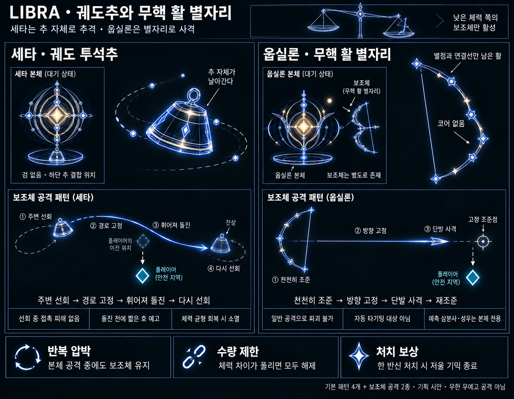

# LIBRA — 궤도 투석추와 무핵 활 별자리 v9

작성일: 2026-10-20 · 상태: 보조체 기획 제안 / 게임 미구현

수량 규칙 갱신: 사용자 지정으로 **남은 체력 비율 차이 10%p마다 보조체 1개**다. 종전 최대 2개 제한은 제거했다. 사망 후 새 패턴은 아직 추가하지 않았다.

이번 메시지의 두 번째 ‘세타’는 문맥상 **웁실론**으로 해석했다. 배정은 **세타 = 그라비스식 투석추**, **웁실론 = 코어 없는 활 별자리**다. 반대 배정을 의도했다면 형태·역할을 바꾸지 않고 소유자만 교환할 수 있다.

## 1. 이번 변경의 핵심

추가 지면에 떨어져 감속 영역을 만드는 v8 안 대신, **저울이 기운 동안 필드에 남아 본체와 별개로 반복 압박하는 보조체**를 만든다. 체력바 아래 저울·체력이 낮은 쪽에 추 부여·균형 회복으로 해제라는 큰 규칙은 유지한다.

| 구분 | 세타의 저울추 | 웁실론의 저울추 |
|---|---|---|
| 이름 | 궤도 투석추 | 무핵 활 별자리 |
| 움직임 | 플레이어 주변에 느슨하게 남아 선회 | 주인의 옆·뒤에 떠서 거리 유지 |
| 공격 | 추 자체가 예고한 호를 따라 돌진 | 조준을 고정한 뒤 화살 한 발 발사 |
| 회피 | 휘어진 경로에서 비켜나기 | 잠긴 사선에서 횡이동 |
| 주요 실루엣 | 고리 달린 묵직한 작은 추 | 작은 별점과 연결선으로 만든 빈 활 |
| 없앨 방법 | 체력 균형 회복 또는 저울 시스템 종료 | 동일 |

‘죽지 않는 스코프’라는 역할은 가능하지만, 기존 SCOPE를 그대로 소환해 무적을 주는 형태보다 **저울에 연결된 무핵 사격 장치**로 표현한다. 보스와 똑같은 밝은 코어·체력바를 주지 않아, 때려서 없애야 할 적으로 오인하지 않게 한다.

## 2. 세타 — 궤도 투석추

### 참고한 것과 가져오지 않는 것

비보스 자료인 [그라비스 궤도 투석](Gravis_Elite_Orbit_Design.md)의 ‘본체와 독립적으로 작동하는 위성’, ‘플레이어 주변에 남는 느슨한 궤도’, ‘예고한 곡선을 따라 파고드는 다트’를 참고한다. 중력장의 당김·탄환 편향·대시 지연이나 그라비스의 다른 공격은 추가하지 않는다.

원본 그라비스는 위성 3개를 사출하지만 이번 저울추의 개수는 **체력 차이 10%p당 1개**로 결정한다. 해당 문서의 기존 피해량·14초짜리 시전·복귀 중 피해를 그대로 복사하지 않는다.

### 형태

- 작은 고리와 둥근 사다리꼴 무게 덩어리로 만든다. 중앙의 밝은 몬스터 코어는 없다.
- 세타의 저울접시에 매달려 있다가 짧은 사출 예고 뒤 분리된다. 분리·배치 이동 중에는 피해가 없다.
- 선회할 때는 짧고 어두운 잔상, 돌진 준비 때는 실제 이동할 호와 끝의 마감선을 표시한다. 선회 궤도 전체를 피해 고리로 그리지 않는다.

### 반복 행동

1. **선회:** 플레이어의 현재 위치를 느리게 따라오는 중심 주위를 돈다. 관성과 가감속 제한으로 따라오며, 플레이어가 움직이면 원이 헐겁게 벌어진다. 정확한 원에 순간적으로 붙거나 전방으로 순간이동하지 않는다.
2. **준비:** 충분히 가까워지고 재사용 간격이 지났을 때, 플레이어 현재 위치 근처를 지나는 짧은 곡선을 정해 약 0.8초부터 예고한다. 잠금 뒤에는 경로를 바꾸지 않는다.
3. **투석 돌진:** 추 자체가 곡선을 따라 빠르게 지나간다. 조준점에서 멈추지 않고 조금 지나친다. **실제로 이동하는 추의 몸체에만 피해**가 있으며 한 번의 돌진은 한 번만 피해를 준다.
4. **복귀:** 큰 호를 그리며 다시 느슨한 선회로 돌아간다. 복귀는 무해하며 곧바로 두 번째 돌진을 이어 붙이지 않는다.
5. **재준비:** 여전히 추 단계가 유지되면 새 예고를 거쳐 반복한다. 단계가 끝나면 즉시 무해해지며 소멸한다.

개별 재사용 간격은 초기 약 3~4초에서 검토하되 아래의 공통 보조 공격 슬롯이 우선한다. 3개 이상이어도 동시에 돌진하지 않고 준비된 추부터 교대한다. ‘계속 괴롭힘’은 보조체가 유지되며 여러 차례 공격한다는 뜻이며, 선회 중 상시 접촉 피해나 무예고 추적 피해를 뜻하지 않는다.

## 3. 웁실론 — 무핵 활 별자리

### 형태가 역할을 설명한다

- 작은 별점 약 5~7개가 위·아래 활대를 만들고 가느다란 선으로 연결된다. 가운데는 **검은 빈 공간**으로 남긴다.
- 빛나는 중심 코어·몸체 껍질·저울접시·얼굴·손발을 붙이지 않는다. 큰 중앙 별도 두지 않아 코어처럼 읽히지 않게 한다.
- 평소에는 활대의 별점과 연결선만 남고, 발사 준비 때 시위와 짧은 화살을 그려낸다. 발사 후 시위와 화살은 사라지고 활의 별자리 형태는 유지된다.
- 웁실론 본체보다 작고 어둡게 한다. 초기 크기는 본체 프레임 높이의 약 40~50%다. 주인의 밝은 코어와 별자리의 빈 중앙이 확실히 대비되어야 한다.
- v5의 작은 동반광은 계속 장식이다. 그것을 별자리의 코어로 바꾸거나 동반광 자체가 공격한다고 설정하지 않는다.

### 반복 행동

1. **거리 유지:** 웁실론 옆·뒤의 자리에서 천천히 따라온다. 플레이어 주변을 감싸거나 바로 옆으로 순간이동하지 않는다. 사격할 때는 멈춘다.
2. **조준:** 활의 별점과 시위가 서서히 공격축에 맞춰진다. 현재 플레이어 위치를 따라 천천히 조준한다.
3. **잠금:** 사선을 고정하고 약 0.7~0.9초의 최종 예고를 보여준다. 잠금 뒤에는 플레이어를 따라 돌지 않는다.
4. **단발 사격:** 짧은 화살 한 발을 직선으로 쏜다. 탄의 진행 경로가 피해이고 예고선 자체는 피해가 아니다. 발사 후 유도·분열·반사·추가 연사는 없다.
5. **휴식:** 시위가 풀리고 화살이 정리된 뒤 다시 조준한다. 방향 전환과 자리 이동은 이때 처리한다.

개별 재사용 간격은 초기 약 3~4.5초에서 검토하되 공통 보조 공격 슬롯을 따른다. 수가 늘어도 별자리의 잠금과 발사를 엇갈리게 배치한다. 본체 U1과 다르게 **이동 예측·3갈래 사격을 하지 않고**, 본체 U2와 다르게 고공 성우도 쓰지 않는다.

스코프에서는 사용자가 언급한 ‘남아서 조준 사격으로 신경을 쓰게 하는 역할’을 가져온다. 외형 참고 문서 [일반 몹 청사진의 SCOPE](Astral_Enemy_Blueprints_v1.md)는 중앙 코어가 있는 관측기이므로, 그 코어·원형 관측 링까지 복제하지 않는다. 기존 SCOPE의 현행 구현 수치나 전투 코드를 이번 조사에서 검증한 것은 아니다.

## 4. 파괴 불가가 납득되도록 하는 규칙

- 두 보조체는 적 체력·독립 처치·보상을 갖지 않는다. 플레이어 투사체는 몸체 장식에 소모되지 않고 통과한다.
- 자동 조준·최근접 적 탐색·타깃 순환에서 제외한다. 보조체를 향해 공격이 빨려 들어가 본체를 못 때리는 일이 없어야 한다.
- 선회·대기 몸체는 플레이어와 물리 충돌하거나 피해를 주지 않는다. 위험은 명시적으로 예고한 투석 돌진·발사된 화살뿐이다.
- 피격 섬광이나 피해 숫자로 ‘맞고 있지만 안 죽는 적’처럼 연출하지 않는다. 생성될 때 HUD 저울의 추 점등과 필드 보조체 형성을 연결해 원인을 보여준다.
- 두 별자리가 겹쳐 코어가 생긴 것처럼 보이지 않도록 배치하고, 보스의 다음 공격 자세를 가리지 않는다.

## 5. 체력 저울과 수량

v8의 체력 비교 HUD를 이어받는다. 세타는 왼쪽, 웁실론은 오른쪽으로 고정하며, 체력이 낮은 쪽의 접시가 내려간다.

- 원하는 수량은 `floor(남은 체력 비율의 차이 / 10%p)`다. 항상 체력이 낮은 반신 쪽에만 부여한다.
- 차이 0~10%p 미만은 0개, 10~20%p 미만은 1개, 20~30%p 미만은 2개, 30~40%p 미만은 3개다. 이후도 같은 규칙을 따른다.
- 예: 세타 80%·웁실론 50%면 웁실론 쪽 3개, 세타 54%·웁실론 50%면 0개다. 차이는 상대 퍼센트가 아닌 **퍼센트포인트**로 계산한다.
- 종전 최대 2개 제한과 15/30%p 진입·8/23%p 해제 기준은 사용하지 않는다. 양쪽이 살아 있는 동안 차이는 100%p 미만이므로 이론상 최대 9개다. 한쪽 사망 시에는 10개를 생성하지 않고 종료 규칙을 먼저 적용한다.
- 증가 수량은 조건이 약 0.6초 유지된 뒤 생성 예약한다. 감소는 10%p 경계를 내려온 즉시 반영한다. 이 유지 시간은 깜빡임 방지용 초기 제안이며 수량 계산 자체를 바꾸지 않는다.
- 새 보조체는 본체의 현재 활성 공격이 끝난 뒤 생성 예고를 거쳐 배치한다. 이미 예고한 공격 도중 플레이어 바로 옆에 생겨 즉발하지 않는다.
- 10%p 경계를 넘을 때마다 투석추 1개 또는 활 별자리 1개를 추가한다. 개수와 함께 피해·속도·예고 시간을 일괄 강화하지 않는다.

수량 감소 시 제거 대상 보조체·이미 날아간 해당 화살·예약 돌진을 함께 무효화한다. 여러 보조체 중 제거 순서는 최근 생성한 쪽부터로 고정한다. 낮은 체력의 소유자가 뒤바뀌면 기존 보조체를 먼저 정리하고 새 쪽에서 조건 유지와 생성 예고를 다시 거친다. 화면 위에서 투석추가 갑자기 활로 변하지 않는다.

체력 균형이 회복되거나 한 반신이 쓰러지면 **공통 저울 시스템과 보조체를 해제**한다. 죽은 반신의 추가 계속 남거나, 마지막 하나가 혼자 남았다고 추가 증식하지 않는다. 남은 보스의 기본 두 패턴은 유지한다.

## 6. 본체와 동시에 계속 작동한다

기존 v8처럼 기본 공격 종료마다 한 번 감속 효과를 만드는 구조가 아니다. 생성된 보조체는 **본체가 공격·거리 전환·회복하는 동안에도 남아 자기 조준·선회·재사용 주기를 진행**한다. 세타와 웁실론 본체의 기본 4패턴은 v7을 따른다.

전체 위험 구성은 **기본 4패턴 + 보조 공격 2종**이다. 개별 보스의 기본 패턴이 3개씩이 된 것은 아니지만, 플레이어가 배우는 회피 문제는 실제로 추가되므로 난도·예고 검토에서 따로 계산한다.

동시 공격의 시작안은 본체의 공격 슬롯 1개와 보조 공격 슬롯 1개다. 보조체가 여러 개 있어도 동시에 투석 돌진하거나 화살을 발사하지 않는다. 앞선 보조 공격의 돌진·화살이 끝난 뒤 다음 보조체가 자기 최종 예고를 거친다. 대기·선회 자세는 동시에 보여줄 수 있다. 수량 증가로 보조 공격이 끊임없이 이어지지 않게 공통 휴식 박자를 둔다. 구체적 간격은 3개·6개·9개 상황에서 검증한다.

- T1 돌진 경로와 투석 경로가 플레이어의 양옆을 동시에 닫지 않게 한다.
- U1의 예측 삼분사가 이미 회피 경로를 좁힌 경우 별자리 사격의 잠금 시작을 늦춘다.
- U2의 원 바깥으로 빠지는 경로를 투석추가 전부 가로지르지 않게 한다.
- 화면 밖의 보조체는 새 공격을 시작하지 않는다. 화면 안으로 무해하게 복귀한 뒤 다시 예고한다.
- 플레이어 기본 이동으로 안전한 연결 경로가 없으면 보조 공격을 연기한다. 이미 보여준 예고를 몰래 다른 곳으로 바꾸지 않는다.

시간·피해·밀집도는 모두 시제품 검증 대상이다. 문서의 ‘약 3초’ 같은 값보다 예고를 보고 기본 이동으로 빠져나갈 수 있는지가 우선한다.

## 7. v8에서 대체되는 내용과 산출물

v8의 팔각형 감속 영역·추 착지·공격 종료마다 감속 영역 발동은 채택하지 않는다. 저울 HUD와 체력 차이의 단계·균형으로 해제하는 규칙만 가져온다. 별도의 감속·끌어당김·장판을 보조체에 덧붙이지 않는다.

- [보조체 시각화](Concepts/Libra_Counterweight_Supports_v9.png)
- [내장 image_gen 프롬프트](Concepts/Libra_Counterweight_Supports_ImagePrompt_v9.md)
- [기본 패턴 v7](Libra_Theta_Upsilon_Patterns_v7.md)
- [이전 저울 HUD·단계 제안 v8](Libra_Balance_System_v8.md)

시각화의 1개·2개는 동작 예시이며 현행 수량 상한을 뜻하지 않는다. 현재는 정적 외형과 행동 기획이다. 게임 코드·자동 타기팅·피해 판정은 아직 변경하지 않았다.

## 8. 한쪽 사망 후 추가 패턴에 대한 판단 — 미확정

현재는 기본 공격 4개에 보조체 공격 2종, 체력 저울에 따른 수량 조절까지 있다. 기본 패턴 수는 과도하지 않지만 플레이어가 함께 읽어야 하는 정보는 이미 충분하다. 특히 10%p당 1개로 바뀐 뒤에는 새 공격보다 보조체 밀집도와 예고 가독성을 먼저 확인한다.

한쪽 사망 후 기존 규칙대로 보조체가 해제되면 남은 쪽의 기본 두 패턴만 남는다. 따라서 **사망 후 전용 공격 1개를 넣을 여지는 있다.** 다만 이것이 이미 확정됐다는 뜻은 아니다. 먼저 현재 구성을 플레이해 마무리 구간이 허전한지 판단하고, 필요하면 생존한 보스에게 전용 마무리 공격 하나를 검토한다. 양쪽 생존 분기별로 하나씩 만들 경우 제작할 공격은 둘 늘어나지만 한 번의 전투에서는 생존한 쪽의 하나만 추가로 보게 된다.

새 공격을 넣기 전 단계로는 한쪽 사망의 전환 연출과 기존 두 패턴의 연결 박자를 다듬는 방법도 있다. 새 사망 후 공격·가속·추 유지 규칙은 이번 수량 변경에 함께 적용하지 않는다.
