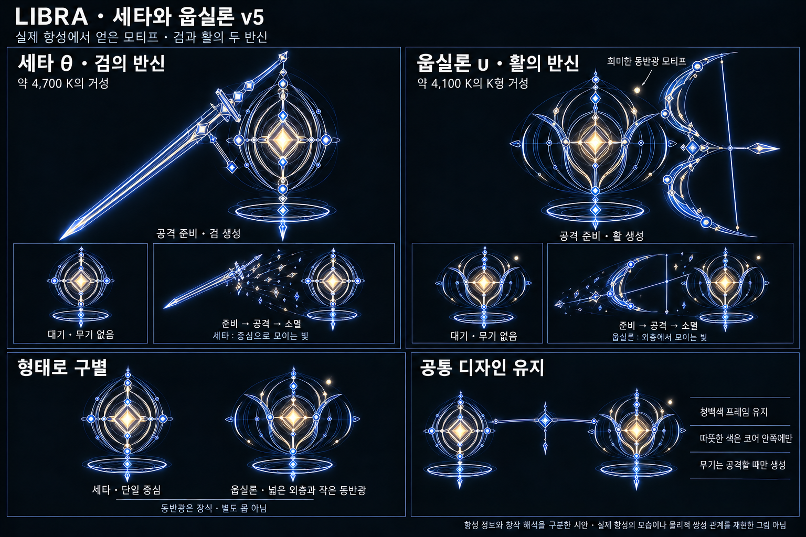
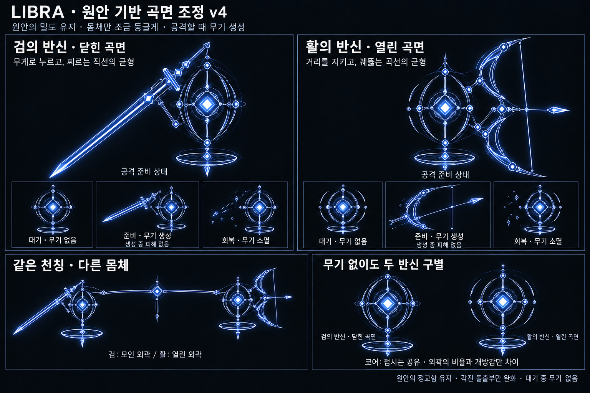
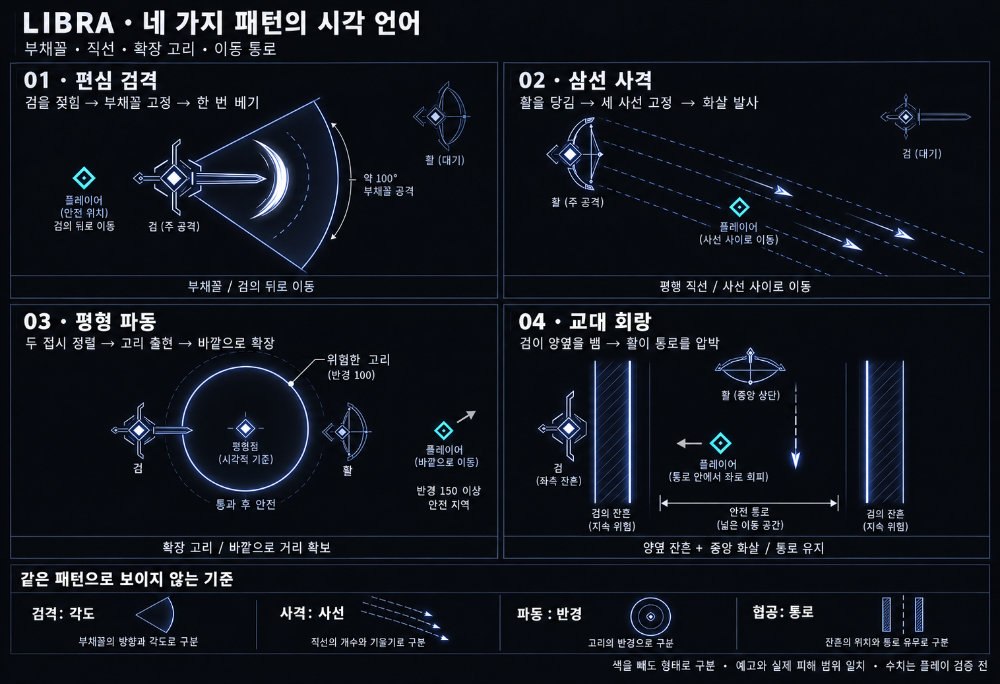

# LIBRA — 검과 활의 쌍성

작성일: 2026-10-19 · 개정일: 2026-10-20 · 현행 외형: v5 세타·웁실론 항성 모티프 · 상태: 게임 미구현

**추가 시스템 제안:** [투석추·무핵 활 별자리 v9](Libra_Counterweight_Supports_v9.md). 체력바 아래 저울로 남은 체력을 비교하고 낮은 쪽에 **차이 10%p당 보조체 1개**를 붙인다. 세타는 그라비스식 궤도 투석추, 웁실론은 코어 없는 활 별자리다. 종전 최대 2개 제한은 제거했다. 차이를 줄이면 수량이 감소하고 한쪽을 처치하면 해제한다. 공격 간격 등 효과 수치는 검증 전 제안이다. 사망 후 추가 패턴은 아직 미확정이다. v8의 감속 영역은 대체되었다. 아래의 ‘기울기는 다음 행동의 예고’라는 종전 규칙은 체력 비교 표시로 대체하며 공격 예고는 무기 자세와 필드 표식을 따른다.

**현행 패턴 구성:** [사용자 지정 패턴 v7](Libra_Theta_Upsilon_Patterns_v7.md). **세타: 돌진 연속 베기 / 거리 전환 후 접근 검격. 웁실론: 이동 벡터 예측 삼분사 / 고공 성우 낙하.** 각자 2패턴이다. 아래의 공동 파동·교대 회랑, 한쪽 처치 후 1패턴만 사용하는 규칙, 이전 수치·패턴 시트는 종전 기록이며 적용하지 않는다. v6 후보는 v7로 대체되었다. v7의 횟수·시간·거리 수치는 초기 제안이다.

**현행 리디자인:** [세타·웁실론 v5](Libra_Theta_Upsilon_Redesign_v5.md). 검의 반신은 세타(θ), 활의 반신은 웁실론(υ)로 배정한다. 최초 원안의 정교함과 v4의 둥근 프레임을 유지하면서 항성 특성을 반영한 외곽·빛·동반광의 차이를 준다. 두 별의 무기 배정은 창작이며 실제 물리적 쌍성 관계를 뜻하지 않는다. 아래 v4는 외형 변경의 기반이고, 현행 외형은 v5를 우선한다.

> 검과 활을 공격할 때만 만들어내는 두 반신이 하나의 천칭을 이룬다. 플레이어는 두 개체를 동시에 상대하지만, 둘은 하나의 공격 박자를 공유한다.

사용자가 제안한 ‘검 보스 0.5 + 활 보스 0.5’를 **하나의 보스전 예산을 나눠 갖는 두 표적**으로 해석했다. 체력·공격 빈도·화면 점유를 각자 완성형 보스 수준으로 주지 않는다.

## 1. 이번 기획의 기준

- 전투 중 실제 회피 판단이 다른 기본 패턴을 **4개** 둔다. 등장·사망·색상 변경·단순 강화는 패턴 수에 포함하지 않는다.
- 특히 최소 3개는 색을 제거해도 구별되어야 한다. 이번 안은 네 개 모두 본체 동작, 예고 도형, 위험 형태, 대응을 다르게 설계한다.
- 네 패턴은 **세타 2개 + 웁실론 2개**로 배정한다. 한쪽이 쓰러져도 남은 개체는 자신의 두 패턴을 유지한다.
- 각 패턴이 혼자 완결되는 구성을 먼저 검토한다. 동시 공격 여부는 네 패턴을 개별 검증한 뒤 결정한다.
- 기획과 시각화만 작성한다. 신규 몹·렌더러·전투 코드는 변경하지 않는다.

기존 보스 문서와 기존 천칭자리 시안은 읽거나 참고하지 않았다. 비보스 자료인 `Quasar_Elite_Design.md`, `Astral_Enemy_Blueprints_v3.md`와 아래 QUASAR 이미지에서 선의 밀도·본체 구성·패널 편집 구조만 참고했다. QUASAR의 공격을 천칭자리 패턴으로 복제하지 않는다.

## 2. 외형 v4 — 정교한 최초 원안에서 각만 조금 둥글린다

사용자가 다시 지정한 기준은 **최초 외형 시트 v1**이다. v2·v3의 단순 도형 방향은 현행 외형에서 채택하지 않는다. 최초 원안의 겹친 프레임·중앙 코어·가느다란 내부 구조·부유 접시·큰 무기의 정교함은 유지하고, 외곽과 돌출부만 조금 둥글린다. 시트는 외형과 무기 생성·소멸의 설명용이며 실제 피해·예고 범위는 아래 패턴 규칙을 따른다.

검은 배경, 청백색의 얇은 선, 밝은 마름모 코어, 겹친 궤도 프레임과 타원형 저울접시라는 최초 디자인의 구성을 유지한다. 본체의 꺾인 외곽은 완만한 곡면으로 잇고, 바늘 같은 옆 돌출부는 짧고 둥근 끝으로 바꾼다. 작은 연결부는 둥근 마디로 완화한다. 코어의 마름모, 곧은 검날과 날끝은 남겨 대비를 만든다. 몸체를 단순한 타원 하나로 축약하지 않는다. 얼굴·손발을 새로 붙이지 않는다.

| 요소 | 검의 반신 | 활의 반신 |
|---|---|---|
| 대기 실루엣 | 세로로 모인 둥근 연꼴·방패형. 겹친 외곽이 닫혀 있음 | 검보다 조금 넓은 타원형 프레임. 양옆 외곽에 작은 틈이 있음 |
| 인상 | 촘촘히 모여 있고 단단함 | 조금 벌어져 있고 가벼움 |
| 비율 원칙 | 최초 원안의 세로 비율을 유지 | 검보다 폭만 조금 넓혀 차이를 줌. 극단적인 가로 납작형으로 바꾸지 않음 |
| 공통 부품 | 밝은 마름모 코어, 겹친 궤도 프레임, 가는 내부 지지선, 타원형 부유 접시 | 동일 |
| 대기 중 무기 | 없음. 검의 잔상이나 흐린 윤곽도 남기지 않음 | 없음. 활·시위·화살 모두 없음 |
| 준비 동작 | 몸 옆에 원안의 정교한 검을 생성하고 뒤로 젖힘 | 몸 옆에 원안의 정교한 활·시위·화살을 생성하고 당김 |
| 공격 중 무기 | 원안의 큰 직선 칼날·가드·내부 선 장식. 칼날과 끝은 날카롭게 유지 | 원안의 큰 초승달 활대와 곧은 시위. 연결 마디와 활 끝을 조금 부드럽게 조정 |
| 회복 | 검 선이 짧게 끊겨 사라지고 원래 몸체만 남음 | 활과 시위가 사라지고 원래 몸체만 남음 |

정교함 자체를 줄이는 대신, 작은 게임 화면에서 중심·무기·주요 외곽이 먼저 읽히도록 내부 선의 밝기를 낮춘다. **검은 모인 닫힌 외곽, 활은 조금 넓고 열린 외곽**으로 무기가 없어도 구별하되 같은 계열의 두 반신으로 보이게 한다. 활의 외곽 틈은 장식용이며 공격이나 플레이어 통과를 나타내는 표시가 아니다. 둥글림은 몸체 프레임과 돌출부에 적용하고 검날까지 휘게 만들지 않는다. 무기는 준비·공격 동안만 몸 옆에 떠 있으며, 코어가 무기로 변신하거나 몸체를 무기 재료로 분해하지 않는다. 무기의 정교한 선이 준비 시간 안에 순서대로 그려지는 정도로 생성하고, 별도 파티클 폭발이나 긴 조립 연출을 추가하지 않는다.

### 무기 생성과 피해의 관계

- **대기:** 무기 없음. 보조 개체도 무기 없이 대기한다.
- **공격 준비:** 기존 예고의 시작과 동시에 무기를 그려낸다. 예고 앞에 별도 대기 시간을 붙이지 않는다. 준비 전반부에 식별 가능한 무기 윤곽을 완성한다.
- **공격:** 무기 완성 뒤 기존의 정해진 피해 시점에만 판정을 켠다. 생성 중에는 피해가 없다.
- **회복:** 동작 종료 후 무기 선을 짧게 끊어 소멸시킨다. 회복 종료 전 완전히 없어져야 하며 소멸 중 피해도 없다.
- **평형 파동(03):** 검과 활을 생성하지 않는다. 접시 정렬과 코어 점등만으로 공동 공격을 예고한다.
- **교대 회랑(04):** 검은 검격 준비 때, 활은 자신의 사격 예고 때 각각 생성한다. 검은 잔흔을 만든 후 먼저 소멸하고 활도 발사 후 소멸한다. 잔흔은 별도의 공격 효과로 예정된 해제 시점까지 유지한다.
- 무기에는 별도 체력·피격 표적·상시 접촉 판정을 두지 않는다. 기존의 본체 피격 영역은 생성 전후 동일하다.

천칭은 두 접시의 높낮이로 먼저 표현한다. 두 개체 사이의 가로대·중앙점은 상시로 그리지 않고 역할 교대 순간에만 단순한 선 하나와 작은 중심 표시로 보여준다. **별도 제3의 몹이나 공격선이 아니다.** 충돌·피해 판정은 없다.

### 천칭의 기울기가 알려주는 것

- 검 주도: 검의 접시가 낮아지고 검이 생성된다. 활의 반신은 무기 없이 접시를 높인 채 대기한다.
- 활 주도: 반대로 기울고 활과 시위가 생성된다. 검의 반신은 무기 없이 대기한다.
- 공동 공격: 접시 높이가 맞고 두 코어가 같은 박자로 한 번 점등한다.
- 공격 사이: 두 접시가 천천히 수평으로 돌아온다.

기울기는 **다음 행동의 예고**다. 피해량에 따른 숨겨진 균형 게이지나 한쪽 집중 공격을 벌주는 장치로 사용하지 않는다. 플레이어는 어느 쪽부터 공격할지 자유롭게 정한다.

## 3. 두 개체를 동시에 상대하는 규칙

### 체력과 처치

- 보스전 전체 체력을 H라고 할 때 각자 H/2를 가진다. 화면에는 하나의 보스 체력바를 두 구간으로 나눠 보여주고, 이름과 검·활 아이콘으로 남은 쪽을 식별한다.
- 몸체 피격은 개별 처리한다. 둘을 관통한 플레이어 공격은 두 몸에 각각 피해를 줄 수 있으나 연결선에는 피해를 줄 수 없다.
- 한쪽 체력이 0이 되면 생성 중이거나 남아 있는 무기를 즉시 지우고 본체만 비활성 잔해가 된다. 충돌과 피해가 사라지고 부활하지 않는다.
- 나머지 하나도 체력이 0이 되면 승리다. 첫 처치는 전투 종료로 처리하지 않는다.
- 한쪽이 쓰러지면 진행 중인 협공 전체와 그 협공의 잔흔·화살을 취소하고, 1초 이상 쉬어 상태 변화를 보여준다.
- 검만 남으면 01, 활만 남으면 02를 사용한다. 03·04는 비활성화한다. 공격력 상승·패턴 가속 없이 짧은 마무리 구간을 만든다. 한쪽을 먼저 쓰러뜨리는 보상이 실제 난도 감소로 이어진다.

### 공통 공격 박자

두 개체는 동시에 존재하고 위치를 바꾸지만, 독립적인 공격 타이머는 갖지 않는다. 기본 순서는 **01 검격 → 02 사격 → 03 파동 → 04 협공 → 반복**이다. 첫 순환으로 네 동작을 학습하게 한다.

단독 패턴 동안 보조 개체는 낮은 밝기로 대기한다. 이동과 자세 변화는 가능하지만 공격·몸통 접촉 피해로 회피 공간을 막지 않는다. 기본안은 보스 몸체 접촉 피해를 두지 않고, 명시적으로 예고한 공격에만 피해를 둔다.

다음 패턴은 이전 패턴의 탄·잔흔이 모두 끝난 뒤 시작한다. 일반 패턴 사이에는 최소 0.8초, 공동 공격 뒤에는 최소 1.0초의 공격 없는 회복을 보장한다. 이전 공격이 화면 밖에 남아 있더라도 후속 예고를 시작하지 않는다.

## 4. 네 패턴 — 도형과 회피가 모두 다르다

위 v1 패턴 시트는 위험 도형과 회피 설명용으로 유지한다. 시트에서 대기 개체가 들고 있는 무기는 현행안에서 제거한다. 본체와 무기의 상태별 외형은 상단의 v5 시트를 따른다.

| 번호 / 패턴 | 본체 준비 | 예고 | 실제 위험 | 플레이어의 판단 |
|---|---|---|---|---|
| 01 편심 검격 | 검을 생성하고 한쪽 뒤로 젖힘 | 검 중심의 부채꼴 | 한 번 지나가는 넓은 검격 | 각도 밖, 특히 검의 뒤로 이동 |
| 02 삼선 사격 | 활을 생성하고 시위를 당김 | 분리된 평행 사선 3개 | 직진하는 짧은 화살 3발 | 사선 사이의 빈 띠로 이동 |
| 03 평형 파동 | 두 접시가 수평으로 맞음 | 중앙에서 생길 원주와 바깥 진행 표시 | 바깥으로 한 번 확장하는 얇은 고리 | 바깥쪽으로 거리 확보 |
| 04 교대 회랑 | 검을 세운 뒤 활이 통로에 정렬 | 양옆의 긴 띠, 이후 통로 내 한 줄 | 양옆 검 잔흔 + 통로 한쪽의 단발 화살 | 통로 안을 유지하며 옆으로 회피 |

### 01. 편심 검격 — 각도를 읽는다

1. **예고 0.9초:** 검을 생성하며 뒤로 당긴다. 약 100도의 부채꼴을 표시하고 시작 순간의 방향을 고정한다. 이후 플레이어를 따라 돌지 않는다.
2. **베기 약 0.25초:** 검과 짧은 호 형태의 잔상이 부채꼴을 가른다. 판정은 예고한 부채꼴 안으로 제한한다. 같은 베기에는 한 번만 피격된다.
3. **회복 최소 0.8초:** 검끝이 내려가며 무기가 사라진다. 잔상에 추가 피해는 없다. 활의 반신은 무기 없이 대기한다.

회피 의도는 반경에서 무조건 달아나는 것보다 **공격 각도 밖으로 돌아가는 것**이다. 부채꼴을 360도에 가깝게 넓혀 파동과 비슷하게 만들지 않는다.

### 02. 삼선 사격 — 사선 사이를 고른다

1. **예고 1.0초:** 활·시위·화살을 생성하며 활을 당기고 평행한 직선 3개를 표시한다. 가운데 사선을 예고 시작 시점 플레이어 위치에 맞춘 뒤 전체 방향을 고정한다.
2. **발사:** 한 번에 3발을 쏜다. 길게 이어진 레이저가 아니라 **화살촉과 짧은 몸통**이 이동한다. 유도·반사·추가 연사는 없다.
3. **회복:** 발사 동작 뒤 활과 시위를 지운다. 날아가는 화살은 원래 수명대로 이동하고, 화살이 소멸한 뒤 최소 0.8초 쉰다. 검의 반신은 무기 없이 대기한다.

선은 화살의 진행 중심이다. 실제 화살 폭을 함께 읽을 수 있는 가는 경계선을 붙인다. 두 사선 사이에는 플레이어가 서 있을 수 있는 빈 띠를 남긴다.

### 03. 평형 파동 — 바깥 거리를 확보한다

1. **예고 최소 1.2초:** 두 반신이 멈추고 접시를 수평으로 맞춘다. 둘 사이의 중앙점이 잠기고 작은 원주가 나타난다. 진행 방향을 짧은 바깥쪽 눈금으로 표시한다.
2. **파동:** 그 원주가 한 번만 확장한다. 원판 내부 전체가 아니라 **이동 중인 얇은 고리**에만 피해가 있다. 지나간 내부는 안전하다.
3. **종료:** 미리 표시한 최대 반경에서 고리가 사라진다. 회복 최소 1.0초. 두 반신은 파동이 끝날 때까지 추가 공격을 하지 않는다.

기본 대응은 파동 바깥쪽으로 이동하는 것이다. 파동 속도는 기본 이동 속도보다 느리게 시작하고, 방 끝까지 쫓아오는 전장 전체 파동으로 만들지 않는다. 대시 무적 통과는 기본 성공 조건이 아니다.

플레이어가 생성 원주 안에 이미 있다면 그 안에 머무를 수도 있다. 이것도 정당한 안전 위치다. ‘무조건 바깥이 정답’으로 만들려고 내부에 추가 폭발을 넣지 않는다.

### 04. 교대 회랑 — 두 보스가 한 번의 문제를 만든다

1. **배치:** 검은 통로의 옆, 활은 통로의 끝에 선다. 이동 중에는 공격하지 않는다. 화면 밖에서 시작하지 않는다.
2. **검의 예고 1.1초:** 양옆에 평행한 긴 띠 2개가 나타난다. 가운데는 비어 있다. 플레이어는 가운데 통로로 들어간다.
3. **검의 실행:** 검이 양옆을 차례로 쓸어 띠 안에만 피해를 주고, 같은 범위에 짧은 잔흔을 남긴다. 통로 중앙을 가르는 검 궤적에는 피해를 주지 않는다.
4. **활의 예고 0.9초:** 양옆 잔흔이 자리 잡은 뒤, 활은 **통로의 왼쪽 또는 오른쪽 절반 중 플레이어가 있는 쪽**에 한 줄을 고정한다. 나머지 절반은 안전하다. 중앙에 정확히 서 있으면 어느 절반을 택했는지 선으로 먼저 표시한다.
5. **활의 실행:** 고정된 절반에 단발 화살을 쏜다. 플레이어는 통로를 벗어나지 않고 반대 절반으로 피한다.
6. **해제:** 화살 통과 직후 잔흔을 지우고 최소 1.0초 함께 쉰다. 잔흔이 예고된 시간보다 먼저 꺼지거나 늦게 남지 않는다.

이 패턴의 핵심은 ‘검 공격을 피하니 활이 무조건 맞힌다’가 아니다. **검이 회피 공간의 경계를 만들고, 활이 그 안에서 한 번의 횡이동을 요구한다.** 협공의 마지막 안전 위치를 예고 단계부터 확보한다.

## 5. 시작용 수치와 회피 가능성

아래는 구현값이 아닌 초기 플레이 검증용 가설이다. R은 플레이어 피격 반경, V는 감속 없는 기본 이동 속도다. 실제 게임의 최저 기본 이동 성능으로 재검증한다.

| 항목 | 초기 가설 / 제약 |
|---|---|
| 검격 반경 | 약 6R, 각도 약 100도 |
| 화살 한 발의 피해 반폭 | 약 0.25R, 실제 화면에서 경계 가독성 별도 확인 |
| 삼선 사격 중심선 간격 | 최소 4R. 플레이어 반경을 제외하고도 빈 띠가 남아야 함 |
| 파동 띠 폭 | 약 0.6R. 접촉 판정에는 플레이어 반경도 포함 |
| 파동 진행 속도 | 약 0.65V에서 시작 |
| 파동 최대 반경 | 약 8R에서 시작. 맵 크기에 따라 축소 |
| 협공 가운데 통로 폭 | 최소 8R. 양쪽 절반에 각각 플레이어가 설 수 있어야 함 |
| 협공 화살 | 한쪽 절반의 중앙 사선만 사용. 반대 절반에 피격 폭 침범 금지 |
| 협공 잔흔 수명 | 검 실행부터 화살 통과까지 + 짧은 표시 해제 여유. 화살 속도와 함께 결정 |
| 공격 피해 | 초기에는 일반 주요 피격 1회와 같은 수준에서 시작. 기존 전투 수치 확인 전 숫자 확정 금지 |

**최소 예고 시간은 고정 초 수치보다 회피 가능성을 우선한다.** 현재 위치에서 플레이어 피격 원 전체가 안전 영역에 도달하는 최단 경로 길이를 d라고 할 때, `예고 ≥ d/V + 0.25초`를 만족하도록 예고를 늘리거나 공격 배치를 바꾼다. 표의 예고는 하한 후보이며 이 조건을 면제하지 않는다.

벽·보스 몸체·화면 경계를 반영해 검증한다. ‘안전한 점이 존재한다’와 ‘현재 위치에서 그 점으로 갈 수 있다’를 구별한다. 연결된 회피 경로가 없으면 위험 구역을 축소하거나 해당 패턴을 보류한다. 숫자를 맞추려고 플레이어를 강제로 옮기지 않는다.

협공에서는 **통로 진입 경로**와 **통로 안의 좌우 이동 경로**를 각각 확인한다. 파동은 예고 중 바깥 전선보다 먼저 나갈 수 있는지, 이후 벽에 막히기 전에 고리가 끝나는지 확인한다. 방이 좁으면 협공 통로 방향 변경 → 범위 축소 → 패턴 보류 순으로 대응한다.

## 6. 공정성과 시각 규칙

- 예고는 피해가 없다. 실제 피해는 표시 경계 안에만 있다. 밝은 장식이나 연결선에는 피해를 주지 않는다.
- 진행 방향 화살표와 안내 문구는 컨셉 시트의 설명이다. 실제 게임 효과로 채택할지는 별도 결정한다.
- 같은 패턴의 한 번의 실행으로 검·활이 연속 중복 피해를 넣지 않도록 두 개체가 피격 유예를 공유한다. 초기 가설은 0.5초이며, 기존 피격 규칙과 통합할 때 재검토한다.
- 네 패턴 모두 플레이어의 색 인식에 의존하지 않는다. 부채꼴·평행선·고리·통로와 무기 자세만으로 구분한다.
- 협공의 잔흔은 평행선 3개인 사격과 달리 **면적이 있는 양옆 띠 2개**다. 바깥 경계를 연결해 띠 폭을 읽게 하고, 활의 가운데 사선은 짧고 밝게 따로 표시한다.
- 몸체와 표식이 겹치면 공격 표식이 우선 읽히게 하고, 보조 개체 장식은 어둡게 한다.
- 잠금 후 예고의 방향·위치는 바꾸지 않는다. 화면 밖 조준, 순간이동 후 즉발, 회복 중 새 공격을 금지한다.
- 개체 처치·전투 종료·장면 이탈 시 남은 판정을 지운다. 일시정지 중 예고와 공격의 시간은 함께 멈춘다.

## 7. 플레이 검증에서 확인할 것

1. 축소한 흑백 시트에서 검과 활을 즉시 구분할 수 있는가? 무기가 없는 대기 상태에서도 모인·벌어진 외곽이 구별되며, 정교한 내부 선이 주요 실루엣을 흐리지 않는가?
2. 예고만 보고 01·02·03 중 어느 공격인지 맞힐 수 있는가? 04도 단순 사격 강화로 보이지 않는가?
3. 기본 이동만으로 벽 근처·중앙·두 보스 사이에서 각 공격을 피할 수 있는가?
4. 협공에서 통로 진입과 횡이동이 모두 가능하며, 안내된 안전 영역에 숨은 피해가 없는가?
5. 한쪽 집중 공격과 번갈아 공격하기가 모두 성립하는가? 첫 개체 처치가 분명한 진전으로 느껴지는가?
6. 최소 한 순환에서 네 패턴을 모두 보여주는가? 먼저 개체가 쓰러져 패턴이 생략되는 빠른 처치는 허용한다.

현재는 정적 기획 검토와 이미지 확인까지 수행한다. 실제 이동·공격·수치 검증은 게임에 시제품을 만든 뒤 수행해야 한다.

## 8. 시각화 자료와 출처 범위

- 현행 외형 시트: [Libra_Theta_Upsilon_Design_v5.png](Concepts/Libra_Theta_Upsilon_Design_v5.png)
- 현행 외형·항성 조사 문서: [Libra_Theta_Upsilon_Redesign_v5.md](Libra_Theta_Upsilon_Redesign_v5.md)
- 현행 외형 프롬프트: [Libra_Theta_Upsilon_ImagePrompt_v5.md](Concepts/Libra_Theta_Upsilon_ImagePrompt_v5.md)
- 최초 원안 곡면 조정 시트(기반): [Libra_Duality_Original_Rounded_v4.png](Concepts/Libra_Duality_Original_Rounded_v4.png)
- v3 곡선 간소화 시트(미채택·보관): [Libra_Duality_Rounded_States_v3.png](Concepts/Libra_Duality_Rounded_States_v3.png)
- 이전 간소화 시트(보관): [Libra_Duality_Simple_States_v2.png](Concepts/Libra_Duality_Simple_States_v2.png)
- 이전 외형 시트(보관): [Libra_Duality_Anatomy_v1.png](Concepts/Libra_Duality_Anatomy_v1.png)
- 네 패턴 시트: [Libra_Duality_Patterns_v1.png](Concepts/Libra_Duality_Patterns_v1.png)
- 생성 프롬프트: [Libra_Duality_ImagePrompts_v1.md](Concepts/Libra_Duality_ImagePrompts_v1.md)
- 구조·선·패널 편집 참고: `Concepts/Quasar_Elite_PatternComparison_v2.png`, `Concepts/Quasar_Elite_Fall_Motion_v2.png`

내장 image_gen으로 생성한 디자인 레퍼런스다. 실제 게임 캡처나 판정 검증 결과가 아니다. 이미지와 문서 사이에 세부 형상 차이가 생기면 피해·안전 위치·시간 규칙은 본 문서를 기준으로 한다.
