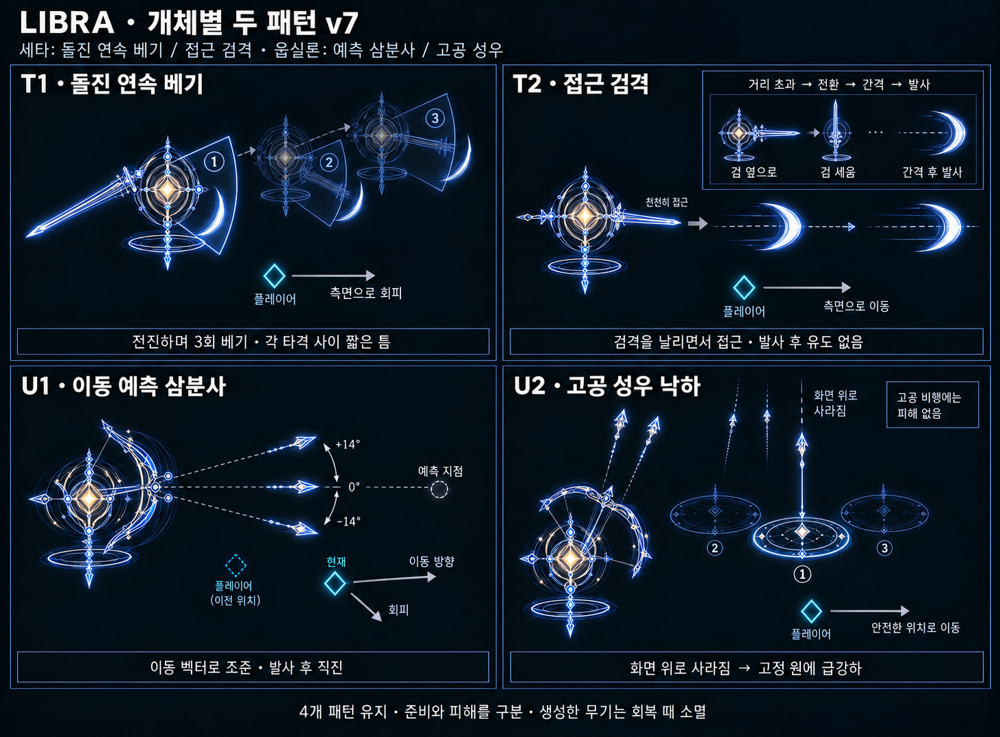
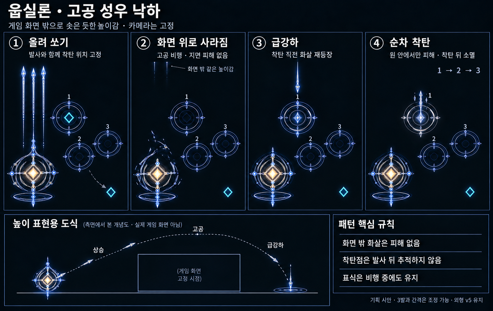

# LIBRA — 세타·웁실론 패턴 기획 v7

작성일: 2026-10-20 · 상태: 사용자 지정 방향 반영 / 수치·동시 공격은 검증 전 / 게임 미구현

공통 추가 기믹 제안: [투석추·무핵 활 별자리 v9](Libra_Counterweight_Supports_v9.md). 기본 4패턴을 유지하면서 낮은 체력 쪽에 본체와 독립적으로 반복 압박하는 보조체를 붙인다. 체력 균형·한쪽 처치 시 해제와 동시 위험 제한은 v9를 따른다. v8의 감속 영역 제안은 대체되었다.

**세타 2개·웁실론 2개**를 유지한다. 이번 방향은 사용자가 지정한 다음 네 가지다.

- 세타 T1: 부채꼴 공격을 계속하면서 돌진.
- 세타 T2: 일정 거리 이상에서 전환 애니메이션과 간격을 거친 뒤 검격 발사. 발사 중에도 플레이어에게 접근.
- 웁실론 U1: 플레이어 이동 벡터로 미래 위치를 예측하는 3갈래 화살.
- 웁실론 U2: 게임 화면 바깥까지 솟아오른 듯 높이 쏜 화살이 성우처럼 낙하.

아래 패턴 이름·횟수·시간·반경은 이를 구체화한 **초기 제안**이다. 실제 별의 물리 현상 설명이 아닌 게임 연출이며, 외형은 v5의 세타·웁실론을 유지한다.

## 1. 전투에서 보이는 네 가지 모습

| 패턴 | 무기 자세 | 본체 움직임 | 위험 형태 | 주된 회피 |
|---|---|---|---|---|
| T1 돌진 연속 베기 | 검을 몸 옆으로 젖히고 좌우 교대 | 짧은 전진을 이어가며 추격 | 본체 앞을 따라 이동하는 부채꼴 | 전진축 옆으로 빠져 측후면 확보 |
| T2 접근 검격 | 검을 세워 모은 뒤 앞쪽으로 방출 | 플레이어에게 천천히 접근 | 본체에서 분리되어 전진하는 초승달 검기 | 검기 사이 간격에 횡이동 |
| U1 예측 삼분사 | 활을 수평으로 당김 | 사격 중에는 자리 유지 | 예측점을 중심으로 벌어지는 3개 화살 | 조준 잠금 뒤 감속·방향 전환 |
| U2 고공 성우 | 활을 위로 세움 | 상승·낙하 동안 자리 유지 | 고정된 지면 원에 떨어지는 화살 | 착탄점 밖으로 이동 |

T1은 이동하는 근접 공격, T2는 분리되는 큰 호, U1은 짧고 뾰족한 3갈래, U2는 지면의 독립 원이다. T2의 검기를 화살촉처럼 그리거나 U1을 긴 빔으로 연결하지 않는다. 색을 빼도 읽히는 차이를 유지한다.

## 2. 세타 — 거리에 따라 두 패턴을 오간다

### 거리 판단과 전환

거리 d는 세타와 플레이어의 본체 중심 사이 거리다. L은 T1 한 번 베기의 유효 도달 거리다.

- **원거리 진입:** `d > 1.8L` 상태가 약 0.3초 유지되면 T2 전환을 예약한다.
- **근거리 복귀:** `d < 1.2L` 상태가 약 0.3초 유지되면 T1 복귀를 예약한다.
- 두 경계 사이에서는 현재 패턴을 유지한다. 경계 근처에서 자세를 계속 바꾸는 현상을 막는다.
- 활성 베기나 이미 시작한 발사를 중간에 다른 공격으로 바꾸지 않는다. T1은 현재 짧은 연속 베기 묶음, T2는 현재 한 발의 방출 동작을 마친 뒤 예약 전환을 실행한다.
- 등장 시에도 거리에 맞는 준비·전환을 먼저 보여준다. 멀리 있다고 첫 프레임부터 검기를 쏘지 않는다.

**전환 예시:** 감속 및 검 자세 변경 약 0.6초 → 공격 없는 간격 약 0.4초 → 새 패턴의 개별 예고 → 실행. 두 시간은 합쳐 약 1초의 출발점이며 플레이 검증으로 조정한다. 기존 투사체가 있다면 그것이 소멸하기 전에는 전환 간격이 끝난 것으로 처리하지 않는다.

전환 중에는 새 베기·새 검기·몸통 접촉 피해가 없다. 검이 남아 있다면 기존 검을 사라졌다 다시 생성시키지 않고 자세를 바꾸며, 검이 없는 상태라면 전환 중 생성한다. 방향 전환 애니메이션 자체는 별도 공격 패턴으로 세지 않는다.

### T1. 돌진 연속 베기

**인상:** 원거리에서 짧게 진입하는 찌르기가 아니라, 검을 계속 휘두르며 거리를 좁혀 오는 근접 압박이다.

1. **진입 준비:** 검을 옆에 생성하고 첫 부채꼴·전진 방향을 표시한다. 초기 예고는 약 0.8초에서 시작한다.
2. **연속 전진 베기:** 초기안은 3회다. 짧게 앞으로 밀고 나가며 앞쪽 부채꼴을 벤다. 검은 좌우로 교대해 휘두르지만, 위험 범위는 항상 표시된 전방 부채꼴 안이다.
3. **각 타격 사이:** 약 0.25~0.35초의 피해 없는 재정렬 틈을 둔다. 이때 다음 전진축을 완만하게 플레이어 쪽으로 돌리고 새 예고를 보여준다. 한 타격 실행 중에는 조준 방향을 고정한다.
4. **마지막 베기 후:** 최소 약 0.8초의 회복을 두고 검이 사라진다. 멀어졌다면 예약한 T2 전환을, 가까우면 다음 T1 준비를 시작한다.

**돌진은 묶음 전체로 보면 계속 전진하지만 판정은 매 타격에 나뉜다.** 틈 없는 상시 부채꼴 피해와 영구 추격을 만들지 않는다. 한 타격은 한 번만 피해를 주고, 지난 자리에 남는 검 잔상은 장식이다.

한 번의 베기 동안 본체가 움직이므로 정지한 부채꼴 하나만 그려서는 부족하다. **그 타격의 시작·종료 위치 사이에서 부채꼴이 휩쓸 구역 전체**가 예고 안에 들어가야 한다. 이동거리와 각도는 예고 시점에 정하고, 실행 중 더 길어지거나 꺾이지 않는다. 컨셉 시트의 옅은 미래 위치와 숫자는 동작 설명이며 세 개를 한꺼번에 피해 구역으로 켜는 뜻이 아니다.

옆·뒤로 빠진 플레이어에게 즉시 180도 돌아 베지 않는다. 타격 사이 회전은 초기 약 25~35도 이내로 제한하고, 필요한 회전이 더 크면 공격 없는 재배치로 처리한다. 벽 앞에서는 예고 전에 전진 거리를 줄이거나 타격을 보류하며, 벽을 따라 갑자기 미끄러지며 판정 방향을 바꾸지 않는다.

### T2. 접근 검격

**인상:** 거리를 벌려도 세타가 멈춰 포대가 되지 않는다. 천천히 따라오면서 검기까지 던져 플레이어의 이동을 끊는다.

1. **전환 완료:** 위의 자세 전환과 무공격 간격을 먼저 거친다. 검을 옆으로 크게 젖힌 T1과 달리 세워서 코어 앞의 빛을 모은다.
2. **접근:** 초기안은 플레이어 기본 이동 속도 V의 약 0.45배다. 사격 사이에는 플레이어 쪽으로 방향을 조정하며 전진한다.
3. **한 발 예고:** 검과 프레임을 짧게 압축한다. 조준은 이번 발의 예고 후반에 고정한다. 이후 방출까지는 잠긴 축을 따라 전진해 발사 원점의 이동이 예고 사선을 옆으로 밀어버리지 않게 한다.
4. **방출:** 본체·칼날과 확실히 떨어진 **큰 초승달 검기 하나**를 전방으로 날린다. 검기는 직진하며 후속 유도·반사·분열은 없다. 본체도 전진을 이어간다.
5. **간격:** 한 발마다 충분한 빈 박자를 두고 반복한다. 가까워지면 현재 발의 동작을 끝낸 뒤 T1 복귀를 예약한다. 근접 전환을 이유로 이미 날아간 검기를 갑자기 새 방향으로 돌리지 않는다.

발사 간격의 출발점은 약 1.2~1.5초이며 한 발의 준비 신호는 약 0.45~0.6초다. 영구적으로 검기를 뿌리지 않도록 초기에는 **2발마다 짧은 공동 회복 구간**을 넣는다. 이때 세타도 공격 없이 감속한다. 세타가 공격을 계속하는 중에도 웁실론의 공격 기회를 줄 수 있는 박자다.

검기의 피해는 실제 보이는 호와 짧은 두께에 맞춘다. 호의 속 빈 중앙을 장식과 다르게 넓은 보이지 않는 판정으로 채우지 않는다. 사거리는 유한하며, 화면 밖으로 나간 검기는 소멸한다.

## 3. 웁실론 — 이동을 읽는 화살과 높이를 쓰는 화살

### U1. 이동 벡터 예측 삼분사

**인상:** 플레이어가 지금 있던 곳을 뒤늦게 쏘는 대신, 계속 같은 방향으로 달리면 도착할 곳을 노린다.

1. **활 생성:** 외곽이 좌우로 열리고 수평 활을 만든다. 동반광은 약하게 점등하지만 별도 공격은 하지 않는다.
2. **이동 관측:** 초기 약 0.2~0.3초 동안 플레이어 실제 이동량을 평균내 속도 벡터 v를 구한다. 순간 입력이나 미래 입력을 읽지 않는다. 대시로 이동한 한 프레임이 예측점을 멀리 튀게 만들지 않도록 예측 속도를 제한한다.
3. **예측점 결정:** `예측점 = 잠금 시 플레이어 위치 + 평균 이동 벡터 × 예측 시간`. 예측 시간은 **잠금 후 남은 발사 대기 + 현재 거리 기준 화살 비행 시간**을 합친 근사값이며, 초기 최대 약 0.9초로 제한한다. 화면·맵 안으로 보정한다. 완벽한 요격 해법을 강제하는 조준은 아니다.
4. **조준 잠금:** 예측점으로 향하는 가운데 축과 좌우 두 방향을 고정한다. 최소 약 0.3초 동안 방향이 바뀌지 않는 마지막 예고를 보여준다. 실제 잠금 시간은 기본 이동으로 회피 가능한지 확인해 늘린다.
5. **삼분사:** **중앙 화살 + 좌우 약 ±14도의 화살**, 총 3발을 동시에 쏜다. 이번 안은 v6의 평행 사격이 아니라 벌어지는 3갈래다. 발사 후 세 발 모두 각자의 고정 방향으로 직진한다.
6. **회복:** 활이 소멸하고 화살이 정리된 뒤 다음 공격으로 넘어간다.

플레이어가 멈췄다면 v는 0에 가까워지고 현재 위치를 노린다. 플레이어가 잠금 뒤 감속하거나 방향을 바꾸면 조준이 빗나갈 수 있어야 한다. 실시간 추적선으로 잠금 후에도 예측을 갱신하지 않는다.

가까운 거리에서는 세 화살이 한 덩어리처럼 겹쳐 피할 틈이 없어질 수 있다. **예고 중 사거리·각도·폭을 기준으로 플레이어가 3개 사선 밖에 도달 가능한지 확인**하고, 불가능하면 거리를 벌리거나 U2를 선택한다. 발사 직전에 몰래 좌우 각도를 넓히지 않는다.

컨셉 시트의 ‘현재 위치·예측점·이동 벡터’는 설계 설명이다. 실제 게임에서는 미래 위치 점을 반드시 노출할 필요는 없지만 세 발의 최종 방향과 잠금 시점은 읽혀야 한다.

### U2. 고공 성우 낙하

**인상:** 낮은 포물선 투사체가 아니라, 화살이 게임 화면의 높이를 벗어날 만큼 솟아올라 잠깐 사라지고 높은 곳에서 꽂힌다.

1. **수직 준비:** 활을 위로 세우고 외층의 선들이 위쪽으로 당겨진다. 초기 준비는 약 0.9초. 아직 피해는 없다.
2. **발사와 지점 고정:** 초기 3발을 한 번에 높이 쏜다. 그 순간 플레이어 현재 위치 하나와 주변의 떨어진 지점 두 개를 골라 원형 착탄 경계를 동시에 만든다. U1과 달리 미래 이동 위치를 다시 추적하지 않는다.
3. **상승:** 화살은 위쪽으로 가늘고 긴 잔상을 남기며 작아진다. 끝이 화면 위에 잘려 사라질 정도로 투영 높이를 키운다. 카메라는 본래 전투 화면에 고정한다.
4. **고공:** 화살 본체는 잠깐 보이지 않는다. 상승음이 멀어지고 지면 착탄 표식만 남는다. 이 구간에도 보스와 플레이어의 위치·배율은 유지한다.
5. **급강하:** 각 착탄 직전 약 0.35~0.5초 동안, 해당 원 바로 위에 가늘고 긴 화살이 다시 나타난다. 하강 가속·짧은 수직 잔상·가까워지는 소리로 높이와 속도를 읽힌다.
6. **착탄:** 1 → 2 → 3 순으로 약 0.3초 간격. 화살촉·짧은 축과 국소적인 선 파편이 생기며 **그 순간 원 안에만 피해**를 준다. 착탄 뒤 원과 판정은 사라진다.
7. **회복:** 마지막 착탄 후 최소 약 0.9초. 활은 발사 후 먼저 사라져도 되며, 남은 화살이 끝나기 전 다음 공격은 시작하지 않는다.

발사부터 첫 착탄까지 초기 약 1.8~2.2초를 출발점으로 삼는다. 예를 들어 2.0초 비행이면 상승 약 0.65초 → 고공 약 0.95초 → 급강하 약 0.4초다. 2·3번 화살은 고공 체류를 더 길게 하여 각각 시간차로 떨어진다. 카메라 이동이나 실제 맵 위쪽 좌표까지 탄을 날리는 방식으로 높이를 대신하지 않는다.

### 높이 연출과 판정의 분리

- 고정된 **지면 착탄점**과 화살의 **시각적 높이**를 따로 취급한다. 화면 위로 이동하는 그림은 고도 표현이며 맵 상단으로 향하는 수평 탄막이 아니다.
- 상승·고공·낙하의 비행 경로에는 피해가 없다. 화면 밖의 보이지 않는 화살이 플레이어를 맞히지 않는다.
- 지면 표식은 발사부터 착탄까지 유지한다. 마지막 급강하 때만 더 밝아지며, 지면을 통째로 불투명하게 채우지 않는다.
- 원 세 개가 플레이어의 이동 가능한 길을 모두 막지 않게 배치한다. 맵 경계 보정은 발사 순간에 끝내고 표식 생성 뒤 옮기지 않는다.
- 화살은 가는 축과 화살촉으로 읽혀야 한다. 퀘이사의 큰 낙하 파편이나 운석으로 바꾸지 않는다.

## 4. 두 보스를 함께 배치할 때의 시작 규칙

세타의 모드는 거리로 결정되므로 T1 → U1 → T2 → U2의 고정 순서로 강제하지 않는다. 세타는 현재 거리에 맞는 패턴을 예약하고, 웁실론은 초기에는 U1·U2를 교대한다.

첫 시제품에서는 **공통 공격 슬롯 하나**를 사용한다. 세타의 T1 1묶음 또는 T2 최대 2발이 끝나면 회복하고, 웁실론에게 한 패턴의 기회를 준다. 다음 세타 차례에 거리를 다시 평가한다. 대기 쪽은 무기 없이 위치를 조정할 수 있으나 접촉 피해는 없다. 세타 T2의 ‘다가오면서 발사’는 세타가 공격 슬롯을 가진 동안 계속 성립한다.

처음부터 T1 돌진과 예측 삼분사를 동시에 겹치거나, 성우의 안전 공간을 세타가 전부 쓸어버리게 하지 않는다. 추후 동시 공격을 넣더라도 네 공격을 독립적으로 검증한 다음, 공통 안전 경로를 확보하는 범위에서 조합한다. 별도 협공 전용 공격을 추가하여 5번째 패턴으로 세지 않는다.

한쪽을 먼저 처치하면 살아남은 쪽은 자기의 두 패턴을 그대로 사용한다. 상대에게 주던 공격 슬롯을 제거하더라도 **기존 회복 시간을 삭제하거나 즉시 공격 속도를 올리지 않는다.** 세타는 여전히 거리로 두 모드를 오가고, 웁실론은 두 화살 패턴을 교대한다.

## 5. 수치보다 먼저 지킬 검증 기준

- 예고는 피해가 없고, 실제 피해는 표시된 구역·형태 안에만 있다. 이동하는 T1은 이동까지 포함한 범위를 미리 읽혀야 한다.
- 현재 위치에서 안전한 곳까지 이동할 최단 길이를 d_safe, 기본 이동 속도를 V라고 하면 최종 예고 시간은 `d_safe / V + 반응 여유` 이상이 되도록 조정한다. 문서의 초 수치는 이 검증을 면제하지 않는다.
- 세타의 원거리 진입·복귀 경계에 머무를 때 모드가 반복 전환되지 않는지 확인한다.
- T2는 본체의 접근과 투사체 발사가 함께 보여야 하며, 잠금 후 발사 원점 이동이 예고한 축을 바꾸지 않아야 한다.
- U1은 일정한 이동에는 앞을 노리고, 잠금 뒤 방향 변경에는 실제로 빗나가는지 확인한다. 미래 입력·순간이동 위치를 미리 읽지 않는다.
- U2는 화살이 화면 밖으로 사라져도 착탄점과 남은 위험을 잃지 않게 한다. 고도 연출이 지면 이동이나 긴 레이저로 오인되지 않아야 한다.
- 같은 한 번의 베기·검기·화살·착탄은 지속 접촉으로 여러 번 피해를 주지 않는다. 두 개체 사이의 피격 유예는 공통 규칙으로 조정한다.
- 사망·장면 종료 시 해당 개체의 남은 검기·화살·착탄 예고를 지운다. 일시정지 중에는 예고·예측 관측·고공 체류·공격 시간이 함께 정지한다.

## 6. 산출물과 현재 확인 범위

- [네 패턴 비교](Concepts/Libra_Patterns_v7.png)
- [고공 성우 동작 시트](Concepts/Libra_Upsilon_HighVolley_v7.png)
- [내장 image_gen 프롬프트](Concepts/Libra_Patterns_ImagePrompts_v7.md)
- [외형·항성 모티프 v5](Libra_Theta_Upsilon_Redesign_v5.md)

컨셉 시트는 동작과 위험 형태를 설명하는 정적 레퍼런스다. 흐린 과거·미래 위치는 복제 몹이 아니고 회색 화살표는 설명용이다. 실제 판정·시간은 본 문서를 기준으로 한다. 게임 코드는 변경하지 않았으며, 기본 이동 회피·거리 경계·예측 사격·고공 투영의 플레이 검증은 아직 수행하지 않았다.
