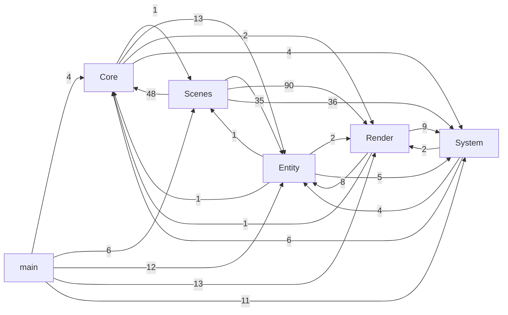
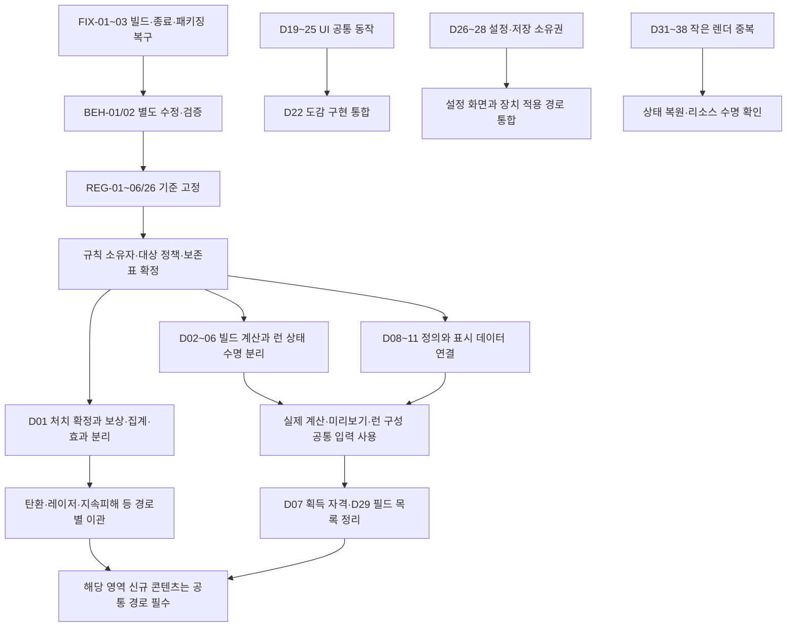

# Onedow 전체 코드 구조·중복·의존 관계 조사

조사일: 2026-10-12. 기준 저장소: `D:/01_Study/02_OpenGL/Onedow`, HEAD `abb8143`와 조사 시점의 로컬 변경을 포함한다. 기존 작업 파일은 보존했으며 이 조사 작업에서는 게임 코드·빌드 설정·QA 엑셀을 수정하지 않았다. 조사 중 `Monster.h`와 `main.cpp`의 외부 변경을 감지하여 최신 원본으로 자료를 다시 생성했다. 최초 기준은 `initial_hashes.json`, 최종 기준은 `baseline_hashes.json`, 최종 일치 여부와 시점은 `verification.json`에 기록한다.

**가장 큰 문제는 같은 규칙을 여러 진입점에서 적용하고, 그 규칙이 UI·렌더·전역 상태에 걸쳐 있다는 점이다.** 처치 처리부터 바로 추출하면 `AddKillCombo()`에 포함된 다른 보너스 누적이나 재계산 시 보존해야 할 런 상태를 놓칠 수 있다. 우선 아래 목록과 의존 관계를 통합 설계의 기준으로 사용한다.

**검토 반영:** 실행 기준은 [항목별 점검표](D:/01_Study/02_OpenGL/Onedow/Docs/QA/CodeStructure_Audit_2026-10-12/Review_Checklist.md)다. D01~D40 모두에 검증 방법·완료 조건·결정 역할을 추가했다. A 항목의 선행 회귀 검증 REG-01~06/26, 결함 FIX-01~03, 동작 변경 BEH-01/02, 입력 계약 API-01을 분리했다. [macOS CI 실측 근거](D:/01_Study/02_OpenGL/Onedow/Docs/QA/CodeStructure_Audit_2026-10-12/CI_Evidence.md)와 [주요 전역 쓰기/alias 경로](D:/01_Study/02_OpenGL/Onedow/Docs/QA/CodeStructure_Audit_2026-10-12/Global_Writes.md)를 보강했다. 이들은 구현 완료가 아닌 조사·작업 기준이다.

## 1. 범위와 조사 방법

| 항목 | 조사 결과 |
|---|---:|
| 자체 게임 소스 `.cpp/.h/.inl` | 98개, 33,643줄 |
| 테스트 소스 | 7개, 1,400줄 |
| 빌드·패키징·리소스 정의 등 보조 파일 | 24개 |
| include 지시문 | 754개 |
| 자체 소스 간 include | 457개 지시문, 중복 제거한 방향 간선 452개 |
| 함수 정의 후보 / 이름 기반 호출 위치 | 831개 / 3,739개 |
| 소스에서 참조되는 `g_*` 이름 | 276종 |
| 자동 검출 중복 후보 | 정확 일치 10묶음, 식별자 정규화 일치 34묶음 |
| 자체 `.cpp`의 VS/CMake 등록 차이 | 없음 |
| 설정된 include 경로에서 미해결된 따옴표 include | 없음 |

전체 105개 파일에 파일 크기·해시·함수·include·전역 이름 참조·호출 위치·중복 후보를 수집했다. 그 위에 전투, 스탯, 런 수명, UI, 렌더, 저장·설정, 빌드의 주요 흐름을 대조하여 **40개 검토 묶음**을 정리했다. 이 40개는 통합 가능한 중복과 의미 확인이 필요한 유사 구현을 함께 담은 조사 단위이며, 독립적인 버그 40개라는 뜻은 아니다. 엑셀 기반 DL-01~14와 기존 계획안의 추가 후보 EX-01~05를 포함하며 서로 겹치는 항목을 재분류했다.

자동 검출은 주석·공백을 제외한 9개 유효 코드 줄, 최소 55토큰 창을 비교한다. 짧은 중복, 다른 알고리즘으로 구현된 동일 규칙은 수동 검토로 보완했다. 10/34묶음은 서로 겹치므로 합산한 44개를 실제 중복 개수로 쓰면 안 된다. 숫자·문자열 리터럴은 보존하며, 식별자 정규화는 서로 다른 데이터 표도 후보로 잡는다.

함수·호출 표는 C++ AST나 링크 결과가 아니다. 오버로드·함수 포인터·매크로·가상 호출·생성자 초기화·람다를 완전히 해석하지 않는다. `g_*`는 참조 이름 수이며 전역 변수 선언 수나 쓰기 지점 수가 아니다. 주요 8개 전역은 직접 쓰기 후보와 별도 수동 alias 경로를 추가했으며 전체 전역의 완전한 데이터 흐름 분석은 아니다. 조건부 include는 모든 분기를 합산했다. 따라서 아래 결과는 **전체 파일의 정적 구조 조사와 주요 규칙의 의미 검토**이며, 모든 실행 조합에서의 동작 검증을 완료했다는 의미는 아니다. 로컬 빌드·게임 실행·회귀 테스트는 수행하지 않았고, 기존 원격 CI 5건의 실패 로그는 직접 확인했다.

서드파티 `Include/`, `miniaudio.h`, 생성된 `glad.c`는 경계와 사용 관계를 조사하되 중복 제거 대상에서 제외했다. 이미지·폰트·음원·기존 산출물은 코드 중복 대상이 아니다. 파일별 책임·의존·함수 목록은 [전체 파일 조사표](D:/01_Study/02_OpenGL/Onedow/Docs/QA/CodeStructure_Audit_2026-10-12/File_Coverage.md)에 있다.

## 2. 현재 구조와 의존 관계

| 영역 | 현재 책임 | 주요 결합 |
|---|---|---|
| `main.cpp` | 앱 수명, 상태 전환, 런 시작/종료, 스탯 재구성, 전투 루프, 보상, HUD | 모든 영역의 전역 상태를 직접 조정 |
| `Core` | GameState/GameManager, 메타, 업적, 도감, 증강 슬롯, 공용 컨텍스트 | Entity/System/Render 및 일부 Scene에 의존 |
| `Core/Scenes` | 메뉴, 설정, 런 구성, 증강 선택, 시작/종료 UI | 게임 모델·설정·렌더에 넓게 의존; 일부 런 정책도 수행 |
| `Entity` | 몹 AI/투사체/충돌/스탯/증강/스폰 | 일부 Render·Scene 의존; 헤더에 구현과 상태가 집중 |
| `Render` | 도형, 텍스트/아이콘/셰이더, 엔티티 표시, 손맛 | Entity 모델과 전투 카운터까지 참조 |
| `System` | 입력/IME, 저장/설정, 오디오, 플랫폼, 디버그/텔레메트리 | Core/Entity/Render 상태를 읽거나 수정 |

아래 화살표는 실제 include 방향이다. 괄호는 영역 사이 include **지시문 수**이며 파일 간 중복 제거 간선 수와 다르다. 내부 간선은 생략했다.

**파일 include 그래프에는 순환이 검출되지 않았지만, 영역을 묶으면 양방향 의존이 존재한다.** 이것은 모순이 아니다. 서로 다른 파일을 통해 영역 간 역할이 얽힌 것이다. 전역 `extern` 참조와 런타임 호출에 따른 결합은 include 그래프보다 넓다.

| 의존 허브 | 직접 의존하는 파일 | 간접 포함 의존 파일 | 영향 |
|---|---:|---:|---|
| Settings.h | 24 | 68 | 언어·시련·옵션·게임 설정이 한 헤더로 확산 |
| Platform.h | 4 | 51 | 플랫폼 경계가 광범위한 헤더 체인을 통과 |
| AugmentDescKR.h / Augment.h | 1 / 15 | 50 / 49 | 한국어 설명 구현이 증강 공용 모델을 통해 확산 |
| PlayerStats.h | 19 | 43 | 전투·UI·메타·미리보기·텔레메트리의 중심 |
| EnemyParticles.h / Bullet.h / EnemyShield.h | 2 / 8 / 2 | 39 / 37 / 37 | 몹 헤더에서 렌더·투사체 관련 의존으로 확대 |
| Monster.h / RangedMob.h | 15 / 3 | 35 / 30 | AI·상태·사망 연출 구현이 헤더에 집중 |
| DrawPrim.h / MonsterManager.h | 22 / 12 | 29 / 28 | UI 렌더와 게임 엔티티 접근의 중심 |

간접 포함 수는 조사한 헤더·소스·테스트 파일의 도달 가능 수다. 실제 재컴파일 번역 단위 수나 빌드 시간 측정값으로 해석하지 않는다. 전체 간선은 `includes.tsv`, 영역 집계는 `module_edges.tsv`에 있다.

### 특별히 끊어야 할 경계

1. **Entity → Scene**: `PlayerRuntime.cpp:3`이 `SceneSkills.h`를 포함하여 게임 스킬 상태를 화면 계층에서 가져온다. 장착 스킬/쿨다운은 게임 상태가 소유하고 화면은 이를 표시해야 한다.
2. **전투 → Render → 전투**: `Juice.h:96`의 `AddKillCombo()`가 콤보, 무한 세례용 `g_RainKillAccum`, 킬 효과음을 함께 바꾼다. 충돌/레이저/공통 보상에서 이 함수를 호출하고 `main.cpp:2907`이 누적값을 읽는다. 전투 집계와 표시 효과를 분리해야 한다.
3. **Entity 헤더 → 사망 렌더**: `Monster.h`에 AI·충돌 상태와 사망 연출용 형상 생성이 함께 있다. 형상 공유와 렌더 구현 이동을 별개로 다룬다.
4. **입력 → 특정 화면/저장 UI**: `Input.cpp`가 GameManager/Codex와 설정 볼륨 편집 전역을 안다. 키 상태·텍스트 입력·Windows IME·화면별 편집 정책의 경계가 불분명하다.
5. **SceneContext/GameContext → 광범위한 모델**: 편리한 컨텍스트가 화면 대부분에 전체 상태를 노출한다. 이미 존재하는 ScenePause/RunEnd/Start의 좁은 컨텍스트 방식을 필요한 화면부터 재사용한다.
6. **SceneMenus.cpp → 여러 `.inl`**: 메인 메뉴/상점/도감 두 구현이 한 번역 단위와 파일 지역 상태를 공유한다. `.inl`을 독립 소스처럼 분리하면 숨은 상태 의존이 드러난다.

## 3. 중복·유사 구현 목록

분류: **규칙**=같은 게임 규칙의 여러 구현, **데이터**=동일 사실의 여러 정의, **절차**=같은 단계의 반복, **유사**=공통 부분은 있으나 동작 차이를 보존해야 함. A는 구조 이관 전 검증/복구가 필요한 선행 항목, B는 해당 영역 이관 시 통합, C는 작은 정리다. FIX의 A는 즉시 결함 복구 우선순위다. 단순 줄 번호는 조사 시점 위치이며 심볼을 기준으로 찾고, 기준 갱신 절차는 점검표 6장에 명시했다.

### 전투·스탯·런 수명

| ID | 분류/순위 | 확인 위치·현상 | 통합 후보와 보존 조건 |
|---|---|---|---|
| D01 | 규칙 A | main `creditKill`/사망 수거/레이저, CollisionSystem 일반몹·원거리몹의 5개 보상 경로. main:2461,2487,3030; CollisionSystem.h:153,228 | 처치 사실을 한 번 확정한 뒤 대상 정책에 따라 보상·런 집계·도감·콤보를 적용. `scored`와 `exploded`의 다른 역할 보존. DL-01 |
| D02 | 규칙 A | main `RebuildPlayerStatsFromOwned`:540, `S_CHAOS` 분기:698, 새 런/재시작; SceneAugment:427 미리보기; RunConfig:57 `FinalizeLoadout` | 기본값→메타/스케일→무기→시련→증강 계산을 공유하고 런 상태 복원을 별도 단계로 둔다. UI 예상값과 실제 빌드의 입력을 명시 |
| D03 | 규칙 A | main:540~590 / 698~722의 `keep*` 보존 목록 | 킬/흡혈마/연속 처치/무기 관련 누적 복원 중복. 전쟁군주 보존은 일반 재계산과 대혼란이 다름. 전부 같은 초기화로 바꾸지 않는다. DL-14 |
| D04 | 절차 A | main:561,644 `ResetAugmentDerivedRuntime`,1323 `ResetForNewGame`,1451 `AbandonCurrentRun` | 드론/차크람/레이저/오브/스킬 등 초기화 목록이 분산. 새 런·재계산·포기별 보존표가 먼저 필요. EX-01 |
| D05 | 규칙 A | main:1489 포기 / 1894 DYING 결과 처리; SaveSystem.h `RecordRunResult`:264 | Creative 제외, 결과 기록, 게임 수 업적, 저장 요청이 반복. 결과 확정은 한 소유자가 한 번 수행하고 사망 연출 시점은 유지 |
| D06 | 절차 A | PlayerRuntime.cpp:19 `ResetPlayerSkills` / SceneSkills.cpp:24 `ClearEquippedSkills` | 동일 장착 슬롯/교체 인덱스 초기화. 전자는 대시·실드·시간정지까지 초기화하므로 슬롯 초기화만 공통화하고 호출 목적 구별 |
| D07 | 규칙 B | GameManager.cpp:244,313,402의 once-only 타입/슬롯 장부 검사 | 획득 자격 판정을 공유하되 일반/디버프/특수 추첨의 retired·선행조건 필터 차이를 정책으로 남김. EX-02 |
| D08 | 규칙 B | Settings.h:193~231 시련 실제 배율 / SceneRunConfig.cpp:1096~1158 설명 합계 | 계산 결과를 UI가 사용. 임계 구간/누적/상한 확인. DL-05 |
| D09 | 데이터 B | Monster.h:`MakeKind`(404), RangedMob/EnemyProgression/EnemySpawner / Codex 수치 문자열 | 기본 스펙·진행 배율·현재 스펙을 구분하고 기본 정의에서 도감 수치를 얻음. 문장 자체는 번역 소유 유지. DL-10 |
| D10 | 데이터 B | Weapons.h:47, SceneRunConfig.cpp:345/362/366, main:2384 펄스 | 무기 기본 표와 실제 적용 경로·펄스 상수가 별도 관리됨. 표가 기본값/최종값/펄스 중 무엇을 뜻할지 확정 필요. DL-11 |
| D11 | 데이터 B | PlayerStats.h `Apply`, AugmentCatalog.cpp, AugmentDescKR.h, Augment.h `AugDesc`, 아이콘/예약 ID | 효과 수치·설명·분류·식별자가 분산. 안정 ID를 유지하고 수치 소유자를 정함. 짧은 요약/긴 설명/언어별 문장은 구별. DL-09 |
| D12 | 유사 B | MonsterManager.h `CollisionTier`:101 / `RegulusTargetTier`:188 / Codex.h `CodexMobTier`:360 | 분류 목적이 다르므로 단일 Tier로 합치지 않음. 공통 기초 속성만 검토. 엑셀의 `CombatTier`는 현재 소스에서 발견되지 않음. DL-06 |
| D13 | 규칙 B | main:2962~2967,3021~3025 광전사 HP 비율 피해 배율; CollisionSystem.h:92 치명타 / main:3019 | 배율 계산/치명타 추첨은 공유 후보. 발사 시 고정 피해와 타격 시 계산의 시간 차이는 보존 |
| D14 | 절차 B | CollisionSystem.h:133~152 /206~225 및185~197 /264~276 | 일반/원거리 몹의 피해 선택·숫자·불꽃, 관통/도탄 후속 처리 중복. 피격 반경과 hackRanged 특수 행동은 별도 |
| D15 | 유사 B | Monster.h:`ConstrainGenesisToViewport`/`ConstrainGimbalToViewport`/`ConstrainRegulusToViewport`(1107/1122/1134), main의 Gravis/Quasar 반사·범위 | 경계 clamp/반사에 공통 기하가 있으나 몸체 반경·속도 반전·앵커 의미가 다름. 필요한 기하 도구만 추출. DL-07 |
| D16 | 유사 B | RangedMob.h:`Update`(101) Scope / Monster.h:`UpdateGimbal`(1315) | 추적→차징→발사 형태 유사. Scope 3연사와 Gimbal 단발 등 상태 전이 차이 유지. 거대 공용 AI FSM은 근거 없음. DL-08 |
| D17 | 유사 B | MonsterManager.h `FindNearest`:73 / CollisionSystem.h `RicochetTo`:60 / main 조준 탐색 | 일반/원거리 대상 순회가 반복. 생존 대상 열거는 공유 가능, 도탄 제외 대상·거리·조준 우선순위는 각 정책 유지 |
| D18 | 절차 C | EnemySpawner.cpp:24~57/90의 종류별 생존 수 계산, Manager의 개체 제한 검사 | 종류별 조회/집계 공통 후보. 한 번의 순회로 바꿀 여지는 있으나 성능 효과는 측정하지 않음 |

### UI·텍스트·설정

| ID | 분류/순위 | 확인 위치·현상 | 통합 후보와 보존 조건 |
|---|---|---|---|
| D19 | 절차 B | SettingsText/ShopText/FxText/PlayText/codexText/CodexLocalizedText, CurLangIdx/Tutorial LangIndex | KR/EN/JP 선택과 인덱스 보정 반복. 선택기만 공통화하며 기존 UI 텍스트 관리 방침에 맞춰 거대 문자열 레지스트리는 만들지 않음. DL-02 |
| D20 | 절차 B | SceneSettings의 기준 간격, Shop/Codex/RunConfig/Augment의 rect·rail·hover·scrollbar | 동일 레이아웃 계산을 그리기와 hit test가 공유. 모든 화면을 같은 레이아웃으로 강제하지 않음. DL-03 |
| D21 | 절차 B | SceneCodexInline.inl:48/706/761, SceneShop.inl:78/683/722, RunConfig/Settings 선택 처리 | back 입력·키 반복·스크롤바 드래그 중복. 화면별 포커스/선택 이동 차이 유지. DL-04 |
| D22 | 규칙 B | SceneCodex.inl / SceneCodexInline.inl; Scene_Codex 분기와 DebugToolkit CODEX 캡처 | 독립 도감과 메뉴 내 도감의 표시/분류/검색/wrap 중복. 일반 진입이 줄었다고 삭제 불가; 디버그 캡처 포함 호출자를 정리한 뒤 한 본체+진입 어댑터 검토. DL-12 |
| D23 | 유사 B | Codex.inl:121 /Inline:1017 exact wrap, SceneAugment `TarotWrapAugment`:279 및1814, RunConfig:1176 | 동일 wrap 구현은 합침. 공백/CJK/문장부호/강제 개행 차이는 옵션 또는 별도 정책으로 보존 |
| D24 | 절차 C | SceneStart.cpp:64~81 /214~228 튜토리얼 문장 split/trim | 같은 전처리 한 번 정의. 시작 화면과 Ready의 위치/연출은 유지 |
| D25 | 절차 B | CodexInline:94 /Shop:115 및 Settings/RunConfig 전환 처리 | 진입/뒤로가기 애니메이션 시간·완료 처리 반복. 화면별 세션 초기화는 분리 |
| D26 | 데이터 A | Settings.h 기본값, SaveSystem.h 저장/로드, SceneSettings.cpp:112~200 스냅샷·1510 재초기화·적용 | 옵션 추가마다 여러 목록을 갱신. 설정 값/기본값/범위/스냅샷/적용의 소유 관계 정리. 저장 호환성과 즉시 적용 후 취소 복원 확인. DL-13 |
| D27 | 절차 B | Audio.cpp 내부 적용값 / Settings.h 원하는 값 / main:1740 동기화 / SceneSettings 클릭 적용 | 원하는 설정과 실제 장치 상태의 이중성은 필요하나 적용 호출이 분산. 공통 apply 경로로 모아 미리듣기/취소 복원 의미 보존 |
| D28 | 데이터 B | SaveSystem.h:44~100 저장 키 /170 이후 로드 /242 초기화 | 필드 목록·기본값 반복. 옵션 유지와 진행 초기화는 대상이 다름. 새 저장 포맷 도입보다 기존 필드/호환성 표부터 작성 |
| D29 | 데이터 B | GameplayTelemetry.h snapshot/capture:75~117/augment diff:197~240; DebugToolkit.cpp:222/314; Augment 미리보기 필드 | 스탯 필드 목록을 수동으로 여러 번 관리. 공통 필드 기술이 필요한 범위만 공유; 디버그 편집 권한·텔레메트리 노출·UI 표시는 분리 |
| D30 | 절차 C | main:3593/3614 Creative HUD,3878/3939 스킬/상태 슬롯 frame | 동일 상태 색/표시와 프레임 기하 반복. 내용·쿨다운 배치와 프레임만 분리 |

### 렌더·리소스·개발 도구

| ID | 분류/순위 | 확인 위치·현상 | 통합 후보와 보존 조건 |
|---|---|---|---|
| D31 | 데이터 B | Monster.h:`DrawGenesisDeathEffect`(833) / EntityDraw.cpp의 Genesis 분기(720) | 외피 9정점/판 7정점 각도 정의 반복. 기본 형상만 공유하고 사망 scale/shake와 생존 fill/push는 유지 |
| D32 | 절차 C | EntityDraw.cpp:346~350/408~412 원형 가시성, drawLineQuad:36; Menus LogoLine:251; Augment TarotSegment:63; WeaponShell DrawPlayerLine:37 | 동일 원형 cull/선분 사각형 기하 공유 후보. 축퇴 기준·두께·스타일 차이 유지. EX-04 |
| D33 | 유사 C | UiLayout Smoothstep:31, SceneTransitionEase:38, Augment/Logo/Debug의 Clamp01 및 Ease 함수 | 동일 clamp/보간만 재사용. cubic/quintic/ease-out이 다른 함수를 이름이 비슷하다고 합치지 않음 |
| D34 | 절차 C | IconSystem.h:316/349 알파 보강;528/562/597 아이콘 그리기 | 동일 픽셀 알파 루프와 quad 준비/upload 반복. Darken의 GL_MIN과 blend 복원은 별도 draw 옵션/계약 유지. EX-03/05 |
| D35 | 절차 B | TextRenderer.h:416/486 glyph 배치,435~465/510~540 upload; IconSystem/TextRenderer vertex source | 일반/회전 텍스트의 glyph 순회와 제출 중복. 회전 좌표만 분리하고 glyph atlas·batch flush 계약 유지. 공유 vertex source 후보도 포함 |
| D36 | 절차 B | MainShader.cpp Compile:149; IconSystem Compile:110; TextRenderer Compile:175; GameManager initShaders:47; Nebula/Planet/Blur link | 컴파일/링크/quad VAO 초기화 반복. 오류 처리 수준이 달라 기존 공통 함수를 보강해서 사용. 셰이더별 uniform/fragment/블렌딩은 유지 |
| D37 | 절차 C | MainShader.cpp:63~76/82~95 gradient texture; EmbeddedResource.h:21 vs IconSystem:328/339/643 | 같은 GL_RED+mipmap 생성과 Windows resource 읽기 반복. 이미 있는 EmbeddedResource helper 우선 재사용. 새 범용 리소스 프레임워크 불필요 |
| D38 | 유사 B | Icon/Text/MainShader/Blur/Nebula/Planet의 shader·VAO·blend 변경; MainShader.cpp:244/327 quad | 공통 제출 단계와 상태 복원 계약 후보. 효과별 상태 차이 있어 무조건 공용 draw로 합치지 않음. `g_GfxPass`/batch flush 순서 명시 |
| D39 | 절차 C | scripts/test_* 7개에서 vswhere/vcvars/cl/실행 반복 | 테스트 실행 환경만 작은 공통 runner 후보. GL 링크가 필요한 blur와 헤드리스 도메인 테스트 차이 유지. 테스트 안 작은 fixture는 독립성 이점 고려 |
| D40 | 데이터/절차 B | CMakeLists /vcxproj 소스·Resource, package/zip/release 스크립트, macOS CI | 현재 cpp 목록 일치. 패키지 경로·버전·복사 대상은 분산. 플랫폼 공통 패키지 내용 기준을 정하고 플랫폼 단계는 별도 유지 |

`D32`의 선분 구현이나 `D38`의 GL 처리처럼 닮았다는 이유만으로 한 함수로 합칠 수 없는 항목도 포함했다. 같은 데이터 구조 모양, enum switch, 각종 명시적 필드 대입은 그 자체로 제거 대상이 아니다.

## 4. 동작 불일치와 구조상 위험

| 상태 | 근거 | 처리 방향 |
|---|---|---|
| BEH-01 / 확정 동작 변경 | 일반 스웜: 탄환 기본 흡혈 20%, 공통 경로 100%, 레이저 흡혈 누락 | 구조 변경과 별도 티켓/검증으로 먼저 처리. 모든 수단 100%; 점수/XP/스타더스트 배율과 분리 |
| BEH-02 / 확정 동작 변경 | 투척 스웜: 탄환은 콤보·도감, 공통 경로는 제외; 레이저는 일반 보상 분기로 들어갈 수 있음 | 구조 변경과 별도 티켓/검증으로 먼저 처리. 콤보·도감만; 제외 항목은 점검표 참조 |
| 새로 확인한 숨은 부수효과 | `Juice.h:96~101` AddKillCombo가 `g_RainKillAccum`도 증가; main:2907이 무한 세례 쿨다운 감소에 사용 | 기존 콤보 호출을 그대로 재사용하면 ‘콤보·도감만’ 정책과 다른 보너스가 붙음. 콤보 표시와 해당 처치 누적을 분리하는 설계 필요; 무한 세례의 세부 대상 정책은 별도 확인 항목 |
| 의도 확인 필요 | 일반 스탯 재계산은 전쟁군주 누적 복원, 대혼란은 미복원 | DL-14 이관 전에 결정. 이번 조사에서 임의 확정하지 않음 |
| 정적 불일치 후보 | Trial HP 적용이 미리보기/새 런/재시작과 일반 재계산/대혼란에서 다름; FinalizeLoadout의 baseFireInterval 저장 순서가 재계산과 다름 | 동일 입력 비교 검증과 의도 확인 필요. 현재 보고서만으로 실제 플레이 버그로 단정하지 않음 |
| 의도 확인 필요 | Creative 회복/처치/결과 기록 가드가 경로별로 다름 | Creative·DYING 정책 표를 별도 작성하고 해당 통합 전에 확인 |
| FIX-01 / A, CI 확인 | 최근 macOS CI 5건 실패. 최신은 main의 swprintf_s 명시 크기 호출을 Platform.h 매크로가 잘못 확장. 이전에는 SceneAugment에서도 같은 오류 | 실제 실패를 먼저 복구. [CI 근거](D:/01_Study/02_OpenGL/Onedow/Docs/QA/CodeStructure_Audit_2026-10-12/CI_Evidence.md) 참조. 전체 macOS 빌드 통과 전 미완료 |
| FIX-01 / A, 후속 플랫폼 장애 | Input.cpp의 Windows native/windows.h/imm.h 및 HWND/HIMC가 CMake 공통 소스 | 위 CI는 Input.cpp 컴파일까지 도달하지 않음. IME 플랫폼 분리와 Windows/macOS 입력 검증을 같은 티켓의 별도 단계로 수행 |
| FIX-03 / A, 패키징 불일치 | zip_onedow.ps1은 staging 지정 파일, shell/CI는 bin/Onedow 전체 압축 | 포함 정책 차이는 확인됨. 임시 fixture로 save/스크린샷 제외와 배포 manifest 동일성 검증. 실제 사용자 파일 포함 사례는 미관측 |
| FIX-02 / A, 종료 수명 결함 | main 종료에서 TextL/S만 Cleanup 후 glfwTerminate; TextXL 전역 소멸자는 GL Cleanup 수행 | TextXL도 컨텍스트 유효 구간에서 정리하는 작은 수정 우선. 크래시 재현 여부와 독립적으로 호출 순서 결함 확인 |
| API-01 / A, 입력 계약 | SpawnEnemyParticleBurst의 delay/life/범위 제한, 무시 인자와 용량 정책 | 호출자 요청과 결과를 대조하는 별도 계약 조사. 기존 파편 테스트의 상한 만족을 의도 보장으로 간주하지 않음 |
| 전환 소유권 중첩 | main의 GAMEOVER→READY 처리와 GameManager::UpdateStateSystem/ResetRunProgress 모두 런 초기화를 관여 | 상태 쓰기 순서에 따라 중복 실행이 억제될 수 있으므로 ‘두 번 초기화 버그’로 단정하지 않음. 전환 owner를 하나로 정할 필요 |
| RNG 결합 | 전투/스폰/AI와 UI·VFX가 전역 rand 흐름 공유 | 표시 효과를 바꾸면 게임 난수 흐름도 달라질 수 있음. 재현성/회귀 비교 시 주의; RNG 분리는 별도 설계 티켓 |

## 5. 자동 중복 후보 전체 판정

아래는 자동 후보를 빠짐없이 분류한 결과다. 파일/줄별 원본은 `clones_exact.tsv`, `clones_renamed.tsv`에 있다.

| 정규화 후보 | 판정/연결 |
|---|---|
| 001 | once-only 획득 장부 → D07 |
| 002 | 증강 패널의 반복 그리기 블록 → D20/D32; 레이아웃 차이 보존 |
| 003 | SceneContext 지역 참조 별칭 → 제외. 구조를 푸는 선언이며 독립 중복 규칙 아님 |
| 004 | 기존 도감의 상세 설명 박스 → D22/D23 |
| 005 | 두 도감 wrap → D22/D23 |
| 006 /007 /008 /009 | back 입력 /전환 /키 반복 /스크롤 드래그 → D21/D25 |
| 010 | 튜토리얼 split/trim → D24 |
| 011 | 서로 다른 증강 목록 그룹 순서 → 제외. 분류 목적이 다른 정책 |
| 012~016 | 증강 카탈로그 행의 동일 스키마 → 행 반복 자체는 제외. 동일 수치의 설명/적용 중복은 D11에서 별도 관리 |
| 017 /018 | 피해 처리 /관통·도탄 → D14 |
| 019 | Genesis 형상 → D31 |
| 020 /021 /022 | 아이콘 알파 /일반·darken /회전 제출 → D34 |
| 023 | 아이콘·텍스트 초기화 → D35/D36 |
| 024 /025 | gradient texture /quad 구성 → D37/D38 |
| 026 /027 /028 /029 | shader link /vertex source /초기화 /VAO → D36 |
| 030 /031 | glyph 배치 /upload → D35 |
| 032 | snapshot의 서로 다른 필드 대입 → 해당 창은 제외. 별도 capture/diff/편집 목록 유지 문제는 D29 |
| 033 /034 | Creative HUD /스킬 슬롯 프레임 → D30 |

정확 일치 001→D07, 002→D23, 003/004/005→D21, 006→D24, 007/008→D34, 009→D37, 010→D35. 제외 판정은 ‘해당 영역에 중복이 없다’는 의미가 아니라 자동으로 잡힌 그 코드 모양만으로는 중복 규칙이라고 판단하지 않는다는 뜻이다.

## 6. 통합 순서와 선행 의존

조사 결과에 따른 **권고 순서**이며 구현을 시작한 것은 아니다. 모든 중복을 한 번에 없애거나 기반 프레임워크를 먼저 만드는 방식은 피한다.

| 통합 영역 | 제안 소유자/입력 | 의존 조건 | 완료 판정 |
|---|---|---|---|
| 처치 | Entity의 처치 사실/대상 정책, Core의 런 결과; Render/Audio는 효과 소비 | 대상 유형, once-only 확정, 콤보 부수효과, Creative 규칙 | 새 몹·무기에서 별도 보상 계산이 필요 없고 5개 기존 경로가 동일 정책 사용 |
| 스탯 | 순수 빌드 계산 + 명시적 런 상태 보존/복원 | 무기/메타/시련/증강 순서, HP/스택 정책 | 실제값과 미리보기에 동일 입력을 주었을 때 동일 계산; 초기화 목적별 차이는 명시 |
| 콘텐츠 정의 | 기존 Entity 정의를 기본값 소유자로 활용 | 안정 ID·저장 호환, 기본/현재/표시값 구분 | 밸런스 변경이 UI 숫자 문자열 수정에 의존하지 않음 |
| UI | 기존 UiLayout/SceneUI 등을 확장 | 선택/포커스/텍스트 정책 차이 | 동일 rect로 표시/hover 처리, 입력 동작과 화면별 의미 보존 |
| 설정 | 원하는 값·스냅샷·저장·적용 소유 관계 | 이전 저장·취소 복원·오디오 적용 | 필드 추가 위치가 추적 가능하고 저장/복원/화면이 누락되지 않음 |
| 렌더 | 기존 DrawPrim/EmbeddedResource/셰이더 함수 활용 | GL 상태·batch flush·context 수명 | 효과별 출력과 후속 draw 상태 보존 |

신규 콘텐츠·밸런스 개발은 계속할 수 있다. **통합 완료 영역부터 공통 경로 사용을 필수로 한다**는 기존 합의를 적용한다. 아직 이관하지 않은 경로는 목록에서 추적하고 공통 경로로 연결할 때 기존 구현을 함께 제거한다. 규칙·초기화 목록·의존 파일이 바뀌면 이 조사표를 갱신해야 한다.

## 7. 후속 검증 범위와 산출물

현재 테스트 7개는 blur, Genesis launcher, Magnetar field, mob death FX, Quasar beam/nova, Regulus beam에 집중된다. 처치 보상·런 결과·스탯 재계산/미리보기·설정 복원의 동등성을 직접 보장하는 전용 검증은 현재 목록에서 확인되지 않았다. 해당 영역 이관 시 기존 테스트를 유지하고 그 규칙을 확인하는 최소 회귀 검증을 추가한다. 단순 UI 문구/작은 기하 helper에 구현을 복제하는 테스트를 붙일 필요는 없다.

| 파일 | 용도 |
|---|---|
| `File_Coverage.md` | 전체 105개 파일의 책임·줄 수·함수·직접 의존·검토 항목, 보조/외부 경계 목록 |
| `files.tsv` / `support_files.tsv` | 파일별 정량값·해시와 보조 파일 목록 |
| `includes.tsv` / `module_edges.tsv` | include 발생 위치와 영역 관계 |
| `functions.tsv` / `call_sites.tsv` | 함수/이름 기반 호출 위치. 완전한 C++ 호출 그래프 아님 |
| `global_references.tsv` | 전체 `g_*` 참조 파일별 분포; 읽기/쓰기 구분 없음 |
| `focus_write_candidates.tsv` / `Global_Writes.md` | 주요 전역의 직접 쓰기·수정 호출 후보와 참조/포인터 alias 경로 |
| `Review_Checklist.md` | D01~D40 개별 완료/검증/담당, A 선행 테스트, FIX/BEH/API 분리 |
| `CI_Evidence.md` / `ci_*_failed.log` | macOS CI 최근 실패 5건의 원격 근거 |
| `clones_exact.tsv` / `clones_renamed.tsv` | 자동 후보의 모든 발생 위치 |
| `summary.json` / `baseline_hashes.json` | 구조 집계와 최종 조사 시점 기준 |
| `initial_summary.json` / `initial_hashes.json` / `verification.json` | 최초 기준, 조사 중 외부 변경 감지, 최신 기준 일치 확인 |
| `audit_structure.py` | 원본 수정 없이 정적 자료 재생성. 재실행하면 기준 해시도 갱신됨 |

최종 확인: 파일 목록/등록/간선/후보 분류의 일관성과 보강 작업 시작 기준 해시를 대조한다. **현재 코드의 로컬 빌드·게임 동작 검증과 CI 복구는 후속 구현 단계에 남아 있다.** 과거 CI 실패를 확인한 것과 새 구현의 성공 검증을 구별한다. 클래스/API 최종 설계는 선행 FIX/BEH/REG 기준을 정리한 뒤 진행한다.
