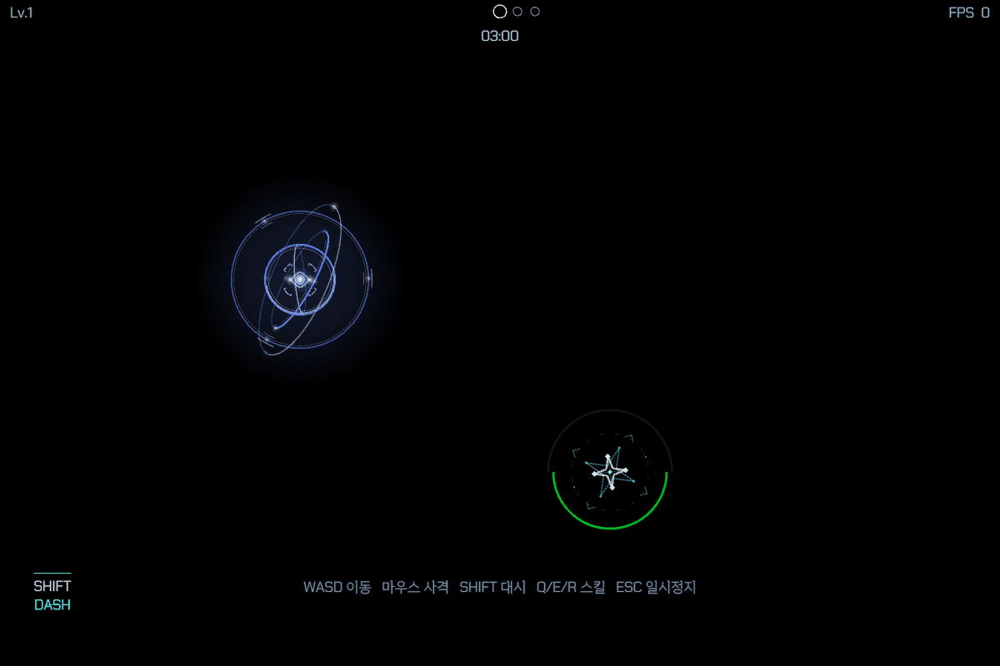

# QUASAR 엘리트 — 강착 파편 연속 폭격 v4

작성일: 2026-10-17 · 상태: 게임 적용 · 피해·밀집도는 플레이 검증 대상

공통 규칙: [엘리트 몹 공통 규칙](Elite_Enemy_Rules.md)

## 시각 디자인

기존 퀘이사의 코어·자이로 띠·강착 원반을 유지하면서, 원반의 네 방출부에서 파편을 계속 만들어 쏜다. 원반이 열리고 회전이 빨라지며, 매 발사 때 방출부가 잠깐 비었다가 복원되고 국소 방출 고리가 점등한다. 파편은 여섯 꼭짓점의 각진 덩어리·흰 중심선·작은 부스러기 두 개로 구성한다. 기존 작은 노드보다 크고 잔상이 굵다.

v4는 퀘이사 두 패턴의 준비 동작과 파편 궤적을 수정한 버전이다. 위 미리보기는 실제 렌더러의 지정 시점 캡처를 시간 순서대로 묶은 것이다. [이전 v3 콘셉트](Concepts/Quasar_Elite_Barrage_v3.png)는 과거 참고 이미지이며, 직선 급강하 표현은 v4에 적용하지 않는다.

## 두 패턴 구별

| 항목 | 기존 양방향 빔 | 파편 연속 폭격 |
|---|---|---|
| 본체 예고 | 띠가 접히고 빔 축에 정렬 | 원반이 벌어지고 방출부들이 연속 점등 |
| 위험 형태 | 긴 직선 | 시간차로 생성·소멸하는 여러 원 |
| 동작 | 코어에서 양방향 광선 | 원반에서 파편 연속 방출·회전하며 휘어지는 접근 |
| 대응 | 빔 축에서 옆으로 이탈 | 계속 이동하며 새 표식과 기존 표식 사이로 경로 선택 |

빔 → 폭격 → 빔 순으로 교대하며 각각의 회복 후 기존 3.2초 대기를 거친다. 폭격 전 대기와 폭격 중에는 빔 조준선·극 제트를 표시하지 않는다. HP·스폰·보상은 이번 변경으로 바꾸지 않는다.

## 발사·조준 규칙

1. **1.1초 준비:** 본체 표류를 멈추고 먼저 원반을 수축하며 회전을 감속한다. 이후 띠와 원반을 크게 펼치며 가속하고 연속 방출로 이어진다. 아직 착탄 표식과 피해는 없다.
2. **0.2초마다 1발, 총 18발:** 매번 발사하는 시점의 플레이어 위치를 읽는다. 첫 발과 마지막 발 사이의 시간은 정상 고정 업데이트에서 약 3.4초다.
3. **무작위 분산:** 약 2/3는 플레이어 중심 반경 90px 안, 약 1/3은 90–180px 고리 안의 점을 정한다. 이동 방향 예측 조준은 하지 않는다. 발사 후에는 그 점을 따라 움직이지 않고 고정한다.
4. **각 발 1초 예고:** 발사 순간 원형 표식을 하나 만들고 원주 진행 표시를 채운다. 18개를 한꺼번에 예고하지 않는다. 정상 동작에서 동시에 남아 있는 미착탄 예고는 약 5개(경계 프레임에서 최대 6개)다.
5. **착탄:** 각 파편은 자기 발사 시점 1초 뒤에 착탄한다. 이전에 쏜 파편이 떨어지는 동안 다음 파편들을 계속 발사한다. 마지막 발까지 떨어진 뒤 약 0.8초 회복한다.

첫 발은 준비 시작 약 1.1초에 발사해 약 2.1초에 착탄하고, 마지막 발은 약 4.5초에 발사해 약 5.5초에 착탄한다. 회복까지 약 6.3초다. 긴 프레임이 생기면 밀린 여러 발을 한 번에 쏘지 않고 발사 간격과 각 발의 1초 예고를 유지하므로 실제 패턴 길이는 늘어날 수 있다.

## 한 발의 이동과 시각 표현

탄환 세례가 방향을 틀며 들어오는 인상을 참고했다. 매 발사 때 정해진 착탄점으로 휘어 들어오며, 비행 중 플레이어를 다시 추적하거나 이미 표시한 원을 옮기지는 않는다.

- 출발점에서 원반의 접선 방향으로 빠져나온 뒤 큰 활 모양으로 돌아 들어온다. 각 발의 곡선은 출발점·접선 방향·착탄점을 기준으로 정한다. 좌우로 휘는 방향은 발마다 교차한다.
- 전체 비행을 단일 3차 곡선으로 연결한다. 이전의 ‘짧은 분리 → 직선 접근 → 수직 급강하’ 구간 전환을 제거해 중간에 방향과 속도가 꺾이지 않는다. 비행 후반으로 갈수록 진행이 빨라진다.
- 파편은 곡선 접선 방향을 따라 자세를 바꾸면서 자체 회전도 한다. 끝부분에서 갑자기 수직으로 자세를 고정하지 않는다.
- 잔상도 실제 과거 궤적을 여섯 구간으로 따라 그린다. 길이는 약 65px로 제한해 긴 레이저처럼 보이지 않게 한다.
- 착탄 순간의 원·각진 파열·피해 규칙은 유지한다. 비행 경로에는 피해가 없다.

## 두 패턴의 준비·회복 연결

1. **폭격의 힘 모으기:** 준비의 앞 28%에서 원반과 본체가 수축하고 감속한다. 이후 안쪽 띠가 양쪽으로 벌어지며 원반 장축·단축·외곽 고리가 크게 확장된다. 준비는 1.1초다.
2. **빔의 압축:** 기존 1초 준비와 0.7초 잠금 시간은 유지한다. 준비 중 자유 회전 띠가 감속하며 접히고 바깥 궤도가 조준축으로 점진적으로 정렬된다. 잠금 후반 가속과 발사로 연결된다.
3. **회전 속도 연결:** 상태마다 회전 속도를 즉시 교체하지 않고 현재 속도에서 목표 속도로 부드럽게 가감속한다. 준비 시작·발사·회복에서 회전각을 초기화하지 않는다.
4. **띠의 뒤집힘 제거:** 띠가 옆면을 지날 때 최소 폭을 강제로 유지하던 동작을 제거했다. 폭이 자연스럽게 0을 지나도록 하고, 띠의 자세는 각도 최단 경로를 매번 다시 선택하는 대신 두 축 벡터를 연속 보간한다. 중간에 보간 회전 방향이 바뀌는 튐을 방지한다.
5. **조준과 본체 회전 분리:** 자유 회전 띠는 조준축이 바뀌어도 함께 꺾이지 않는다. 코어는 실제 조준축을 부드럽게 따라간다. 실제 빔 예고선과 피해 판정은 기존 고정 축을 사용한다.
6. **빛과 회복:** 준비 중 흡입 고리는 잠금 직전에 서서히 사라지고, 발사 후 코어의 밝기와 원반 전개량도 연속적으로 복귀한다. 앞뒤로 넘어가는 띠 노드의 밝기도 깊이에 맞춰 전환한다.

[빔 준비 실제 미리보기](QA/Quasar_Elite/Motion_v4/Beam_Preview.gif)

## 피해·맵 경계 — 초기 검증값

| 항목 | 값 |
|---|---|
| 발사 수 / 간격 | 18발 / 0.2초 |
| 각 발의 예고·곡선 비행 | 1.0초 |
| 착탄 반경 | 64 월드 px |
| 착탄 피해 | 6 |
| 재피격 유예 | 같은 퀘이사의 폭격에 대해 0.35초 |
| 마지막 착탄 후 회복 | 약 0.8초 (피해 없는 조각 연출 포함) |

이전의 시전 전체 1회 피격 제한은 제거했다. 착탄한 순간 해당 원 안에 있을 때만 피해를 주며, 경로와 예고에는 피해가 없다. 0.35초 유예가 지난 후 다시 착탄을 맞으면 피해를 받는다. 다른 퀘이사나 다른 공격에 대한 전역 무적은 추가하지 않는다. 기존 플레이어 방어·보호막·대시 처리 경로를 사용한다.

착탄 범위가 맵을 벗어나면 중심을 안쪽으로 보정한다. 연속 폭격에서는 범위의 겹침을 허용한다. 맵이 원 하나도 수용하지 못하는 극단적인 크기이면 해당 발의 범위를 생략하되 총 발사 횟수는 유지한다. 사망 시 남은 파편과 피해 예고는 즉시 표시·업데이트를 중단한다. 시간 정지는 기존 게임 업데이트와 함께 정지한다.

## 검증

- `scripts/test_quasar_fall.ps1`: 정확히 18발, 발사 간격, 이동 중인 플레이어에 대한 매 발 조준, 발사 후 표식 고정, 1초 예고, 동시 예고 수, 6 피해·재피격 유예, 맵 경계 전달, 전체 곡선의 연속성, 준비·회복의 열기·전개량·회전 속도 연결, 사망 취소, 빔→폭격→빔 전환.
- `scripts/test_quasar_beam.ps1`, `scripts/test_quasar_nova.ps1`: 기존 빔과 사망 보상 회귀 검사.
- Windows x64 Release 빌드. 기존 `APIENTRY` 매크로 재정의 경고는 남아 있다.
- 실제 실행 화면과 애니메이션: `Docs/QA/Quasar_Elite/Motion_v4/`. 이전 v3 캡처는 과정 기록으로 보관한다.

스모크 재현 단계는 `QUASARFALL=<초>`와 `QUASARBEAM=<초>`다. 폭격은 준비 시작, 빔은 1초 준비의 시작을 기준으로 해당 시점까지 실제 업데이트를 진행한다. 같은 초기 시드와 조준 대상 이동으로 시점을 재현한다. 미리보기 GIF는 이 캡처들을 일정 간격으로 묶은 QA 자료이며, 실제 피해 규칙은 위 자동 검사로 별도 확인한다.

실전에서 퀘이사 2기·다른 적과 섞였을 때의 밀집도, 이동만으로 피할 수 있는 여유, 연속 피격 난이도는 추가 플레이 검증 대상이다. 수치는 확정 밸런스가 아니다.

## 이미지 생성 기록

v3 콘셉트는 내장 `image_gen`으로 생성했다. v4는 게임의 기존 선 렌더러와 실제 캡처를 사용한다. 이전 v3 시각 레퍼런스는 `Concepts/Quasar_Elite_Barrage_v3.png`, [전체 생성 프롬프트](Concepts/Quasar_Elite_Barrage_v3_Prompt.md)를 함께 저장했다. 이전 버전 이미지와 프롬프트는 과정 기록으로 보관한다.
